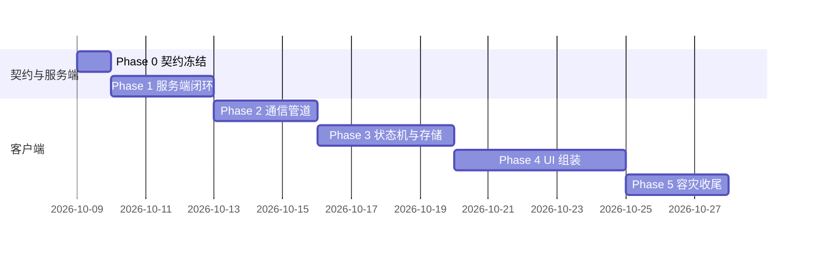

# 协同日程开发文档（collab-implementation）

> 定位：`collab-schedule-draft.md`（设计 SSOT，九轮评审闭环）的**施工执行文档**——开发步骤、每步验收线、联调脚本、单机 app 衔接改造点。设计细节（契约字段/SQL/加密流程/状态转移表）一律引用设计稿章节号，本文不复制正文（防双源）。

## 0. 阅读前提与总原则

- **事实源顺序**：设计稿 > 本文档 > 代码注释。发现冲突先改设计稿再改本文。
- **五阶段硬序**（设计稿 §12）：契约 → 服务端骨架 → 端侧管道 → 端侧状态机 → UI → 存储容灾。Phase 2 起才碰拾光主仓。
- **双仓边界**（设计稿 §8.4）：`shiguang-relay`（Go，独立新仓）不 import 拾光任何代码；拾光主仓只增不破坏（db v5 幂等迁移）。
- **每阶段收尾必做**：`toolbox run docs-lint`（文档轮）+ devlog 断点落账（context/epics）。

## 1. Phase 0：协议契约冻结（预计 0.5–1 天）

**目标**：双端编程的契约产物全部落盘，本地可跑。

| 步骤 | 内容 | 产物 | 验收线 |
|---|---|---|---|
| 0.1 | 建 `shiguang-relay` 仓（`go mod init` + Dockerfile + docker-compose.yml 含 postgres/redis） | 仓骨架 | `docker compose up -d` 起 PG/Redis |
| 0.2 | 写 `relay_protocol.proto`：信封（§2.1）、action_type 全枚举（§12 契约行清单）、topology_skeleton（§4.2 含 threshold）、member_key_envelopes（§10.3）、visibility（§3.5）、FreeMask 掩码（§3.6）、client_msg_id（§1.4） | proto 文件 | `buf lint` / `protoc` 双端生成通过 |
| 0.3 | 生成 Go `types.pb.go` + Dart `types.pb.dart`；生成脚本入 CI（变更未同步产物则拦截） | 双端契约代码 | Flutter 侧 import 编译通过 |
| 0.4 | PG 五表 DDL（§10.1 三表 + §5.1 事件流水 + §5.3 key_envelopes），含 `max_seq_id` 行锁取号约定（§5.1） | `migrations/0001_init.sql` | `psql -f` 本地建库成功；`UNIQUE(bundle_id, seq_id)` 在位 |
| 0.5 | 鉴权协议定稿文档化：Challenge-Response（§1.4）、WSS 首帧 AUTH、重放去重键 | 契约注释/README | 评审通过 |

**退出条件**：curl 能对本地 PG 手工插入一条合法事件且 seq 约束生效。

## 2. Phase 1：服务端最小闭环（预计 2–3 天）

**目标**：「收密文 → 验签/ACL → 行锁取号 → 原子入库 → WSS 广播」全通，作为端侧联调靶场。

| 步骤 | 内容 | 验收线 |
|---|---|---|
| 1.1 | 验签中间件 + Challenge-Response 签发双 Token（§1.4）；Redis msg_id 去重 | 无 token 401；重放同 client_msg_id 幂等返回 |
| 1.2 | `POST /auth/register`（PoP 自签验证 §1.5）+ OPK 托管/补仓标记 | 缺自签名拒绝入库 |
| 1.3 | 好友域：Ticket 验签建联（§1.6）+ friendships CRUD | 扫码握手 pending→accepted 全通 |
| 1.4 | `POST /v1/schedule/action`：双层 ACL（§1.7）→ 行锁取号 → 事务写 bundles/skeletons/流水 → 广播 | 并发 10 请求同 Bundle 无 seq 冲突（写压测脚本）；FORCE_FINALIZE 二到 409 |
| 1.5 | `GET /v1/bundles/participating` + `GET /v1/schedule/sync?since_seq`（§10.2） | 换机场景模拟：新库 participating→sync 全量还原 |
| 1.6 | WSS hub：首帧 AUTH（3s 掐线）+ 按 cursor 差异推送 + CLIENT_ACK 更新游标（§10.3） | 断连重连后补收漏掉的事件 |
| 1.7 | 部署脚本：PaaS 或自建 compose + caddy 反代 WSS | 公网/Docker 内双客户端互通 |
| 1.8 | **网关硬约束（2026-10-09 审查修正）**：单包 Payload ≤256KB 硬限（API 网关层拒绝超限，防 500MB 打爆内存/DB）；`relay_messages` TTL（建议 7/30 天）即焚 + 后台清理 cron 删除过期/acked；瞬时信令 `DELIVERY_ACK` 触发即焚；磁盘水位监控告警 | 投递 300KB 包被 413 拒；过期 relay_messages 被清理且不阻塞事件流 |

**验收总纲**（设计稿 §12 表）：curl 发密文入库、seq 自增、广播可达；全员离线时 Wake Push Payload 携带 bundle_id+latest_seq。

## 3. Phase 2：客户端安全与通信管道（预计 2–3 天，拾光主仓）

**目标**：端到端加密链路与 WSS 通道双机对测通过。此阶段**不建 UI、不动单机表**，全部独立 `lib/collab/` 目录。

| 步骤 | 内容 | 验收线 |
|---|---|---|
| 2.1 | 依赖接入：cryptography / flutter_secure_storage / web_socket_channel+dio（§11.4） | pubspec 就绪，analyze 0 issue |
| 2.2 | 密钥域：MSK 生成 + kek 包装 + recovery_vault 上传；Key Ring 数据结构（§5.3/§5.2） | 单测：包装/解包、改密码 O(1) 只重包装 MSK |
| 2.3 | 注册流：PoP 自签 + OPK 100 个上传 + 心跳补仓监听（§1.5） | 对真服务端注册成功 |
| 2.4 | 加密封装单点：512B PKCS#7 填充 + AES-256-GCM（IV 12B 不复用）+ key_ver 标注（§9.2） | 单测：「好」与小作文密文等长 |
| 2.5 | WSS 客户端：纯路径建连 + 首帧 AUTH + 指数退避重连（§1.4/§2.2） | 断网 30s 重连自动恢复 |
| 2.6 | 单消费管道：StreamQueue 串行化 WSS/HTTP 两路（§2.2/§11.1） | 竞态单测：两路并发注入不乱序 |
| 2.7 | **双机对测**（Phase 2 退出条件） | A 发密文 → 服务端 → B 收到并解密成功 |

## 4. Phase 3：端侧状态机与本地存储（预计 3–4 天）

**目标**：事件回放引擎闭环，离线可跑。

| 步骤 | 内容 | 验收线 |
|---|---|---|
| 3.1 | db v5 幂等迁移：`collab_*` 新表（本地 bundles/steps/events/key_ring/outbox/refs，§11.3）+ `source` 扩 `'collab'` 枚举 + `collab_block_refs` 映射表 | 旧库升级不丢数据；新装同构 |
| 3.2 | FSM 回放器纯函数（§4.2–§4.5：母子联动/threshold/Consensus 三值/REOPEN/ABANDONED_LOCALLY） | 离线注入 5 条事件序列，终态与设计稿转移表逐格一致 |
| 3.3 | 本地 Outbox（§11.1）：PENDING_SEND 入队/联网弹出/409 清箱引导 | 弱网单测：杀进程不丢操作 |
| 3.4 | 装配：FreeMask 量化桶生成/按位与（§3.6）；Wake Push 消费接 FIFO | 掩码单测 + 唤醒拉取走单管道 |

## 5. Phase 4：UI 组装（预计 4–5 天）

**目标**：六页全通（§11.2），文案先入 ui-spec §0.4 词汇表再上屏（项目硬约束）。

| 步骤 | 内容 | 验收线 |
|---|---|---|
| 4.1 | 页面 B 成员混合日历（预占三级渲染 + 一键响应浮条） | widget 测试 |
| 4.2 | 页面 D 拒绝面板（四步含隐私开关）+ 页面 F 审计时间轴（含便签抽屉） | 私密理由在非发起人端只渲染骨架提示 |
| 4.3 | 页面 A 发起人画板（双轨/幽灵图层/共振条磁吸）+ 页面 C 决策矩阵（门限进度/铃铛/三键） | 全流程走查：发起→拒绝→转派→CONFIRMED |
| 4.4 | 页面 E Consensus 看板（三态矩阵/ADD_SLOT 上限 8 置灰/落槌） | 分票死锁→Force Finalize 走查 |
| 4.5 | 下沉事务（§11.3）+ REOPEN 回退强通知（§4.4） | CONFIRMED 后本地出 pinned/collab 块；REOPEN 块变闪烁虚线+系统通知 |
| 4.6 | 好友域 UI：扫码建联 + 安全码核对页（§1.6） | 真机扫码全通 |

## 6. Phase 5：存储容灾与收尾（预计 2–3 天）

| 步骤 | 内容 | 验收线 |
|---|---|---|
| 5.1 | BYOS WebDAV 驱动（追加日志/快照宽限期，§5.5）+ 官方 R2 兜底（Presigned 直传） | 断网积压重连补传演练 |
| 5.2 | 换绑向导（握手文件校验/迁移/官方 PURGE）+ 首页常驻横幅（§5.6） | 迁移后旧节点清空 |
| 5.3 | 换机全量还原演练：新设备登录 → participating → sync → Key Ring 还原 → 时间轴重现 | 零数据丢失（设计稿 §12 表 Phase 5 验收线） |
| 5.4 | 收尾并入：schedule-app §11 台账行、functional-spec/ui-spec 联动条目、playbook 收录、arch-guard 扩展 | docs-lint + arch-guard 全绿 |

## 7. 联调清单（每 Phase 退出跑一遍）

1. **双机对测脚本**：两模拟器/真机 + 本地 compose 服务端，跑 Phase 2.7 场景；
2. **并发压测**：同 Bundle 10 并发 action，断言 seq 严格递增无 500；
3. **弱网演练**：飞行模式点同意 → 联网自动补发 → 服务端确认；
4. **换机演练**：Phase 5.3 全量还原；
5. **隐私抽查**：服务端日志/库内 grep 明文关键词（如案例中的会议标题）零命中。

## 8. 与单机 app 的改造点汇总（全部限 Phase 3+）

| 改造 | 性质 | 风险 |
|---|---|---|
| db v4→v5：collab_* 新表 + source 扩枚举 + collab_block_refs | 幂等迁移，单机表不加列 | 低（沿用既有分段幂等模式） |
| 排程算法/BlockRenderer 认得 source='collab' | 分支扩展 | 低；arch-guard 加一条断言 |
| app 设置页增「协同/存储」入口（换绑横幅宿主） | 纯增量 | 低 |
| 主工程依赖 +3（cryptography/web_socket_channel/dio） | 依赖 | 中；锁版本 |

## 9. 里程碑总览

> 总计约 3 周单人量。每 Phase 结束在 context/epics 落 devlog 断点；Phase 0 开工前需用户指令（新增 epic 建档）。
