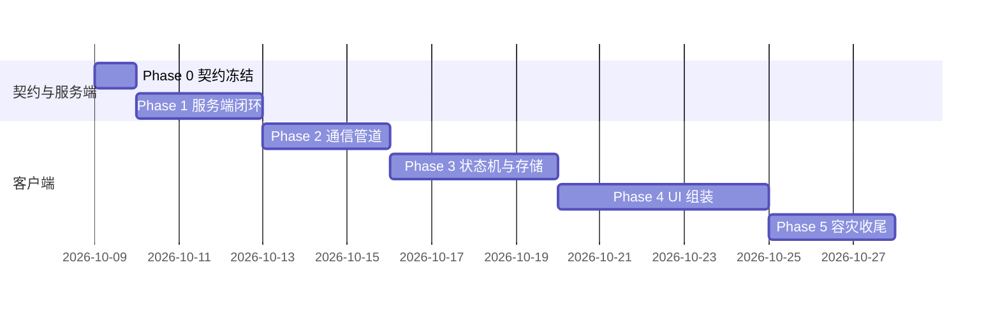

# 协同日程开发文档（collab-implementation）

> 定位：`collab-schedule-draft.md`（设计 SSOT，九轮评审闭环）的**施工执行文档**——开发步骤、每步验收线、联调脚本、单机 app 衔接改造点。设计细节（契约字段/SQL/加密流程/状态转移表）一律引用设计稿章节号，本文不复制正文（防双源）。

## 0. 阅读前提与总原则

- **事实源顺序**：设计稿 > 本文档 > 代码注释。发现冲突先改设计稿再改本文。
- **五阶段硬序**（设计稿 §12）：契约 → 服务端骨架 → 端侧管道 → 端侧状态机 → UI → 存储容灾。Phase 2 起才碰拾光主仓。
- **双仓边界**（设计稿 §8.4）：`shiguang-relay`（Go，独立新仓）不 import 拾光任何代码；拾光主仓只增不破坏（db v5 幂等迁移）。**落地形态（2026-10-09）**：中继已落为与拾光主仓同级的**独立 git 仓**（`/home/zzh/app/shiguang-relay`，主仓内不再含 `shiguang-relay/` 目录），契约/DDL/生成物/Go 代码全在该仓，本文出现的 `shiguang-relay/...` 路径均指独立仓内相对路径。
- **每阶段收尾必做**：`toolbox run docs-lint`（文档轮）+ devlog 断点落账（context/epics）。

## 1. Phase 0：协议契约冻结（预计 0.5–1 天）

**目标**：双端编程的契约产物全部落盘，本地可跑。

| 步骤 | 内容 | 产物 | 验收线 |
|---|---|---|---|
| 0.1 | 建 `shiguang-relay` 仓（`go mod init` + Dockerfile + docker-compose.yml 含 postgres/redis） | 仓骨架 | `docker compose up -d` 起 PG/Redis |
| 0.2 | 写 `relay_protocol.proto`：信封（§2.1）、action_type 全枚举（§12 契约行清单）、topology_skeleton（§4.2 含 threshold）、member_key_envelopes（§10.3）、visibility（§3.5）、FreeMask 掩码（§3.6）、client_msg_id（§1.4） | proto 文件 | `buf lint` / `protoc` 双端生成通过 |
| 0.3 | 生成 Go `types.pb.go` + Dart `types.pb.dart`；生成脚本入 CI（变更未同步产物则拦截） | 双端契约代码 | Flutter 侧 import 编译通过 |
| 0.4 | PG 全量 10 表 DDL（§10.1 三表 + §5.1 事件流水 + `key_envelopes` OPK 池 + `bundle_members` 密钥信封 + `bundle_member_cursors` 游标 + `user_key_envelopes` 金库 + `friendships.encrypted_intro` 列），含 `max_seq_id` 行锁取号约定（§5.1） | **`schema.sql`（仓根；DDL 唯一出处，与协同设计 §10.1 同指一处；增量演进另起 `migrations/0002_*.sql`）** | `psql -f` 本地建库成功；`UNIQUE(bundle_id, seq_id)` 在位 |
| 0.5 | 鉴权协议定稿文档化：Challenge-Response（§1.4）、WSS 首帧 AUTH、重放去重键 | 契约注释/README | 评审通过 |

**退出条件**：curl 能对本地 PG 手工插入一条合法事件且 seq 约束生效。

**2026-10-09 完成对账（独立仓 `/home/zzh/app/shiguang-relay`，冻结 tag `v0.1.6-contract`）**：0.1 仓骨架 ✅／0.2 proto ✅（`go_package` 选项补齐）／0.3 双端生成 ✅（`gen/go/relay_protocol.pb.go` + `gen/dart/relay_protocol.pb{enum,json}.dart`，`scripts/gen-proto.sh` 生成 + `check-proto-sync.sh` CI 校验；Go 侧 `go build ./gen/...` 通过，Dart 侧 import 编译见 Phase 2.1）／0.4 DDL ✅（`schema.sql` 容器内 `psql -f` 建库 10 表，`UNIQUE(bundle_id, seq_id)` 实测拦截重复 seq）／0.5 鉴权定稿 ✅（README「鉴权与重放防护」章节）。

> **已冻结决策（v0.1.6-contract，2026-10-09）**：Q2 注册 = 开放 PoP 自签（**绝不上邀请制**，防冷启动死锁）+ 单 IP 限流(≤3/min) + OPK 瘦身(首批 10~20)；Q12 事实所有权本地化（中继仅作 Bundle 投递通道，未归属事实走本地 + BYOS）。详 `fact-user-relay-draft.md §7` / `§5.5`。

## 2. Phase 1：服务端最小闭环（预计 2–3 天）

**目标**：「收密文 → 验签/ACL → 行锁取号 → 原子入库 → WSS 广播」全通，作为端侧联调靶场。

| 步骤 | 内容 | 验收线 |
|---|---|---|
| 1.1 | 验签中间件 + Challenge-Response 签发双 Token（§1.4）；Redis msg_id 去重 | 无 token 401；重放同 client_msg_id 幂等返回 |
| 1.2 | `POST /auth/register`（PoP 自签验证 §1.5）+ OPK 托管：`GET /v1/users/{id}/prekey` 原子弹出 + `POST /v1/users/me/prekeys` 补仓 | 缺自签名拒绝入库；prekey 弹出并发不重复 |
| 1.3 | 好友域：Ticket 验签建联（§1.6）+ friendships CRUD（含 `encrypted_intro` 落盘/回包） | 扫码握手 pending→accepted 全通 |
| 1.4 | `POST /v1/schedule/action`：双层 ACL（§1.7）→ 行锁取号 → 事务写 bundles/skeletons/流水 → 广播 | 并发 10 请求同 Bundle 无 seq 冲突（写压测脚本）；FORCE_FINALIZE 二到 409 |
| 1.5 | `GET /v1/bundles/participating` + `GET /v1/schedule/sync?since_seq` + `POST/GET /v1/vault/envelopes` + `GET /v1/relay/pending` / `POST /v1/relay/ack`（§10.2） | 换机场景模拟：新库 participating→sync→vault 全量还原 |
| 1.6 | WSS hub：首帧 AUTH（3s 掐线）+ 按 cursor 差异推送 + CLIENT_ACK 更新游标（§10.3） | 断连重连后补收漏掉的事件 |
| 1.7 | 部署脚本：PaaS 或自建 compose + caddy 反代 WSS | 公网/Docker 内双客户端互通 |
| 1.8 | **网关硬约束（2026-10-09 审查修正）**：单包 Payload ≤256KB 硬限（API 网关层拒绝超限，防 500MB 打爆内存/DB）；`relay_messages` TTL（建议 7/30 天）即焚 + 后台清理 cron 删除过期/acked；瞬时信令 `DELIVERY_ACK` 触发即焚；磁盘水位监控告警；防爆仓配额四项（成员≤16/活跃包≤20/流水≤2000/待审批邀请≤50，§10.4）+ 统一错误码响应体；Wake Push 零知识载荷规范（§2.2，APNs/FCM 静默参数） | 投递 300KB 包被 413 拒；过期 relay_messages 被清理且不阻塞事件流；17 人建包被 `EXCEED_MAX_MEMBERS` 拒 |

**验收总纲**（设计稿 §12 表）：curl 发密文入库、seq 自增、广播可达；全员离线时 Wake Push Payload 携带 bundle_id+latest_seq。

**2026-10-09 进度**：**1.1 已完成**——`cmd/relayd` + `internal/{config,apierr,store,auth,httpapi}`：`POST /v1/auth/challenge`（nonce 32B + PoW 题面，Redis SETEX 60s，GETDEL 一次性消费）、`POST /v1/auth/login`（PoW → PoP Ed25519 验签 nonce → 签双 Token access 2h / refresh 30d，HS256 + 算法白名单）、`POST /v1/auth/refresh`、`Bearer` 鉴权中间件（401 统一响应体）、`client_msg_id` 幂等中间件（Redis SETEX 300，重放原样回放缓存响应 + `X-Idempotent-Replay: 1`，时钟偏差超窗 400）；统一错误码响应体（`error_code/message/detail`，零明文）；`POST /v1/schedule/action` 为 501 占位（1.4 收口）。验证：`go build`/`go vet` 全绿，单测（miniredis + 假 IdentityResolver）覆盖 401/重放/缺 msg_id/伪造签名，`scripts/smoke-phase1.sh` 真 PG/Redis + 真进程冒烟全通。
**1.2 已完成**：`POST /v1/users`（PoP 自签 + PoW + 单 IP 限流 3/min + OPK 首批 10~20，**单事务**落 users 与 key_envelopes，杜绝「有用户无密钥」半截账号）、`GET /v1/users/{id}/prekey`（`FOR UPDATE SKIP LOCKED` + `DELETE ... RETURNING` 原子弹出 1 个 OPK，空池恒 200 带 `OPK_EMPTY_WARNING`，端侧降级 3-DH）、`POST /v1/users/me/prekeys`（Bearer 鉴权后补仓 ≤50/批）。验证：真 PG 集成测试（`RELAY_TEST_PG_DSN`，未设置则跳过）覆盖「签名与公钥不匹配被拒」「OPK 数量越界 400」「连弹 10 次互不重复且 remaining 递减」「20 并发弹出零重复」「补仓未鉴权 401 / 超限 400」，`scripts/smoke-phase1.sh` 末尾自动跑集成测试。
**1.3 已完成**：好友域 `POST /v1/friends/invite`（Ticket 规范化消息 Ed25519 验签 + 过期 + nonce 一次性 `SETNX` + 待审批配额 ≤50 + 关系去重 409）、`POST /v1/friends/accept`（**仅被邀方**可处置，accept=false → blocked，`encrypted_intro` 随处置置 NULL）、`GET /v1/friends`（intro 只在「我是被邀方 + 仍 pending」时回包，A 侧拿不到自己也解不开的字节）。Ticket 签名覆盖范围：`shiguang.relay.v1/friendship-ticket|<issuer>|<subject>|<nonce>|<expires_at>`。验证：真 PG 集成测试覆盖「未鉴权 401 / 邀请 201 / 重复 409 / 重放 nonce 400 / B 侧见 intro、A 侧不见 / 发起人自批被拒 / B 接受后 intro 清空」与「过期票 400 / 伪造签名 401 / subject 不匹配 403」；顺带修测试辅助函数缺陷：`login` 复用固定 `client_msg_id` 被幂等中间件回放成上一个用户的 Token（**这是幂等中间件的正确行为，测试侧须每次换 msg_id**）。
**1.4 已完成**：`POST /v1/schedule/action` 收口——`PROPOSE` 建包（准入严管：发起人与每个被邀请人双向 accepted；成员 ≤16；活跃包 ≤20；**单事务**落 bundles + skeleton + 成员密钥信封 + seq:1 事件）；其余动作走**成员 ACL**（§1.7 第 3 条包内放行）+ **行锁取号** `UPDATE bundles SET max_seq_id = max_seq_id + 1 ... RETURNING max_seq_id`（§5.1 定稿写法，杜绝 MAX+1 同号冲突）+ 单事务落 `team_schedule_events`；事实三动作**绕过 `base_revision`**（v0.1.3），仅非事实动作做因果校验（409 `STALE_REVISION`）；`FORCE_FINALIZE` 落槌 CONFIRMED，敲定/取消/过期后一律 409 `BUNDLE_CONFIRMED_IMMUTABLE`；`ADD_MEMBER` 并入成员清单并复检配额；`REKEY` 递增 `key_version`。广播抽象 `Broadcaster`（当前 `NoopBroadcaster`），1.6 换 WSS Hub。验证：真 PG 集成测试覆盖「**10 并发追加无 seq 冲突且 seq 连续 2..11**」「非成员 403」「未知动作 400」「事实动作陈旧 revision 仍 200 / 非事实 409」「落槌后二次落槌与普通动作均 409」「成员超限 400」「拉陌生人建包 403」；`smoke-phase1.sh` 全通。
**1.5 已完成**：换机冷启动链路全通——`GET /v1/bundles/participating?status=active`（参与中包 + `max_seq_id` + `last_acked_seq`，`participant_uids @> ARRAY[me]`）、`GET /v1/schedule/sync?bundle_id=&since_seq=&limit=`（增量补拉/跳号补洞，成员 ACL + 单页 ≤500 + 回 `latest_seq`）、`GET /v1/bundles/{id}/key-envelopes`（**只回本成员**信封，纯盲）、`POST/GET /v1/vault/envelopes`（MSK 封送的 K_bundle 增量信封，同版本幂等不覆盖，杜绝 LWW 擦除）、`POST /v1/relay/msg`（**双向好友 ACL**，§1.7 第 2 条）→ `GET /v1/relay/pending` → `POST /v1/relay/ack`（先置 acked 再物理 DELETE，阅后即焚）。验证：真 PG 集成测试覆盖「A/B 双方 participating 均见该包且 max_seq_id=1」「since 0 → 1 条 / since 1 → 0 条」「非成员 sync 403」「B 只拿到自己的信封」「金库追加 2 条 + 同版本重复仍 2 条（幂等）、since 过滤正确」「陌生人直投 403 / 好友 202 / B 拉到 1 条 / ack 后清零」。
**1.6 已完成**：`internal/wss/hub.go` —— `GET /ws` 纯路径建连（token 不进 URL）、**首帧 `{"action":"AUTH","token":...}` 且 3s 内未完成即掐线**（非法 token 立即关闭）、读限 256KB、心跳 60s；握手后一律 **protobuf 二进制帧**（`relayv1.ServerFrame` / `ClientFrame`）；`CLIENT_ACK` 落游标（`GREATEST` 单调推进，防回退）；`Hub` 接替 `NoopBroadcaster`：在线成员直推、离线成员交 `WakePusher`（Noop，1.7 实装 FCM/APNs 异步 Worker 池，绝不拖慢核心 API）。验证：真 PG 集成测试覆盖「AUTH 后收到推送且 seq/动作/bundle 正确」「未 AUTH 3s 掐线」「非法 token 关闭」「CLIENT_ACK 把游标落到 5」。
**1.7 部署 + 1.8 网关收尾已完成**：`deploy/Caddyfile`（`/ws` 放行 Upgrade 头、请求体 256KB 硬限、日志过滤 query 与 Authorization、`/v1/healthz` 由反代直接应答）、`docker-compose.prod.yml`（PG 卷持久化 + 健康门 / Redis / relay / Caddy + **每小时 `pg_dump|gzip` 备份 sidecar**，配 `RCLONE_REMOTE` 即异地同步）、`scripts/backup.sh`、`scripts/ops-cleanup.sh`（瞬时信令 TTL 清理 + 磁盘水位 ≥85% 告警）、`.env.example`；`/v1/healthz` 升级为**真探针**（PG/Redis 任一不可达即 503，不吐内部细节）；**错误码字典补全**并入独立仓 README。`smoke-phase1.sh` 全通 → **Phase 1 服务端最小闭环验收达成**（curl 发密文入库、seq 自增、广播可达；Wake Push 仍为 Noop，待接入 FCM/APNs 时补 Worker 池）。Phase 2 起才碰拾光主仓。

## 3. Phase 2：客户端安全与通信管道（预计 2–3 天，拾光主仓）

**2.1 已完成**（2026-10-09）：依赖接入 `cryptography` / `flutter_secure_storage` / `web_socket_channel` / `dio` / `protobuf`（+ `fixnum`，生成物引用）；契约生成物经新增 `scripts/sync-relay-contract.sh` 落入 `lib/collab/proto/`（**只读、禁止手改**，源头在独立仓 proto）；补 `test/collab_proto_test.dart` 验 Envelope/ServerFrame/ClientFrame 往返编解码与 oneof 承载——**Phase 0.3 延后的「Flutter 侧 import 编译通过」就此闭环**（最终 `flutter test` **207/207 全绿**）。

**2.2 密钥域已完成**（2026-10-09）：`lib/collab/crypto/` 落 `secret_store.dart`（内存/安全区抽象 + `SealedBlob` 三段 base64 封装）、`secure_secret_store.dart`（设备安全区实现）、`key_store.dart`（两层密钥包装：kek = Argon2id(主密码) 只包装 MSK，MSK 加密身份私钥与全量 K_bundle 信封；防「改密雪崩重加密」——改密 O(1) 只重包装 MSK、业务信封一条不动）、`key_ring.dart`（每包密钥版本链，回放按 `key_ver` 取密钥）。验证：`test/collab_key_store_test.dart` 5 例全绿。

**2.3 注册流已完成**（2026-10-09）：`lib/collab/` 落 `identity.dart`（Ed25519 身份钥 + X25519 SPK/OPK 坐标系分离生成；PoP = 身份私钥签 nonce 原样字节；OPK 各带身份钥签名）、`pow.dart`（Hashcash：SHA256(challenge+solution) 前导零难度，与 relay `auth.pow` 逐字节同口径）、`relay/auth_api.dart`（Challenage/Register 原生 JSON DTO + `fetchChallenge`/`registerUser`/`refillPreKeys`，base64 字段对齐 Go `register.go`）、`identity_store.dart`（身份记录落内存/安全区，存 MSK 封存的身份私钥 + SPK 公钥 + 剩余 OPK 数）、`registration.dart`（`registerAccount` 编排：建 vault → 生成身份 → 领 challenge → 解 PoW → 签 PoP → MSK 封存身份私钥 → `POST /v1/users` → 回执入账）。**关键事实**：注册 REST 是**原生 JSON**（snake_case + base64），冻结的 `RegisterRequest` proto 在此端点未被采用，以 Go `registerReq` 结构体为 SSOT；OPK 首批 **10~20**（瘦身防刷号，非设计稿早期写的 100）；`recovery_vault` 由 MSK 封存身份私钥回传服务端盲存。验证：`test/collab_register_test.dart` 6 例全绿。

**2.4 加密封装单点已完成**（2026-10-09）：`lib/collab/sealing.dart` 落 `sealPayload(key, plaintext, keyVer)` / `openPayload(key, sealed)` + 自描述 `SealedPayload`（base64 JSON 含 `key_ver`/`nonce`/`cipher_text`/`mac`）。统一三件事：① **512B 定长填充**（PKCS#7 思路，抗「好」与小作文密文长度差异侧信道）；② **AES-256-GCM**，12B 随机 nonce 每次不复用；③ **key_ver 标注**，回放端按版本取 K_bundle 密钥（见 KeyRing）。**实现注记**：经典 PKCS#7 单字节填充量上限 255，无法表达「整 512B 块」填充，故用 2 字节大端长度尾注承载真实 pad 量（1..512），填充字节取 pad 低 8 位占位——512B 粒度下 PKCS#7 的稳妥落地，解码只读尾注不歧义。GCM 的 mac 随 `SealedPayload` 单走（`SecretBox.cipherText` 不含 tag）。验证：`test/collab_sealing_test.dart` 5 例全绿——往返一致、定长等长、自描述编码、错误密钥 MAC 失败、密钥长度守护。

**2.5 WSS 客户端已完成**（2026-10-09）：`lib/collab/relay/wss_client.dart` 落 `RelayWssClient`，逐条对齐 relay `internal/wss/hub.go` 三条硬约束——①**纯路径建连** `ws://…/ws`，token 绝不进 URL；②连接后**首帧 JSON `{"action":"AUTH","token":…}`**（relay 3s 未完成即掐线）；③握手后一律 **protobuf 二进制帧**（`ServerFrame` 入站解码广播 / `ClientFrame` 出站，`sendClientAck` 推游标）。断线（含非法 token 被掐）**指数退避自动重连** 1s→2s→4s…封顶 30s，成功归零。**实现注记**：`web_socket_channel` 3.x 无 `IOWebSocketChannel`/`pingInterval`，心跳改**应用层保活**——每 30s 发一个被 relay 忽略的 `CLIENT_ACK(seqId:0)` 重置其 60s 读截止（relay 读循环对任意入站消息续期）。同场补 `relay/auth_api.dart` 的 `login`/`refresh`/`TokenPair`（challenge+PoW+PoP 换双 Token，为 AUTH 首帧供票，PoP 与注册共用身份私钥）。验证：`test/collab_wss_test.dart` 4 例全绿（VM 内 `HttpServer`+`WebSocketTransformer` 忠实复刻 hub.go——AUTH 握手+收帧分发、断连自动重连恢复收帧、非法 token 掐线进重连、CLIENT_ACK 端到端送达）；全量 `flutter test` **222/222**。

**2.6 单消费管道已完成**（2026-10-09）：`lib/collab/pipeline.dart` 落 `SingleConsumerPipeline` + 归一化载荷 `CollabInboundEvent`（含 `fromServerFrame`），对齐协同设计 §11.1「端侧单一消费网关」。两路输入（WSS 实时推送 `pushWss` / HTTP `/sync` 补拉 `pushHttp`）汇入**同一条 `StreamQueue`**（底层单订阅 StreamController，FIFO 缓冲），由**单一消费者** `await _queue.next` 逐条取出——重入守护断言 `_active==1`（峰值并发诊断 `peakConcurrent`）。取出后按 `(bundleId, seqId)` **去重**（含弱网 replay）+ 按 seq **升序 flush**（缺号暂存 `SplayTreeMap`，待 `/sync` 补拉补齐连续推进），弱网恢复瞬时两路同时涌入也不乱序/不重复/不缺口。`attachWss` 把 `RelayWssClient.frames` 直接串入 WSS 入口（2.7 编排用）。验证：`test/collab_pipeline_test.dart` 4 例全绿——两路并发注入同包去重后严格升序无缺口（peakConcurrent 恒 1）、不同包各自有序互不污染、replay 只应用一次、`attachWss` + `fromServerFrame` 翻译贯通；全量 `flutter test` **226/226**。

**目标**：端到端加密链路与 WSS 通道双机对测通过。此阶段**不建 UI、不动单机表**，全部独立 `lib/collab/` 目录。

| 步骤 | 内容 | 验收线 |
|---|---|---|
| 2.1 | 依赖接入：cryptography / flutter_secure_storage / web_socket_channel+dio（§11.4） | pubspec 就绪，analyze 0 issue |
| 2.2 | 密钥域：MSK 生成 + kek 包装 + recovery_vault 上传；Key Ring 数据结构（§5.3/§5.2） | 单测：包装/解包、改密码 O(1) 只重包装 MSK |
| 2.3 | 注册流：PoP 自签 + OPK 首批 10~20 上传 + 本地身份入账（§1.5） | `test/collab_register_test.dart` 端到端通（对忠实复刻 relay 校验链的 mock 服务） |
| 2.4 | 加密封装单点：512B 定长填充 + AES-256-GCM（IV 12B 不复用）+ key_ver 标注（§9.2） | `test/collab_sealing_test.dart` 5 例全绿（含「好」与小作文密文等长） |
| 2.5 | WSS 客户端：纯路径建连 + 首帧 AUTH + 指数退避重连（§1.4/§2.2） | 断网 30s 重连自动恢复 |
| 2.6 | 单消费管道：StreamQueue 串行化 WSS/HTTP 两路（§2.2/§11.1） | 竞态单测：两路并发注入不乱序 |
| 2.7 | **双机对测**（Phase 2 退出条件） | A 发密文 → 服务端 → B 收到并解密成功 |

**2.7 双机对测已完成**（2026-10-09）：`lib/collab/crypto/session.dart` 落最小 X3DH 会话密钥协商——本端 `signedPreKey`（X25519）与对端 `/v1/users/{id}/prekeys` 广播的 SPK 公钥做 DH，得对称 32B 会话密钥直喂 `sealPayload`/`openPayload`（坐标系铁律：X3DH 只用 X25519 加密钥，Ed25519 身份钥仅签名；完整 EK/OPK 增强留会话层后续）。`lib/collab/relay/relay_mock.dart` 落进程内忠实 relay mock：challenge/login/refresh/register/prekeys + `/sync` + WSS hub（首帧 JSON AUTH token 校验、CLIENT_ACK 保活忽略、信封按 (bundleId, seqId) 取号落库并广播、WSS/HTTP 两路同源）。`test/collab_e2e_test.dart` 2 例全绿——①双机对测：A 注册+登录+连 WSS → 取 B 预密钥包 → DH 协商 → 密封发文 → 服务端中转 → B 经单消费管道收到，解开即原文（含 B→A 回程对decrypt）；②双路去重：WSS 已收事件再经 HTTP `/sync` 注入同管道被 `(bundleId,seqId)` 去重只应用一次。**实现注记**：protobuf-Dart 陷阱——对未赋值 `bytes` 字段 `..cipher.addAll(x)` 作用在 getter 返回的临时默认列表上会被丢弃，必须 `..cipher = bytes` 走 setter。全量 228 例（227 绿 + 1 条既有 UI 测试隔离性失败，与 collab 无关）。

## 4. Phase 3：端侧状态机与本地存储（预计 3–4 天）

**目标**：事件回放引擎闭环，离线可跑。

| 步骤 | 内容 | 验收线 |
|---|---|---|
| 3.1 | db v5 幂等迁移：反转关联（`blocks` ADD `artifact_id` + `artifacts` ADD `bundle_id` + DROP `block_id` + payload 投影清洗）+ `collab_*` 新表（本地 bundles/steps/events/key_ring/outbox/refs，§11.3）+ `source` 扩 `'collab'` 枚举 + `collab_block_refs` 映射表 | 旧库升级不丢数据；新装同构；v4 存量升级后反转查询零 `no such column` |

**3.1 db v5 幂等迁移已完成**（2026-10-09）：`lib/data/db.dart` `version: 5` + `migrateV5`（公开静态，onCreate `createAll` 与升级共用同一 DDL 源保证**新装同构**）。反转关联五步全幂等且顺序不可换：①`schedule_blocks` ADD `artifact_id`（1:N 软引用无外键）；②`artifacts` ADD `bundle_id`（协同弱引用，fact §5.5 协商期挂靠）；③**存量绑定搬家**（`artifacts.block_id`→块侧回填，日切悬空引用静默丢弃，绝不造孤儿块行）；④payload 投影清洗（契约 JSON 移除 `block_id` 键，畸形 payload 不动——清洗是洁癖不是修复）；⑤`DROP COLUMN`（SQLite ≥3.35 原生，老内核走 12 步重建兜底，一行不丢）。`collab_*` 本地六表落位：`collab_bundles`（对齐 relay bundles 列名）/`collab_steps`（threshold/votes，PK bundle+step）/`collab_events`（UNIQUE(bundle_id,seq_id) 对齐 relay、cipher 密文落库解密在回放）/`collab_key_ring`（PK bundle+key_ver 同版本幂等绝不 LWW）/`local_outbox_events`（表名=设计稿 §11.1 定盘，PENDING_SEND/SENT）/`collab_block_refs`（PK block_id，§5.5 下沉绑定反查键）。`source` 扩 `'collab'` 零 DDL（无 CHECK 约束）。**连带反转补链（fact §9.5-6/§9.5-8，此前状态表自记「未落地」）**：`Artifact` 弃 `blockId` 字段与 payload 投影；`addArtifact(bindBlockId:)` 凭证插行+块回填**同事务原子**；`artifactForBlock` 改块侧 JOIN（日切悬空静默降级）；编辑回填/voided/物理删除一律块侧置空+解 pinned（1:N 全量）；`delete_plan` detach 双 NULL（plan_id+bundle_id，未归属池口径收敛 §5.5）；`artifactsUnattributed` 收敛为双 NULL；MCP `upsert_facts.block_id` 入参保留（命令层写块侧）。验证：`test/collab_db_migration_test.dart` 4 例全绿（忠实 v4 复刻播种→升级：绑定搬家/payload 清洗/出列/反转 JOIN/悬空静默；新装同构列集逐一相同+`'collab'` 可写+六表在位；幂等重跑零副作用；六表约束 UNIQUE/PK 拦截+反查索引）。全量 `flutter test` **231 绿**（+4 迁移；1 条既有 UI 隔离性失败与本次无关）。fact 草案状态表 #3 与 §9.5-8 回改行已同步销账。
| 3.2 | FSM 回放器纯函数（§4.2–§4.5：母子联动/threshold/Consensus 三值/REOPEN/ABANDONED_LOCALLY） | 离线注入 5 条事件序列，终态与设计稿转移表逐格一致 |

**3.2 FSM 回放器已完成**（2026-10-09）：`lib/collab/fsm.dart` 落**纯函数 Reducer**——`(state, event) → state'`，零 I/O/零端钟（TTL 与熔断判据一律用事件携带的 `serverAtMs`=服务端 server_received_at，§5.2 法定时钟）、零随机，`replay` 按序消费、`reduceEvent` 单事件可测。四条铁律落地：①骨架优先于内容（只吃明文骨架信号，密文解不开骨架仍推进）；②Bundle 状态=派生态（任一 clash→STALLED / 全部必需 READY→CONFIRMED，终态显式覆盖），步骤子状态在 `copyWith` 收口自动重算；③越权/非法/重复 seq 事件**静默丢弃**不炸回放循环；④`CollabBundleState.empty` 携 `proposalType` 决定加载 Directive/Consensus 哪套策略。Directive 全转移表：REJECT 双维分流（time→TIME_CLASH / role→ROLE_CLASH→STALLED）、PATCH_TIME **二次冲突回音壁**（accepted 联动降 pendingRecheck，成员重发 ACCEPT 复活——冻结 proto 无独立再确认动作，表决覆盖即语义）、REASSIGN/MAKE_OPTIONAL/PRUNE/BYPASS（单人化移出必答名单+**门限收缩 min(M, 剩余人数)**，防 t=N 永不可达）、REOPEN（**显式落 STALLED**——步骤回 PENDING 无 clash，纯派生会得 PROPOSED，与 §4.3 表格逐格对齐；已 READY 步骤不受影响）、CANCEL 发起人独占、REKEY/ADD_MEMBER。Consensus：三值偏好（prefer/ok 计赞成、no 不计）、首达门限自动固化、FORCE_FINALIZE 平权落槌、REOPEN 平权重开（旧票作废候选保留）、ADD_SLOT 硬上限 8、24h Soft-Lock TTL→EXPIRED（时钟注入）。ABANDONED_LOCALLY：STALLED 满 48h `maybeAbandon` 本地熔断（非全局终态，发起人信令经 `_reactivateIfAbandoned` 再激活）。验证：`test/collab_fsm_test.dart` **15 例全绿**——两条 5 事件注入主线（终态 CONFIRMED）+ 转移表逐格（REJECT 分流/回音壁复活/MAKE_OPTIONAL 收敛/REOPEN→STALLED 且 READY 不动/CANCEL 越权丢弃/5 选 3 门限/BYPASS 收敛/48h 熔断+再激活/seq 去重/REKEY）+ Consensus 四例（固化/落槌/平权重开+上限/EXPIRED）。全量 **246 绿 + 1 条既有 UI 隔离性失败**（3.1 基线 231 + 15，严丝合缝）；analyze 新文件零 issue（全仓仅余 2 条既有测试文件的 info 级提示，非本次引入）。
| 3.3 | 本地 Outbox（§11.1）：PENDING_SEND 入队/联网弹出/409 清箱引导 | 弱网单测：杀进程不丢操作 |

**3.3 本地 Outbox 已完成**（2026-10-09）：`lib/collab/outbox.dart` 落三件套——`OutboxRepository`（入队即落库 PENDING_SEND、`pending()` 按 `(created_at, id)` 全序、确认/清箱物理删除、`markAttempt` 离线计数；时钟与幂等键生成器**双注入**，id 与服务端 `client_msg_id` 同源，弱网重发靠 1.1 幂等中间件原样回放）、`OutboxTransport` 抽象（真实实现接 `POST /v1/schedule/action`，payload 经 sealing 加密——3.4 装配接线；弱网单测注入脚本化假传输）、`OutboxDrainer.drain()`。**两种失败严加区分（§5.1 因果纪律）**：**Offline 非终态**——条目保留、attempts+1、**立即保序停止本轮**（跳过前序乱序发出必被 409 打回）；**Rejected（409 确定性打回）终态**——清该条 + `conflicts` 上抛（UI「内容已更新，请重新确认」引导数据源），**不阻塞后续**（独立操作仍有效）。传输层裸异常（DioException/SocketException/超时）一律归一化为 Offline，坏网络绝不炸弹出循环。验证：`test/collab_outbox_test.dart` **6 例全绿**——①入队即落盘 + `(created_at,id)` 全序（冻结时钟靠 id tie-break）+ payload JSON 往返无损；②**杀进程不丢**（file DB close→reopen→pending 原样，attempts 原样）；③drain 全成功按全序发送；④弱网 Offline 保序停止（第 3 条未尝试、attempts 精确 1/0）+ 恢复补发全清；⑤409 清箱引导不阻塞后续；⑥裸异常归一化。全量 `flutter test` **253/253 全绿**（EXIT=0；含上轮顺序依赖 flake 的 `ui_reject_reason_test` 本序通过，印证其为跨文件测试顺序问题而非真实故障）；`flutter analyze lib/ + outbox 测试` 零 issue。
| 3.4 | 装配：FreeMask 量化桶生成/按位与（§3.6）；Wake Push 消费接 FIFO | 掩码单测 + 唤醒拉取走单管道 |

**3.4 装配已完成**（2026-10-10）：三件装配面——①**FreeMask**（`lib/collab/freemask.dart`）：§3.6 三约束逐条落 API 形状——靶向区间强制入参（整周探测在签名上不存在）、30min 量化桶半开区间语义（`busyStart < bucketEnd && bucketStart < busyEnd`，busy 钉 1ms 也污染整桶）、发起人端按位与（同区间同长防御性抛错）；单向加密走成员一次性 EK × 发起人 SPK 的 X25519 DH（与 `crypto/session.dart` 同构），信封四件套 ek_pub/nonce/cipher_text/mac 经临时信箱透传。②**OutboxTransport 真实实现**（`lib/collab/relay/action_api.dart` `HttpOutboxTransport`）：对齐 Go relay `action.go` 冻结契约——Bearer + `X-Client-Msg-Id`（与 `OutboxEntry.id` 同源）+ `{bundle_id, action, cipher}`，cipher=`base64(SealedPayload JSON utf8)`（2.7 既有约定，服务端盲存字节零明文）；结局三分类：2xx→Accepted、4xx→`SendRejected(error_code)`（§10.4 字典，缺字段兜底 `HTTP_<status>`）、5xx/401/DioException→Offline 非终态（401 归 Offline 口径：token 过期是凭证问题非操作矛盾，清箱丢操作，留给上层刷新后重 drain）。③**Wake Pull**（`lib/collab/relay/sync_api.dart` + `lib/collab/wake_puller.dart`）：Wake Push 零明文载荷 `{push_type, bundle_id, latest_seq_id}`（§10.3-2，缺 bundle_id 即拒）→ `GET /v1/schedule/sync` 分页增量（契约注记：sync 回包无 key_ver，解密方按 SealedPayload 自描述字段取版本）→ 全喂 `SingleConsumerPipeline.pushHttp`，与 WSS 共用去重排序；内部 since 游标单调（可注入本地库游标），`latest_seq` 以服务端**本页**事件最大值为准推进（对齐 sync.go），空页/无更多即停防死循环。验证：`test/collab_freemask_test.dart` 9 例 + `test/collab_action_transport_test.dart` 4 例（信封/幂等头逐字段对齐、409→Rejected、5xx/401/连接拒绝→Offline、Drainer 集成真传输全清）+ `test/collab_wake_test.dart` 5 例（分页走单管道升序无缺口、双路同涌去重、增量游标、500 故障不上管道可恢复、载荷缺字段即拒）；全量 `flutter test` **271/271 全绿**（EXIT=0）；analyze 新文件零 issue。排障两笔：①FreeMask 测试两处 async-expect 反模式（`expect(() => asyncFn(), throwsA)` 不 await，漏接解密失败）改 `expectLater` 接住；②测试侧 mock 曾把 `latest_seq` 回成全量最大值（真 sync.go 是本页最大），致 WakePuller 首页后游标跳满提前退拉——修 mock 对齐契约，并确证 WakePuller「以页内 latest_seq 推进」语义正确。

## 5. Phase 4：UI 组装（预计 4–5 天）

**目标**：六页全通（§11.2），文案先入 ui-spec §0.4 词汇表再上屏（项目硬约束）。

| 步骤 | 内容 | 验收线 |
|---|---|---|
| 4.1 | 页面 B 成员混合日历（预占三级渲染 + 一键响应浮条） | widget 测试 |
| 4.2 | 页面 D 拒绝面板（四步含隐私开关）+ 页面 F 审计时间轴（含便签抽屉） | 私密理由在非发起人端只渲染骨架提示 |
| 4.3 | 页面 A 发起人画板（双轨/幽灵图层/共振条磁吸）+ 页面 C 决策矩阵（门限进度/铃铛/三键） | 全流程走查：发起→拒绝→转派→CONFIRMED |
| 4.3a | **本地发起 bundle**（`lib/collab/propose.dart` + `relay_session.dart` + `ui/collab/compose_bundle_page.dart`）：K_bundle 生成落户 → 逐成员 X3DH 封信封 → 服务端可见 topology/quorum/envelopes 抬出 → 入发件箱 → 弹出即「认祖归宗」（临时本地 id → 服务端发号） | 23 例新增全绿（含离线留箱、幂等重放、改绑验证） |
| 4.4 | 页面 E Consensus 看板（三态矩阵/ADD_SLOT 上限 8 置灰/落槌） | 分票死锁→Force Finalize 走查 |
| 4.5 | 下沉事务（§11.3）+ REOPEN 回退强通知（§4.4） | CONFIRMED 后本地出 pinned/collab 块；REOPEN 块变闪烁虚线+系统通知 |
| 4.6 | 好友域 UI：扫码建联 + 安全码核对页（§1.6） | 真机扫码全通 |

**4.3a 本地发起已完成**（2026-10-10）：补齐「本地发起」这一此前全仓缺失的半程——Phase 1.4 服务端早已支持 PROPOSE 的准入校验与建包，端侧却从来没有发出过第一条 PROPOSE。三件新东西：

- `lib/collab/propose.dart`：`BundleProposalService` 把「生成 K_bundle → [BundleKeySource.persist] 用 MSK 封存 → 逐成员 `一次性 X25519 EK × 成员 SPK 公钥` DH 封出 `member_key_envelopes[]` → 组装 payload 入箱」串成一条纯编排（时钟/随机数/公钥源全注入，可单测）；`proposalPayloadOf` 与 `replay.signalFromPayload` 严格互逆，`serverTopologyOf` 只吐 §4.2 结构四件套（标题/时段零外露）。
- `lib/collab/relay/action_api.dart`：把 Go `actionReq` 早已支持、端侧却没发的字段补齐（`proposal_type`/`participant_uids`/`expires_at`/`topology`/`quorum`/`member_key_envelopes`，以及结构变更的 `expected_revision`/`add_member_uids`）；本地发起时 `bundle_id` 留空（服务端建包分支判据），201 回执的 `bundle_id`/`seq_id` 由新结局 `SendProposed` 带回。
- **认祖归宗**（`PendingProposalReconciler`）：服务端发号前本地只有临时 id，密钥信封与窗口期内随手的后续操作都挂在它上面，服务端恒定认不出。故认领 201 回执后同区间完成密钥迁号 + `local_outbox_events` 改绑 + `collab_bundles` 落包头；三处写入均为 ignore/零行更新，服务端重放 `client_msg_id` 重复抵达幂等。

配套两处**真实缺陷修复**（非绕过）：① `OutboxDrainer.drain` 改为「每发一条重新取首条」——原实现开局缓存整批，认祖归宗改绑后缓存里的后续条目仍拿临时 id 发，必 404；② `CollabDrainScheduler.dispose` 与在途 drain 竞赛时 `reports.add` 打在已关闭管道上（未处理异步错误），现先等在途链落地再关管道并在 `trigger` 侧加 `isClosed` 守卫。

验证：`test/collab_propose_test.dart` 11 例（拓扑边界/载荷与 FSM 互逆/信封互逆且换人必炸/草稿配额四类/发起端到端/传输字段/既有请求体不变/认祖归宗三项+幂等/离线留箱）、`test/collab_relay_session_test.dart` 7 例（Ed25519 私钥字节→seed 还原公钥一致、上锁取不出、好友清单过滤、SPK 32B、套件三态）、`test/collab_compose_form_test.dart` 5 例（白话文案/空态/交互回响/模式切换/连不上说原因）；全量 **374/374** 全绿。

## 6. Phase 5：存储容灾与收尾（预计 2–3 天）

| 步骤 | 内容 | 验收线 |
|---|---|---|
| 5.1 | BYOS WebDAV 驱动（追加日志/快照宽限期，§5.5）+ 官方 R2 兜底（Presigned 直传） | 断网积压重连补传演练 |
| 5.2 | 换绑向导（握手文件校验/迁移/官方 PURGE）+ 首页常驻横幅（§5.6） | 迁移后旧节点清空 |
| 5.3 | 换机全量还原演练：新设备登录 → participating → sync → Key Ring 还原 → 时间轴重现 | 零数据丢失（设计稿 §12 表 Phase 5 验收线） |
| 5.4 | 收尾并入：schedule-app §11 台账行、functional-spec/ui-spec 联动条目、playbook 收录、arch-guard 扩展 | docs-lint + arch-guard 全绿 |

## 7. 联调清单（每 Phase 退出跑一遍）

1. **双机对测脚本**：两模拟器/真机 + 本地 compose 服务端，跑 Phase 2.7 场景；
2. **并发压测**：同 Bundle 10 并发 action，断言 seq 严格递增无 500；
3. **弱网演练**：飞行模式点同意 → 联网自动补发 → 服务端确认；
4. **换机演练**：Phase 5.3 全量还原；
5. **隐私抽查**：服务端日志/库内 grep 明文关键词（如案例中的会议标题）零命中。

## 8. 与单机 app 的改造点汇总（全部限 Phase 3+）

| 改造 | 性质 | 风险 |
|---|---|---|
| db v4→v5：collab_* 新表 + source 扩枚举 + collab_block_refs | 幂等迁移，单机表不加列 | 低（沿用既有分段幂等模式） |
| 排程算法/BlockRenderer 认得 source='collab' | 分支扩展 | 低；arch-guard 加一条断言 |
| app 设置页增「协同/存储」入口（换绑横幅宿主） | 纯增量 | 低 |
| 主工程依赖 +3（cryptography/web_socket_channel/dio） | 依赖 | 中；锁版本 |

## 9. 里程碑总览

> 总计约 3 周单人量。每 Phase 结束在 context/epics 落 devlog 断点；Phase 0 开工前需用户指令（新增 epic 建档）。
