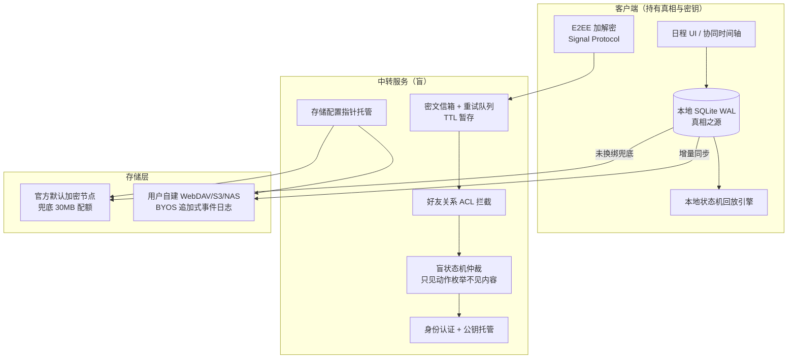
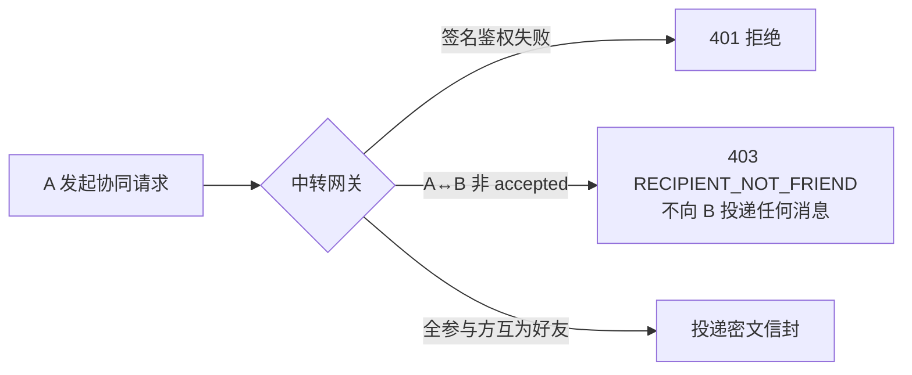
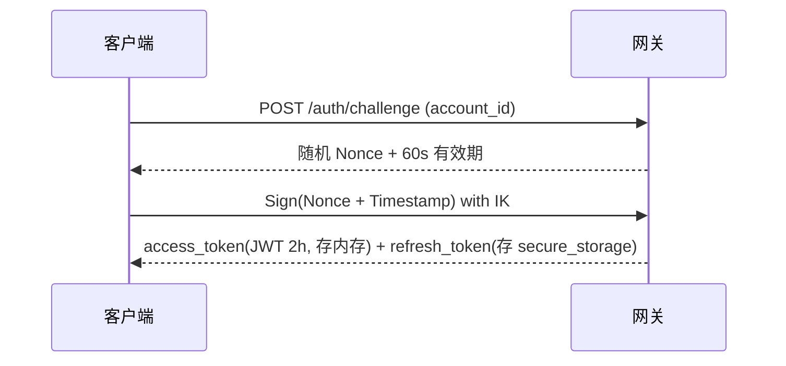
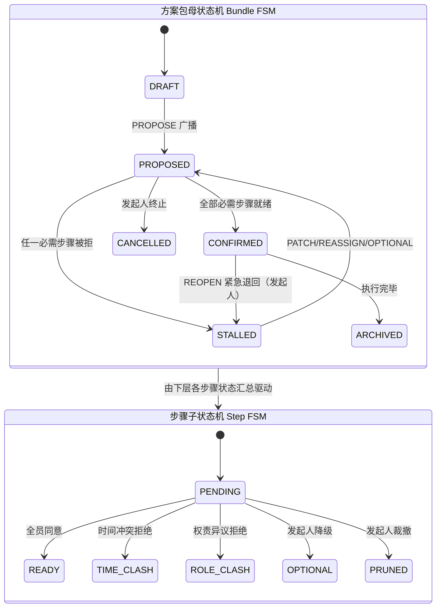
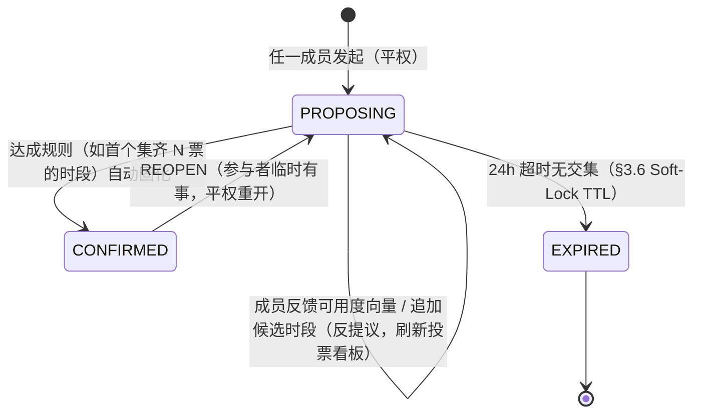
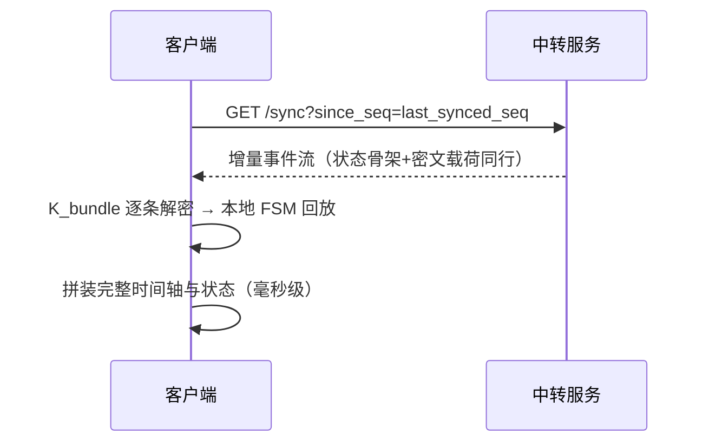
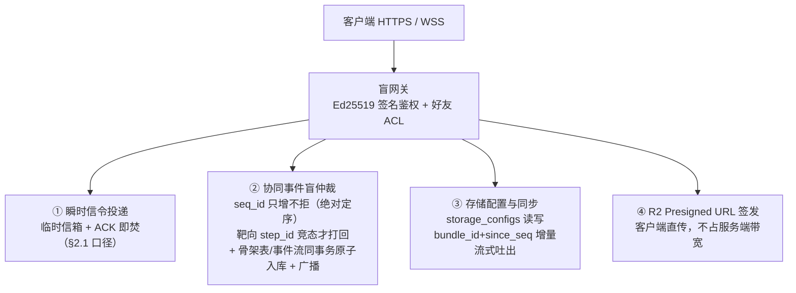
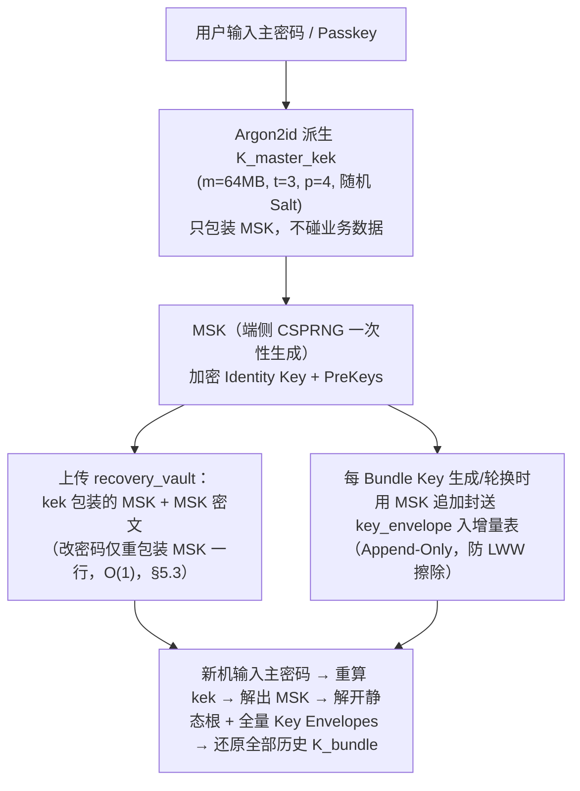
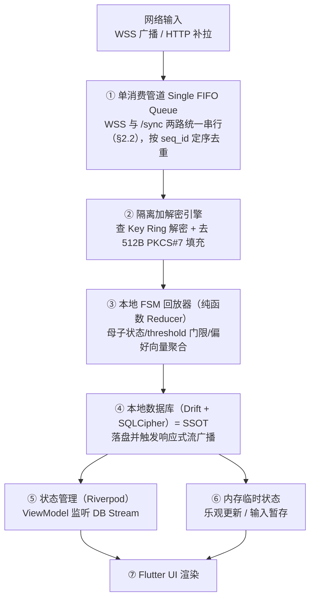
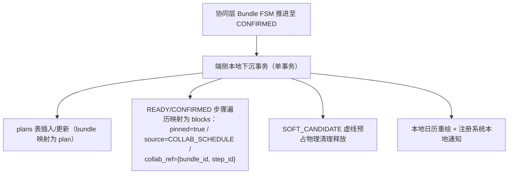

# 协同日程设计（collab-schedule-draft）

> 结论先行：在拾光「本地持有的日程台账」之上增加**多人协同日程层**，采用**端到端加密（E2EE）+ 盲中继（Blind Relay）+ 服务端盲状态机 + BYOS 自带存储**四件套架构。服务端不接触任何业务明文，只做「认证、路由、防骚扰、流程仲裁、密文暂存」；所有内容（日程标题、时间锚点、拒绝理由、备注）在出设备前加密。**2026-10-08 §7 六项全部拍板定稿转 active**（拍板留痕=§7 台账；SSOT 并入=schedule-app §11 台账行，随施工切片 1 落地）。

## 0. 定位与总览

### 0.1 一句话定位

用户体系是**中转服务的标识符（Identity Relay Locator）**——仅用于认证与加密消息中转；协同日程是一套独立于中转的端侧业务，服务端只见密文与骨架状态。

### 0.2 架构总图



### 0.3 四大子系统一览

| # | 子系统 | 核心设计 | 解决的问题 |
|---|--------|---------|-----------|
| 1 | 身份与好友 | 服务端只存 `account_id + 公钥 + prekey`；好友关系明文配对存服务端（Blind Social Graph），备注/资料端侧加密上存 | 寻址、防垃圾信令、换机不丢好友 |
| 2 | 消息中转 | 密文信封投递 + 指数退避重试 + 动态 TTL + DELIVERY_ACK 后物理删除 | 弱网/杀进程下接收方收不到消息 |
| 3 | 协同状态机 | 服务端盲状态机（两级联动 FSM）+ 密文载荷原子绑定 + 全局递增 seq_id | 状态分叉、乱序覆盖、换机拼不出数据 |
| 4 | 存储 | 本地 WAL 优先 + BYOS 追加式事件日志 + 官方默认节点兜底 | 换机丢数据、多端覆盖冲突、平台合规风险 |

### 0.4 与现有拾光体系的关系

- 拾光现有单机体系（plan/block/background/artifact）**不动**，协同层作为增量叠加。
- 协同日程落盘后即为拾光本地 plan/block（`pinned=true`），复用现有渲染与 MCP 通道。
- fact-user-relay-draft 中预留的「多人轨」由本稿承接（其 §多人轨段落以本稿为准）。

## 1. 身份与好友体系（Identity Relay）

### 1.1 服务端数据模型（纯标识符映射）

服务端数据库仅表现为匿名节点：

| 表 | 字段 | 说明 |
|---|------|------|
| users | account_id (UUIDv4) | 网络寻址句柄 |
| users | identity_key_pub (Ed25519) | 身份公钥 |
| users | prekey_bundle (X25519) | E2EE 握手（Signal Protocol） |
| users | push_token | FCM/APNs 唤醒拉密文 |
| users | encrypted_profile | 端侧加密的昵称/头像 |
| users | recovery_vault | 密钥恢复金库（§5.3） |
| friendships | user_id / friend_id | 好友配对（明文 ID，保路由） |
| friendships | status | pending / accepted / blocked |
| friendships | encrypted_friend_alias | 端侧加密的好友备注 |
| user_storage_configs | storage_type / endpoint_url / encrypted_auth_data / config_version | 存储配置指针（§5） |

### 1.2 好友建立与网关校验

好友经信令握手建立（request → accept → 双向写 friendships）。**所有协同信令在网关层过好友 ACL**：



- **生活预约**：发起人与所有被邀请人必须互为好友（逐对校验）。
- **团队调度**：空白时间探测（FreeMask）前置校验更严格——严防陌生人借空白时间探测刺探作息。
- **单向删除/拉黑**：网关返回 `RELATION_TERMINATED`，A 端本地标记不可用并引导重新添加。
- 端侧预校验（选人组件只展示已确认好友）提升体验，服务端兜底校验防绕过。

### 1.3 换机与多设备恢复

1. 新设备身份认证（Passkey / 手机号 / 恢复助记词）；
2. `GET /api/v1/friends` 拉回 friend_id 列表 + 各自最新公钥 + 加密备注；
3. 经 recovery_vault（§5.3）还原身份私钥；
4. 本地批量解密备注、验证公钥指纹 → 好友通信薄无缝还原。

### 1.4 认证与鉴权协议（Challenge-Response + 双 Token，评审补齐）

「Ed25519 签名鉴权」的具体通信协议此前空白——不能每个 API 请求对整包 Body 做私钥签名（性能开销大且防重放复杂）。定稿：



- **HTTP**：日常请求带 `Authorization: Bearer <access_token>`，网关无状态 JWT 校验；仅关键管理动作（改公钥、删数据）才要求私钥签名二次确认。
- **WSS**：纯路径 `wss://relay/ws` 建连（**禁止 token 进 URL**——反代/网关 Access Log 会明文泄露凭证），连接后**第 1 条消息必须是 `{"action":"AUTH","token":...}` 握手帧**，3s 内无效即掐线。
- **重放防范**：信令外层强制携带单调递增 `client_msg_id`(UUID) + 请求时间戳；服务端 Redis `SETEX msg_id 300`，300s 内重复提交幂等去重——抓包原样重放 `POST /v1/schedule/action` 无效。

### 1.5 注册所有权证明与 OPK 补仓（PoP + PreKey 管理，评审补齐）

- **公钥置换攻击防线（Proof-of-Possession）**：`POST /auth/register` 必须附带私钥自签名 `Sign(account_id + timestamp, IK_priv)`——服务端验证公钥能解开该签名（确认请求方真正持有私钥）才允许入库，截获请求替换公钥的攻击无效。
- **OPK 枯竭风暴防线**：注册时一次性上传 100 个 One-Time PreKey；用户登录/心跳时服务端检测存量 **< 20** 即在心跳回包夹带 `NEED_PREKEYS` 标记，客户端后台静默生成新一批 100 个批量补传；极端耗尽时 X3DH **安全降级为仅依赖 Signed PreKey（SPK）**，不卡死建联。

### 1.6 好友添加防刷与 MITM 防线（Ticket + 安全码，评审补齐）

- **防撞库骚扰（Friendship Ticket）**：禁止拿纯 account_id 全局发好友申请（UUID 泄漏库会被垃圾信令塞满收件箱）。定稿：接收方 B 端侧生成带防篡改签名的一次性名片凭证（二维码/短链接）：`Ticket_B = {account_id_B, ephemeral_nonce, expires_at, signature_B}`——A 扫码携完整 Ticket 提交，服务端验签 + 验未过期才写 `friendships(pending)`。
- **公钥指纹核对（Safety Number）**：好友建立后，端侧计算双方身份公钥哈希指纹，展示为 **6 组 5 位数字安全码**——用户可在线下/微信核对，提供防「恶意中继置换公钥」的 MITM 校验入口（中继理论上不可信，端侧可验证）。

### 1.7 双层 ACL（Bundle 作用域授权，解 N 方连通图悖论，评审补齐）

**§1.2「发起人与所有被邀请人必须互为好友」只在发起时成立**——若 A 与 B、A 与 C 是好友而 B、C 互不相识，B 的拒绝事件广播给 C 时会被 ACL 拦成 403，C 的状态机永久分叉死锁。定稿双层校验：

```sql
-- 服务端网关校验规则（伪代码）
func CheckGatewayACL(sender_id, recipient_id, bundle_id) bool {
    -- 1. 瞬时单聊信令（加好友请求、直投 Ping）：必须全局互为好友
    if bundle_id == "" {
        return IsDirectFriend(sender_id, recipient_id)
    }
    -- 2. 协同方案包事件：双方均在 participant_uids 内即法定授权，
    --    不再强制 B↔C 全局互为好友
    return IsParticipantOfBundle(bundle_id, sender_id)
        && IsParticipantOfBundle(bundle_id, recipient_id)
}
```

- **准入严管**：仅 PROPOSE 创建方案包时，严格校验发起人与每个被邀请人互为好友（防陌生人拉群刺探）；
- **包内放行**：方案包合法建立后，事件流广播以 `bundle_id` 成员清单为授权边界——协作域内成员间的路由不再要求全员完全连通图。

## 2. 消息中转与可靠投递（Relay Protocol）

### 2.1 中转信封（服务端可见明文）

```json
{
  "message_id": "msg_9f82c1",
  "recipient_id": "account_uuid_b",
  "ephemeral_sender_id": "account_uuid_a",
  "encrypted_payload": "BASE64_CIPHERTEXT...",
  "created_at": 1791448200
}
```

服务端仅按 recipient_id 投递至加密收件箱；B 端拉取并 ACK 后**立即物理删除密文**（阅后即焚，不保留历史）。

> **生命周期口径（防止双源矛盾）**：阅后即焚**仅适用于本节的点对点瞬时信令**——好友请求、唤醒 ping、DELIVERY_FAILED 通知等 Message Queue 信令；**协同日程事件流（`team_schedule_events`，§5.1）绝不阅后即焚**——它是全员状态一致性与换机恢复的基石，遵循 §5.1 原子持久化，按 §5.7 生命周期（敲定后 30–90 天）冷归档/物理清理。两类通道同走 §2.1 信封格式与 §2.2 重试调度，仅存储生命周期不同。

### 2.2 暂存与重复投递

| 字段 | 说明 |
|---|------|
| message_id (PK) | 全局唯一，幂等防重 |
| status | QUEUED / DELIVERED / FAILED |
| retry_count / next_retry_at | 重投调度 |
| expires_at | 绝对过期时间（动态 TTL） |

- **双通道唤醒（按前后台收敛，弃 3s 空等）**：**前台**依赖 WSS 双向通道，服务端检测 Heartbeat 正常才直推；**后台/断开**直接发系统标准推送（Wake Push，带计数提示）唤醒拉取。**不采用「推送后 3s 无 ACK 切静默推送」**——iOS 对 content-available 静默推送有严格电量预算（锁屏/低电量可延迟 15 分钟甚至丢弃），且锁屏下 TCP 早已挂起，3s 空等只是对死连接发呆、凭空加链路延迟。
- **端侧单一消费网关（Single Consumer Pipeline，防并发重放竞态）**：WSS 推来的增量事件与 HTTP `/sync` 拉回的事件**统一进本地同一条串行 FIFO 队列**，由单一 EventDispatcher 按 seq_id 去重、排序后驱动 SQLite 事务——弱网恢复瞬间两路密文同时涌入时，从代码结构上消灭唯一键冲突与重放错乱。
- **指数退避**：5s → 30s → 2m → 10m → 30m。
- **主动拉齐**：B 端重连即 `SYNC_PENDING` 批量拉走全部未过期密文。
- **动态 TTL**：即时/当日日程 30min–2h；跨天/预约类 24h–72h。超时置 FAILED、物理清密文，并向 A 回发 `MESSAGE_DELIVERY_FAILED` 系统信令；A 端日程块标感叹号，支持【重新发送】/【取消排程】。

### 2.3 元数据泄露防护（Padding 补齐，拍板定稿 §7.1）

服务端可见 `action_type`/`reason_type` 枚举属设计内元数据，但**密文字节长度不得泄露理由长短**——否则中间人可借密文体积差异逆推团队摩擦（如「时间冲突通常密文短、权责异议解释长」）。

- 客户端将明文 JSON 打包加密前，强制 **PKCS#7 填充对齐至 512 字节整数倍**（上限内），解密端去填充还原；
- 填充在加密封装单点（与 §2.1 信封组装同函数）实施，禁止散落调用点各自为政。

## 3. 协同业务模型

### 3.1 树状胶囊：方案包 → 日程 → 步骤

```text
📦 方案包 Bundle（"2026 Q4 战略研讨会"）
 ├── 📅 日程 sched_d1（10月24日）
 │    ├── 🔹 步骤 s_101 签到 09:00–09:30（全员）
 │    ├── 🔹 步骤 s_102 战略宣讲 09:30–11:30（A,B）
 │    └── 🔹 步骤 s_103 分组研讨 14:00–17:00（全员）
 └── 📅 日程 sched_d2（10月25日）
      └── 🔹 步骤 s_201 方案答辩 09:30–12:00（C）
```

### 3.2 两类业务场景与双模策略（Dual-Mode Policy，评审定稿）

底层（盲中继/事件流/Padding/E2EE）100% 复用，业务状态机层按 `proposal_type` 加载两种策略——**照搬团队科层制到朋友聚会会产生「权力模型错位 + 流程过重」的水土不服**：

| 维度 | 团队模式 Directive（工作交付） | 小团体模式 Consensus（生活社交） |
|---|---|---|
| 权力结构 | 单中心：发起人独占仲裁 | 全员平权，人人可反提议/追加候选 |
| 协商方式 | 串行定序：提议→审批→修补 | 多选投票（Doodle）：勾选可去时段取交集 |
| 反馈粒度 | 双维度四细项拒绝（责任留痕） | 极轻量：可用度向量 + 随手备注 |
| 收敛规则 | 必需步骤强一致（threshold 门限全票） | 规则驱动自动敲定（如首个集齐 N 票的时段） |

- **生活预约（Rendezvous）→ Consensus 模式**：提案携带多个候选时段；成员反馈**可用度向量**（可以/优先推荐/不行三值，非二元审批）；平权**反提议**（任何成员可追加候选时段，刷新投票看板）；达成规则即自动固化（虚线 → `pinned=true`），未选候选释放。
- **团队调度（Team Auto-Schedule）→ Directive 模式**：发起人主导排程，成员对时间有否决权（带理由），对事项本身有权责异议权（§3.4）。

### 3.3 分层精准拒绝

拒绝信令携带靶向节点（`target_schedule_id` + `target_step_id`），只冻结冲突步骤，未受影响的日程/步骤保持 READY，避免一票否决瘫痪全案。

### 3.4 双维度拒绝理由

```text
⏰ 时间冲突 → 发起人改期（PATCH_TIME，重寻空白交集）
🚫 权责/意向异议 → 发起人三键闭环：
   ① 转派责任人（REASSIGN）
   ② 降级为可选（MAKE_OPTIONAL，移出强一致约束）
   ③ 裁撤步骤（PRUNE，剩余部分不受影响）
```

拒绝面板强制分流两大类 + 四子类（非我职责/优先级不符/缺前置条件/个人原因），必填详细说明，可选建议转派对象——破除「有空但不想做被迫撒谎说没空」的拉锯战。

### 3.5 伪聊天系统事件流

每个方案包一条**只读系统事件时间轴**（关闭自由群聊输入，防沦为聊天群）：发起、同意、拒绝、微调、终态确认全程留痕。发起人端据此聚合决策矩阵（accepted_list / rejected_list），驱动状态机与操作面板。

**拒绝理由隐私分级（Peer Privacy Paradox 防线，评审补齐）**：理由全员强制公开会逼成员倒退回「敷衍填词/谎称时间冲突」，发起人反而收集不到真实阻碍。双维度拒绝弹窗增隐私范围开关：

- **全员公开（默认）**：理由用 K_bundle 加密，全员时间轴可见；
- **仅发起人可见**：理由用发起人身份公钥 IK_A **单向加密**（即使发起人也非本包成员场景不可见，其他成员端永远解不开）；其他成员时间轴仅渲染骨架提示「B 提出了权责异议，已私密反馈发起人，等待调整中」——事件枚举照常进 FSM，仅内容可见面收窄。

**微沟通断层补齐（防「排程在拾光、对齐在微信」割裂）**：坚决不加自由群聊流，增两类受限密文载体：

- **方案备忘贴纸（Briefing Sticky）**：发起人可在方案包头部置顶一条密文备忘（会议室指引/议程资料链接等微上下文），全员可见，可更新（带 revision）；
- **步骤问答便签（Step Q&A Note）**：成员对单个步骤可附加 ≤50 字短备注（密文随事件流入库），单步骤一条、覆盖式更新——不形成滚动聊天流，保持反焦虑质感。

### 3.6 角色与排期原则：「公事客观规划，私事自主平衡」

- **发起人双轨独立**：团队日程独立轨道规划，**不被自己的私事绑架**；私事仅作半透明幽灵图层（Ghost Layer）视觉参考，是否让路由发起人自主决断。
- **成员混合承载**：单人日程与团队步骤同屏混合渲染，成员据真实负载反馈冲突或异议。
- **空白探测分流**：成员本地算 FreeMask（生活日程+已有团队日程取交集，不暴露明文）；发起人以公约工时为基准池，不以自身私事设限。**FreeMask 传输协议（作息泄漏防线，评审补齐）**：禁止全局作息探测（整周空区可反推几点睡觉几点上班）——定稿三约束：①**靶向范围**：只能针对具体提议候选区间（如 10月24日 09:00–18:00）发起探测；②**粗粒度量化桶**：区间按 30 分钟切片生成二进制掩码串（`01110001`，1=有空）；③**单向加密**：掩码用发起人 IK_A 加密经临时信箱透传，发起人端内存中按位与（BITWISE AND）算全员重叠区，即 §11.2「全员共振条」数据源。
- **幽灵预占（Tentative Soft-Lock）**：收到提案即在本地该时段生成半透明虚线块，防止空白时段被多方抢占。**软锁必须自动释放（TTL）**：每个 Proposal 携带 `expires_at`（默认发起后 24h）；超时未达成一致且未收到延期信令，本地虚线软锁自动淡出、时段重新计入 FreeMask——杜绝提案人掉线或成员迟迟未表态导致的「日历僵尸死锁」。**预占分级（防「幽灵超占」，评审补齐）**：
  - `HARD_TENTATIVE`（强占位，排他）：团队确定性步骤（Directive 已被指派的具体时段）——对外 FreeMask 标记不可用；
  - `SOFT_CANDIDATE`（弱占位）：生活多候选时段（Consensus 场景，成员周末可能同时挂 3 个候选）——仅自身日历显示半透明虚线，**对外计算 FreeMask 时仍标记可用/备选**，不阻断其他邀约，防止「可用时间虚假枯竭」；
  - 固化（CONFIRMED）后统一升格为实体日程（强占位）。

## 4. 协同状态机（盲 FSM）

### 4.1 持有方式拍板：服务端持有盲状态机

状态机**由服务端持有**（盲状态），不采用纯客户端分布式推导。理由：

| 维度 | 服务端盲状态机（选定） | 纯客户端分布式 |
|---|---|---|
| 一致性 | 数据库单点仲裁，永不分叉 | 依赖向量时钟与冲突消解，复杂度高 |
| 客户端复杂度 | 极低（显示终端 + 加解密） | 极高（事件溯源引擎） |
| 服务端视角 | 知道「谁对哪步做了什么动作」，**不知道具体内容/理由** | 全盲只见字节流 |
| 隐私 | 动作枚举外置 + 密文载荷内置，隐私无损 | 极致但工程代价大 |

### 4.2 两级联动 FSM



Bundle 状态为**派生态**：由全部必需步骤的状态聚合推导（任一 TIME_CLASH/ROLE_CLASH → STALLED；全部 READY → CONFIRMED）。

**半盲骨架投影（Semi-Blind Skeleton Projection，解「全盲 vs 仲裁」悖论）**：服务端若全盲（只有一团密文）则数学上无法做聚合推导；若 knows 每步的表态人即泄露任务分工。定稿口径：**内容加密、拓扑明文**——PROPOSE 信封外层携带明文协作骨架 DAG，服务端只维护纯数学票数计数器（Quorum Counter）：

```json
{
  "bundle_id": "b_1001",
  "topology_skeleton": {
    "steps": [
      { "step_id": "s_101", "required_uids": ["uid_a", "uid_b"], "threshold": 1, "is_optional": false },
      { "step_id": "s_102", "required_uids": ["uid_c"], "threshold": 1, "is_optional": false },
      { "step_id": "s_103", "required_uids": ["uid_a", "uid_b", "uid_c", "uid_d", "uid_e"], "threshold": 3, "is_optional": false }
    ]
  },
  "encrypted_payload": "<AES-GCM: 步骤名称/真实时间/备注等全部隐私>"
}
```

- 服务端知道：节点 s_101 需 2 票、s_102 需 1 票、谁已投——据此合法推进 FSM；服务端不知道：步骤是什么事、何时何地、拒绝理由。
- **门限表决（M-of-N，评审补齐）**：每步骤增 `threshold` 字段（默认 = required_uids 全员数；可指定 min_accept_count，如 5 人中 ≥3 到场）——「架构评审 A 或 B 到一人即可」「核心成员 5 选 3」不再因一人没空全盘标黄。Quorum 计数器按 `accept_count >= threshold` 判定该步骤 READY，而非强制全员。
- 隐私边界重定义（修订 §4.1 服务端视角行）：服务端可见面 = 签名身份 + 动作枚举 + **拓扑骨架**（step_id/required_uids/is_optional/threshold）；不可见面 = 一切内容。骨架属设计内元数据，受 §2.3 同一哲学约束（最小暴露，仅仲裁所需）。
- PATCH/REASSIGN/PRUNE 类结构变更信令须同时携带**新版 topology_skeleton**（同事务原子更新骨架表与事件流），保证 Quorum 计数器与事实一致。

### 4.3 状态转移表（服务端仲裁规则）

| 当前状态 | 触发事件 | 新状态 | 伴随行为 |
|---|---|---|---|
| PROPOSED | 参与者 ACCEPT（步骤级） | 视聚合而定 | 事件流追加，时间轴渲染 |
| PROPOSED | REJECT(reason=TIME_CONFLICT) | STALLED（步骤 TIME_CLASH） | 发起人端浮现【修改时段】 |
| PROPOSED | REJECT(reason=ROLE_UNWILLING) | STALLED（步骤 ROLE_CLASH） | 发起人端浮现【转派/降级/裁撤】 |
| STALLED | PATCH_TIME | PROPOSED（步骤 revision+1，回 PENDING） | 仅重置受影响步骤，其余不重复确认；**同步骤其他已同意成员联动置 `PENDING_RECHECK`**（二次冲突回音壁防线，见下） |
| STALLED | REASSIGN | PROPOSED（责任人变更） | 原拒绝者日历清除；新责任人审批 |
| STALLED | MAKE_OPTIONAL | 重新聚合（其余全过则 CONFIRMED） | 移出强一致约束名单 |
| STALLED | PRUNE | 重新聚合 | 步骤删除广播 |
| CONFIRMED | 发起人 REOPEN（紧急退回） | STALLED（受影响步骤回 PENDING，revision+1） | 执行当日核心成员突发缺席等紧急场景；全端事件流留痕，已 READY 步骤不受影响 |
| 任意 | 发起人 CANCEL | CANCELLED | 全员虚线日程销毁擦除 |

**PATCH 二次冲突回音壁防线（评审补齐）**：步骤同时分配 B、C 时，C 已同意 10:00，A 改到 14:00 后 C 在 14:00 未必有空——若只重置拒绝者，会陷入「A 改 14:00→C 拒→改 16:00→B 又不行」的无限拉锯。定稿：

- **同步骤成员状态联动失效**：PATCH_TIME 落地时，该步骤上此前已同意的所有成员强制重置为 `PENDING_RECHECK`，端侧高亮提示「时段已变更，请重新确认」；
- **改期辅助决策**：发起人点【修改时段】时，系统自动拉取该步骤全部责任人的局部 FreeMask 重叠交集，优先高亮「全员共同空闲时段」——不让发起人盲猜，从源头减少再次被拒。

### 4.4 小团体模式极简状态机（Consensus，proposal_type: rendezvous）

Directive 的母子联动+审批链对朋友约饭过重（弹「非我职责」很滑稽、B 反提议还得干等发起人）。Consensus 模式状态机简化为**时段竞争与共识**：



要点：

- **无 STALLED、无审批**：拒绝不是状态事件，只是可用度向量里的「不行」票；服务端 Quorum 计数器按票数统计候选时段，规则达成即 CONFIRMED。
- **平权反提议**：任何成员可 ADD_SLOT 追加候选（服务端校验互为好友即可，无发起人特权），看板刷新对全员可见。**候选硬上限（防看板撑爆，评审补齐）**：单个 Rendezvous 方案包最多挂载 **8 个**候选时段（覆盖全部聚餐聚会诉求）；满额后【+ 我想提议其他时间】置灰不可点（提示「候选已满，可先落槌或等流局后重开」）——防纠结症/恶搞把矩阵横向撑爆、投票视线涣散。
- **拓扑骨架退化**：单步骤多候选（每候选一个 slot_id，threshold=达成规则票数），服务端只数票，依旧零内容泄露。
- CONFIRMED 固化后同样可 REOPEN（生活场景「临时有事」高频，无需发起人仲裁）。**REOPEN 预占回退强通知（防按老日程赴约扑空，评审补齐）**：REOPEN 到达端侧时，已下沉的实体日程块立即转「感叹号 + 闪烁虚线」回退态，并触发**系统级本地强通知**：「原定活动已进入紧急重新协商状态」——哪怕 App 进程未开也要让用户在赴约前知道，此为端侧本地下沉事务（§11.3）的反向通道（仅改本地块呈现态，不删台账行，最终态以 FSM 收敛为准）。
- **分票死锁落槌（Force Finalize，评审补齐）**：4 人中 2 投 Slot 1、2 投 Slot 2 且门限 3 票，谁都不改票就会拖到 24h 流局。现实社交需要有人一锤定音：投票期内若多候选均达次优票数（如均过半但未满门限），**任一成员**（平权）可点击【就定这个时段】触发 `FORCE_FINALIZE(slot_id)`，方案直接锁定 CONFIRMED，其余成员收到敲定通知——还原「挑个时间直接定」的果断体验。**并发竞态门禁（评审补齐）**：B 落槌 Slot 1 与 C 落槌 Slot 2 同秒到达时，以 PG 行级原子门禁先到先得（First-Commit-Wins）：

```sql
UPDATE bundles SET status = 'CONFIRMED'
WHERE bundle_id = $1 AND status = 'PROPOSING';
```

`RowsAffected == 0` 的后到请求直接返回 `409 ALREADY_FINALIZED`，客户端刷新为他人已落槌结果——杜绝状态分叉。

### 4.5 权限隔离（服务端校验 + 端侧断言双层）

| 操作 | 发起人 | 步骤责任人 | 其他成员 |
|---|---|---|---|
| 发起/终止/裁撤/转派/改期 | 独占 | 无 | 无 |
| 同意/拒绝自己的步骤 | 默认同意 | 有权（拒绝必带理由） | 无 |
| 查看事件时间轴 | 可见 | 可见 | 可见 |

- 服务端盲状态机做**动作合法性仲裁**（越权信令直接拒绝推进）。
- 各端本地断言兜底：信令私钥签名 + `actor_id` 角色与步骤归属校验，非法事件丢弃。
- **未响应成员处置（「静默黑洞」防线，评审补齐）**：4 人 10 分钟内同意、唯 D 迟迟不开手机，发起人陷入信息真空（没看到/已读不回/离线无从区分），而 FORCE_REMOVE_MEMBER 会触发昂贵的全员 REKEY。定稿两档轻量工具：
  - **定向轻提醒（Nudge）**：决策矩阵看板上 PENDING 超 2h 的成员出现【提醒确认】按钮，向其设备投递高优先级系统通知/静默唤醒信令（走既有 Wake Push 通道，零新机制）；
  - **一键降级表决（Bypass = MAKE_OPTIONAL 单人化）**：对迟迟不响应的成员按单人单步骤一键 MAKE_OPTIONAL，移出强一致名单、方案直接收敛推进——**不触发 REKEY**，成本远低于剔除成员。
- **发起人失联死锁熔断（Stalled Deadlock TTL）**：发起人独占改期/转派/终止权限，若其失联（丢机/离职/长期断网），方案包会卡死在 STALLED。熔断规则：STALLED 状态持续超过 **48 小时**且发起人无任何 PATCH 响应 → 各成员端**本地**允许该方案包退化为 `ABANDONED_LOCALLY`，自动释放全部关联预占（幽灵软锁淡出、时段重回 FreeMask），避免成员日历被挂死。这是**本地自保性退化**而非全局终态——发起人恢复后其端上状态机仍可将方案重新激活（以发起人最新 revision 信令为准，成员端重新收到即恢复预占），与 §4.4「发起人独占」仲裁权不冲突。

## 5. 一致性、存储与同步

### 5.1 单一事实源：状态与密文原子绑定的事件流

杜绝「纯指针空壳幽灵状态」——服务端不只存 ID 和状态，**每条状态变更与其密文载荷在同一事务内原子入库**：

```sql
CREATE TABLE team_schedule_events (
    id BIGSERIAL PRIMARY KEY,
    bundle_id VARCHAR(64) NOT NULL,
    seq_id BIGINT NOT NULL,             -- bundle 内严格单调递增
    sender_id VARCHAR(64) NOT NULL,
    action_type VARCHAR(32) NOT NULL,   -- 服务端可见枚举
    step_id VARCHAR(64),
    encrypted_payload TEXT NOT NULL,    -- 端到端密文（标题/理由/时间）
    iv VARCHAR(32) NOT NULL,
    auth_tag VARCHAR(32) NOT NULL,      -- AES-256-GCM 防篡改
    created_at TIMESTAMPTZ DEFAULT NOW(),
    UNIQUE (bundle_id, seq_id)
);
```

服务端知道：谁在 seq=N 对哪个步骤做了什么动作；服务端不知道：日程何时何地、步骤标题、拒绝理由的具体内容。

**seq_id 生成实现（并发踩坑防线，评审补齐）**：禁止「SELECT MAX(seq_id) + 1 再 INSERT」——PG READ COMMITTED 下两人同毫秒提交会算出相同 nextSeq 触发 UNIQUE 冲突。定稿行级排他锁原子自增，单条 SQL 拿号：

```sql
UPDATE bundles
SET max_seq_id = max_seq_id + 1, updated_at = NOW()
WHERE bundle_id = $1
RETURNING max_seq_id;
```

拿返回值直接插入事件流水，消除应用层算号的并发重试。

### 5.2 密钥管理（会话密钥，拍板定稿 §7.2）

发起人本地生成方案包对称密钥 `K_bundle`（AES-256），用各成员 **X3DH 预共享公钥**分别包裹后随 PROPOSE 信令上存；成员以私钥解开 `K_bundle` 存本地安全区，后续事件加解密对称进行。

- **单主设备交付（多设备 X3DH 歧义防线，评审补齐）**：PreKey 绑定具体设备，A 若随意拉 B 某台设备的 PreKey，B 换另一台设备即无法解密。定稿：X3DH **只在发起人与成员主设备间完成初次交付**；成员首台设备解出 K_bundle 后**立即**用自己 MSK 加密追加 `key_envelope` 入 `user_key_envelopes`（§5.3）——B 的 iPad 登录时直接从自己的增量信封表拉取解开，彻底规避多设备 X3DH 密钥爆炸。

- **不用双棘轮**：协同日程为低频广播式信令（单 Bundle 生命周期 5–20 次交互），双棘轮的多端棘轮步进同步复杂且离线漏步即解密失败，X3DH 初始分发 + 对称加密已满足需求。
- **成员变更触发 REKEY**：踢出成员/成员退组时，发起人发 `REKEY` 事件——以剩余成员公钥派发 `K_bundle_v2`，后续事件全部改用新密钥；被移除者持旧密钥仅能解其离线前历史，无法读后续信令（前向安全）。
- **Key Ring 密钥环（防历史回放阻断）**：REKEY 会产生密钥版本链，回放引擎必须能解任意 seq 的事件。每个 Bundle 在客户端本地维护 `key_ring: {v1: K_bundle_v1, v2: K_bundle_v2, ...}`；事件信令携带 `key_ver` 标注加密版本，回放时按版本查环解密。新设备恢复路径：密钥环随主私钥 recovery_vault（§5.3）整体加密备份，Vault 还原即全链还原；REKEY 时发起人向在册成员包裹分发的也是**当前有效密钥链**而非仅最新密钥。无对应版本密钥且 Vault 无法还原 → 该段历史标记「无法解密」灰显，FSM 跳过其内容但骨架状态仍可推进（动作枚举明文在场）。

### 5.3 多端密钥恢复（Zero-Knowledge Key Vault）

- **两层密钥包装（MSK，防「改密码雪崩重加密」，评审补齐）**：**禁止用 Argon2id 派生密钥直接加密业务信封**——否则用户改主密码时须把全部存量 key_envelopes 解开再重加密写回（200 个信封 = 一次网络中断即密钥分裂）。定稿双层结构（1Password/Bitwarden 同款 Key Wrapping）：
  - **K_master_kek（密钥加密密钥）**：主密码/Passkey 经 Argon2id 派生，**只用来包装 MSK**，永不触碰业务数据；
  - **MSK（Master Storage Key）**：端侧 CSPRNG 生成的一次 256 位永久随机密钥，加密身份私钥 + 全量 user_key_envelopes；
  - **改密码代价 O(1)**：本地解出明文 MSK → 用新派生的 kek 重新包装一次 MSK → 覆盖更新 recovery_vault 单行——业务信封一条不动，历史日程永不因改密解密崩溃。
- **主通道（增量信封托管，防 LWW 覆盖擦除）**：`recovery_vault` **不是单个可覆盖字段**——采用「静态根 + 增量信封」双件套：
  - **静态根**：MSK 被 kek 包装后的密文 + 身份私钥/PreKeys 的 MSK 密文（改密只换包装层，覆盖写安全）；
  - **Key Envelopes 增量表**：每创建/轮换一个 Bundle Key 时，端侧额外用 **MSK** 封送一份 `key_envelope(bundle_id, key_ver, wrapped_keys)` **追加**入库（Append-Only，绝无覆盖）——手机建方案 1、iPad 同意方案 2，两把密钥以独立信封并存，多设备并发写互不冲掉，换机拉全量信封逐一解开即完整还原（评审修正：单体 Vault 全量覆盖会造成 Last-Write-Wins 密钥擦除灾难）。
- **备通道**：12 位助记词（轻量极客型）/ 面对面扫码局域网传输。
- **时间戳仲裁（防客户端改表作弊）**：事件法定流水时间一律由**服务端事务落盘时写入 `server_received_at = NOW()`**，TTL 计算、时间轴排序、FSM 生效次序均以它为准；客户端 `client_action_time` 仅作 UI 视觉记录（离线操作场景下尤其如此——生效先后由服务端 seq_id 递增定序，不信端钟）。
- **时间规范（双轨制，防 All-Day 漂移）**：
  - **Timed Slot（具体时刻）**：强制 UTC RFC3339 绝对时间（如 `2026-10-24T02:00:00Z`），仅 UI 渲染时转设备时区——跨时区/夏令时防线；
  - **Floating Date（纯日期/All-Day/跨天日程）**：**禁止**折算 UTC 零点（否则纽约用户会把「10月24日」解成本地 23 日 20:00，整天活动漂移到前一晚），一律采用无时区浮动日期字符串 `"2026-10-24"`，任何时区用户打开都是本地日历上的同一天。FreeMask 探测与幽灵预占对 All-Day 时段同样按浮动日期整日计。

### 5.4 客户端同步流



- 断网重连/启动时按 `since_seq` 增量拉取，跳号即触发补拉，绝不脱节。
- **并发防护（区分「时序追加」与「因果冲突」，防假性冲突惊群）**：全局 `seq_id` **仅用于事件绝对定序**——无冲突动作直接顺序入库，**不拒绝**；`base_revision` 乐观锁仅作用于**靶向实体**：仅当同一 `step_id` 被并发修改（如 B 拒绝步骤 1 与 A 改步骤 1 时间竞态）才触发 `STALE_REVISION` 打回；发起人整体重构时才校验 `bundle_revision`。否则 B 同意步骤 1、C 同意步骤 2 的互不相干操作会因全局序号递增互相打回，引发多人协作下的重试惊群风暴。

### 5.5 三层存储容灾（BYOS）

**本地 WAL 优先**：数据真身先落本地 SQLite（sync_status=PENDING），本地是真相之源；远端只增不减。

**BYOS 追加式事件日志**：用户自选 WebDAV/S3/NAS，每事件独立加密文件（文件名含时间戳+设备+UUID，**只追加不覆盖**，杜绝多端覆盖冲突）；目录结构 `manifest.json + events/*.enc + snapshots/`（每 500 条合并快照）。

**快照与修剪界限（Tombstone Retention，防掉线设备 FILE_NOT_FOUND）**：生成新快照（如 `snapshot_v1.enc` 覆盖 seq 1–500）后，**旧事件文件不立即物理删除**——保留至少 1 个快照周期或 30 天（取更晚者），期间长期掉线设备（如只同步到 seq 200 的平板）重连仍可按增量补拉 201–500；超期后再执行物理清理。若设备重连时发现本地 `last_seq` 已早于现存最早增量日志，不再尝试重放旧事件，直接触发**全量快照前滚（Snapshot Fast-Forward）**：拉取最新快照覆盖本地、解密重放快照内事件，再衔接增量。

**中转服 ARCHIVE_ACK 兜底**：密文推给 A 后**不立即删除**，待 A 完成①本地入库②上盘确认后才物理删除；缓冲期 7 天，设备损坏时新机重拉未确认信令，一条不漏。

### 5.6 默认节点与渐进迁移

- **官方默认加密节点兜底**（建议 R2 类免出口费对象存储）：注册即用零门槛，服务端只见密文；单事件包 ≤256KB，单用户配额 30MB，180 天不活跃转冷归档。
- **迁移向导**：验证用户自建节点连通性（写入读取握手文件 `.shiguang_test`）→ 一键迁移历史数据 → 向官方节点发 `PURGE_ALL_DATA` 物理删除，闭环。
- **换绑提醒（非阻断）**：首页顶部常驻横幅（用户未换绑则一直在，可滑折为盾牌图标）；7 天后温和轻提示；仅配额将满/大型协同发起时才阻断式弹窗——守住反焦虑质感。
- **断连熔断**：自建节点连续 3 天同步失败，顶部常驻黄色警告条。

### 5.7 生命周期与瘦身

协商进行中：服务端事件流为单一事实源（保留 30–90 天）；敲定 CONFIRMED 后：各端将拼装完成的日程包异步归档至个人网盘，服务端对已完结流水定期冷归档或物理擦除。

> 本表生命周期与 §2.1 点对点瞬时信令的「阅后即焚」**互斥不冲突**：Message Queue 信令 ACK 即焚，本事件流持久化至归档——口径见 §2.1 生命周期注。

## 6. 边缘场景备忘

- **成员退组 / 发起人移交**：`FORCE_REMOVE_MEMBER`（自动解挂其步骤）、`TRANSFER_INITIATOR`（Ownership 签名移交）。
- **消息投递失败**：A 端标记 + 一键重发（§2.2）。
- **离线重放**：密文按 seq_id 时序还原，事件溯源保证最终一致。
- **生活预约与团队调度共用同一套信封/队列/存储设施**，仅业务状态机不同。

## 7. 拍板台账（2026-10-08 用户裁决定稿）

1. **团队身份 → Ad-hoc Bundle（不引入 Team/Group 实体）**：阶段一坚决不建独立群组实体。Bundle 本身即天然作用域，`participants` 随 Bundle 初始化，退组只需 `MEMBER_REMOVED` 事件。群主转让/退群/权限变更等厚重一致性负担全部规避；未来出现「固定组织反复排程」需求时，在客户端本地引入联系人分组（Tag）向导一键勾选，服务端零新增。
2. **E2EE 握手 → 简化版 X3DH + K_bundle 版本轮换（不用双棘轮）**：双棘轮为高频双向 IM 设计，协同日程是低频广播式信令（单 Bundle 生命周期 5–20 次交互），Sender Keys 多端棘轮步进同步复杂且离线漏步即解密失败。定稿：发起人用被邀请人 X3DH 预共享公钥加密一次性 `K_bundle`，后续信令对称加密；**成员变更（踢出/退组）时发起人发 `REKEY` 事件**（以剩余成员公钥派发 `K_bundle_v2`），兼顾前向安全与工程稳健。
3. **官方默认存储 → Cloudflare R2，配额 30MB 维持**：R2 零出口流量费 + 原生 S3 API 兼容——客户端一套 S3 SDK 抽象驱动同时覆盖官方 R2 与自建 MinIO/S3。密文事件包均 500B–2KB，30MB ≈ 1.5–6 万条事件，够用数年。
4. **服务端技术栈 → PostgreSQL + Redis 延迟队列**：随本拍板一并定稿；部署形态（自建/云托管）留施工切片 2 开工前定。
5. **两协议统一 → 底层统一为 Schedule Proposal，差异作为 `proposal_type` 策略插件**：
   - 生活预约 = schedules 数组含多个并列**候选时段**，决策规则「全员共识选中一个 Slot，其余自动 PRUNE」；
   - 团队调度 = schedules 数组含多个**必选/依赖时段**，决策规则「全员对所有必选 Step 达成一致」；
   - 传输信封、原子事件流、seq_id 步进 100% 复用，仅客户端 FSM 按类型加载不同决策规则。
6. **fact-user-relay-draft 多人轨口径**：本稿转 active 时同步回改该稿多人轨段落指向本稿（§1.3 身份体系承接其预留）。

### 7.1 随拍板补齐的两个防护规则（并入正文）

- **元数据泄露防护（Padding 补齐）**：服务端可见 `action_type`/`reason_type` 枚举，但密文长度不得泄露理由长短（防流量分析逆推团队摩擦）。客户端加密前强制 PKCS#7 填充对齐至 **512 字节整数倍**（见 §2.3）。
- **幽灵预占自动释放（Soft-Lock TTL）**：每个 Proposal 必须携带 `expires_at`（默认发起后 24h）；超时未达成一致且无延期信令，本地虚线软锁自动淡出、时段重新计入 FreeMask，杜绝「日历僵尸死锁」（见 §3.6）。

## 8. 服务端实现与部署（2026-10-08 拍板）

### 8.1 语言与技术栈：Go

服务端是「盲人代理」——无业务计算，只有 I/O 吞吐、长连接开销与并发安全，**Go 首选**（备选 Node.js/TS 供全栈统一场景）：

- Goroutine 单个约 2KB，单机数十 MB 内存维持数万 WebSocket 长连接；
- 单静态二进制交付（<25MB），Docker 多阶段构建秒级部署；
- 技术栈定稿：**Gin**（路由）+ **nhooyr.io/websocket 或 gorilla/websocket**（长连接）+ **pgx**（PG 驱动）+ Redis 客户端（延迟队列）。

### 8.2 请求处理四模块（动静分离）



- **适合 Serverless/无状态**：注册、握手、好友关系、`POST /schedule/action`（本质一条带乐观锁的事务 INSERT）、`GET /sync`、Presigned 签发——几毫秒返回。
- **必须常驻**：WebSocket 连接池（内存 Connection Map）+ Redis 延迟队列消费（TTL 超时/退避重试）——**不适合纯 Serverless 函数**，走常驻容器。

### 8.3 部署阵地：容器 PaaS（定稿）

| 层次 | 选型 | 说明 |
|---|---|---|
| 应用容器 | Zeabur / Fly.io / Railway（或自建 VPS + Docker Compose） | 常驻进程支持 WSS；GitHub push 自动构建部署 |
| 数据库 | Supabase / Neon（托管 PostgreSQL） | 原子事务 + BIGSERIAL seq_id + 备份 |
| 队列/锁 | Upstash 或 PaaS 内置 Redis | 指数退避重试、分布式锁、在线会话映射 |
| 对象存储 | Cloudflare R2 | Presigned URL 客户端直传，零出口费 |

自建备选：2C4G 轻量云主机 + Docker Compose（app / postgres / redis / caddy 反代 WSS + 自动 SSL）。

### 8.4 仓库边界：独立新仓 `shiguang-relay`（定稿）

**服务端独立建仓，不进拾光主仓、不做 Monorepo**：

- **零知识物理隔离**：独立仓从物理层面杜绝客户端模型类（含明文字段）被导入服务端——服务端严禁出现任何加解密密钥与业务明文解析逻辑，只基于契约信封与枚举仲裁；
- 技术栈/CI/部署生命周期完全不同（移动端发版以周计，中继热修复随改随发），分仓后互不干扰。

**契约层定稿：Protocol Buffers + 双端代码生成（不是静态 protocol.json）**：

- 静态 JSON 契约两侧手写解析极易漂移（Go tag 大小写不一致、enum 反序列化落空值）——定稿用 **`.proto` 单一事实源**（或 JSON Schema + Buf/QuickType 生成链）；
- 契约改动即跑生成脚本：Go 侧出 `types.pb.go`、Flutter 侧出 `types.pb.dart`，双方**只面向生成的只读契约文件编程**，杜绝手动对齐字段；
- 生成脚本进 CI：契约变更未同步生成产物则流水线拦截。

最简起步结构：

```text
shiguang-relay/
├── Dockerfile                # 多阶段构建，最终镜像 < 25MB
├── docker-compose.yml        # 本地一键拉起 postgres + redis 联调
├── main.go
├── handler/                  # auth / friendship / schedule_action / sync / storage_ptr
├── hub/websocket_hub.go      # 在线连接池 + 广播
├── fsm/blind_fsm.go          # 盲状态机转移合法性断言（只看枚举）
└── queue/delayed_retry.go    # Redis 延迟重试 + TTL 超时监控
```

## 9. E2EE 加密方案详细设计（2026-10-08 定稿）

> 四个硬指标：零知识（服务端不可解密任何内容）、前向安全与退组防窥（被移除者读不到后续事件）、元数据防侧信道（密文长度不泄露理由长短）、低频信令适配（X3DH + K_bundle 版本链，弃用双棘轮）。

### 9.1 密钥分层（三层职责严格分离）

| 层次 | 密钥 | 算法 | 存储位置 | 职责 |
|---|---|---|---|---|
| L1 身份层 | Identity Key | Ed25519（签名）/ X25519（DH） | 本地 Secure Storage + 加密 Vault 备份 | 信令验签与 X3DH 握手 |
| L2 握手层 | PreKey Bundle（SPK/OPK） | X25519 | 服务端公开托管（单向拉取） | 离线设备建联、防中间人 |
| L3 方案层 | Bundle Key（K_bundle） | AES-256-GCM | 仅参与者设备本地安全区 | 单 Bundle 全生命周期的对称加密 |

### 9.2 加密流程三阶段

**阶段 A：方案包创建与密钥分发**

1. 发起人本地 CSPRNG 生成 256 位 `K_bundle_v1`；
2. 从服务端拉各成员 PreKeyBundle，逐人执行 X3DH 派生协商密钥 SK；
3. 逐人打包密钥信封 `Envelope_B = AES-GCM-Encrypt_SK(K_bundle_v1)`，随 PROPOSE 信令上存；
4. 成员首收时以私钥解出 K_bundle 存本地安全区与 SQLite。

**阶段 B：事件正文加密与 Padding 对齐**（加密封装单点，§2.3）

1. 构造明文载荷（title/time_anchors/reason_detail 等）；
2. PKCS#7 填充对齐 **512 字节整数倍**——「好」（10B）与小作文（400B）密文长度恒等，服务端无法据长度判断沟通激烈程度；
3. AES-256-GCM 加密：随机 12B IV 绝不复用 + 16B AuthTag；事件携 `key_ver` 标注版本（§5.2 Key Ring 回放）。

**阶段 C：成员变更与前向安全（Rekeying）**

1. 发起人生成 `K_bundle_v2 ← CSPRNG(32)`；
2. 仅以剩余成员公钥派发新版 Envelope（REKEY 事件，§7.2）；
3. `seq > N` 的事件全部改用 v2 加密；被移除者抓包也无法解密后续；
4. 成员端 Key Ring = `{v1: K1, v2: K2, ...}`，换机回放按版本逐段解密，无旧数据解密死锁。

### 9.3 密钥恢复（Zero-Knowledge Key Vault）



### 9.4 依赖库清单

| 端 | 库 |
|---|---|
| 服务端 Go | `golang.org/x/crypto/ed25519`（验签）、`crypto/cipher + crypto/aes`（基础套件；服务端仅验签与透传，不解密） |
| Flutter | `cryptography`（X25519/Ed25519/AES-GCM/Argon2id）、`flutter_secure_storage`（Keychain/Keystore 存根私钥） |

## 10. 服务端 Schema 定稿（2026-10-08 四轮评审补齐，Phase 0 DDL 基线）

> 原仅两表（事件流水 + 骨架）缺母体与游标，联调时会「拿不到必须的数据」：换机后发现不了参与中的方案、离线推送无游标、Consensus 三值偏好无处存、bundle_revision 无处放。定稿五表（事件流水见 §5.1，密钥信封表见 §5.3）。

### 10.1 补齐后的核心三表

```sql
-- 1. 方案包根表（母状态机实体，解决：类型/主状态/并发检查/TTL 扫描）
CREATE TABLE bundles (
    bundle_id VARCHAR(64) PRIMARY KEY,
    initiator_id VARCHAR(64) NOT NULL,
    proposal_type VARCHAR(32) NOT NULL,        -- 'DIRECTIVE'（团队）| 'CONSENSUS'（小团体）
    status VARCHAR(32) NOT NULL DEFAULT 'PROPOSED',  -- PROPOSED/STALLED/CONFIRMED/CANCELLED/EXPIRED
    base_revision INT NOT NULL DEFAULT 1,      -- 方案整体版本号（§5.4 整包重构校验）
    max_seq_id BIGINT NOT NULL DEFAULT 0,      -- 当前最大单调自增序号
    participant_uids TEXT[] NOT NULL,          -- 参与全员（寻址 + 拉取权限 ACL）
    expires_at TIMESTAMPTZ NOT NULL,           -- TTL 超时（§3.6 Soft-Lock / §4.4 EXPIRED 扫描依据）
    created_at TIMESTAMPTZ DEFAULT NOW(),
    updated_at TIMESTAMPTZ DEFAULT NOW()
);

-- 2. 协作拓扑骨架表（支持 M-of-N 门限 + Consensus 三值偏好仲裁）
CREATE TABLE bundle_skeletons (
    bundle_id VARCHAR(64) NOT NULL REFERENCES bundles(bundle_id) ON DELETE CASCADE,
    step_id VARCHAR(64) NOT NULL,              -- 步骤 ID 或候选时段 slot_id（Consensus 退化形态，§4.4）
    required_uids TEXT[] NOT NULL,             -- 必需人员 / 选民列表
    threshold INT NOT NULL DEFAULT 1,          -- 门限票数（M-of-N，§4.2）
    is_optional BOOLEAN DEFAULT FALSE,
    step_status VARCHAR(32) DEFAULT 'PENDING', -- PENDING/READY/TIME_CLASH/ROLE_CLASH/PRUNED
    votes JSONB DEFAULT '{}'::jsonb,           -- {"uid_b": "PREFER", "uid_c": "OK", "uid_d": "NO"}
    PRIMARY KEY (bundle_id, step_id)
);

-- 3. 成员同步游标表（解决：离线后精准 Push、避免在线设备重复推送）
CREATE TABLE bundle_member_cursors (
    bundle_id VARCHAR(64) NOT NULL,
    user_id VARCHAR(64) NOT NULL,
    last_acked_seq BIGINT DEFAULT 0,
    PRIMARY KEY (bundle_id, user_id)
);
```

### 10.2 REST & WSS 交互协议清单

| 类别 | 路由 / 信令 | 作用 |
|---|---|---|
| 发现 | `GET /v1/bundles/participating?status=active` | 当前用户参与的全部未归档方案及 `max_seq_id`（换机/新装冷启动先发现再拉取） |
| 同步 | `GET /v1/schedule/sync?bundle_id=...&since_seq=...` | 流式增量事件（离线重连、跳号补拉） |
| 动作 | `POST /v1/schedule/action` | ACCEPT/REJECT/PATCH/VOTE/ADD_SLOT——单事务内更新 bundles + skeletons + 写流水 |
| 确认 | WSS `CLIENT_ACK {bundle_id, ack_seq}` | 更新游标，避免向在线前台设备重复发 Push |
| 推送 | 系统级 Wake Push | WSS 离线时自动触发精准唤醒（§10.3 Payload 规范） |

### 10.3 四大交互缺口闭环

1. **发现机制（Bootstrap Gap）**：新装/换机登录后先调 `participating` 拿 bundle 列表，再并发 `sync` 拉增量——否则 B 根本不知道自己在 b_1001 里。
2. **推送游标失配**：服务端按 `bundle_member_cursors.last_acked_seq` 判定谁漏了事件，只对落后者发 Wake Push；**Payload 必须携带寻址元数据**（不得只说「你有新消息」）：`{"push_type": "BUNDLE_EVENT_WAKE", "bundle_id": "b_1001", "latest_seq_id": 5}`——客户端唤醒后直接投单消费管道精准拉取。
3. **双密钥通道（不再混淆）**：**伙伴协商通道**=K_bundle 经各成员 X3DH 公钥包裹，随 PROPOSE 事件明文外层 `member_key_envelopes` 投递，成员首拉 seq:1 即解出入 Key Ring；**自我备份通道**=各成员解出 K_bundle 后，自行用 K_master 加密一份异步追加写入 `user_key_envelopes`（§5.3），专供自己换机——两通道物理分离，前者对他人、后者对自己。
4. **Consensus 三值仲裁**：`votes JSONB` 存每成员对各 slot 的投票等级（PREFER/OK/NO）；VOTE 动作到达时服务端按门限规则（如某 slot 的 `(PREFER + OK) >= threshold`）自动判定共识，推进 CONFIRMED——Directive 的 ACCEPT/REJECT 与 Consensus 的三值向量共用骨架表，各取所需。

## 11. 客户端架构与页面设计（2026-10-08 评审定稿）

> 核心铁律：**离线优先（Local-First）响应式单向流**——服务端只是远程「密文同步通道」，本地 SQLite + 内存解密缓存才是驱动 UI 的唯一事实源；UI 绝不直接消费网络回包。若用常规「请求→渲染」思维，会被 E2EE 解密开销/离线重放/乐观锁/复杂日历渲染瞬间击穿。

### 11.1 分层单向数据流



**状态流转规范**：

- **纯单向**：一切外部事件先进 FIFO 队列入库，UI 只订阅本地 SQLite 变化（Stream 响应式）。
- **加密存储**：本地库 SQLCipher 全盘加密；**本地库密钥不再新设「开屏密码」派生**（评审校准：避免与 §5.3 MSK 形成双密钥源）——直接复用设备安全区（Keychain/Keystore）保护的 MSK 派生密钥，与 recovery_vault 同源。
- **明文生命周期**：明文（标题/理由）仅驻内存 ViewModel；App 退后台 >5min 或锁屏即清空明文缓存，前台唤醒从本地密文重解（离线优先不受影响——密文一直在本地，重解只是 CPU 开销）。
- **乐观更新与回滚沙箱**：点「同意」时内存态标 `is_submitting`（按钮过渡态，**不动核心状态机**）；收到服务端 seq 确认才落盘触发稳态刷新；收到 `409 STALE_REVISION` 则轻提示「内容已更新，请重新确认」+ 回滚按钮态 + 自动补拉。
- **本地 Outbox（离线发件箱，防弱网丢操作，评审补齐）**：地铁离线点「同意」若只存内存则杀进程即丢、直接写正式状态则被 409 打回时污染本地。定稿本地 SQLite 增 `local_outbox_events` 表：离线操作立即写入（`status: PENDING_SEND`）；UI 以计算属性将正式状态与 Outbox 叠加渲染过渡态（按钮变灰+时钟小标）；后台同步协程常驻监听网络，联网按序弹出发往服务端；收到确认后删 Outbox 项、正式流水写入本地 WAL；被打回则清 Outbox 并弹冲突刷新引导——离线弱网体验达 Signal 级。

### 11.2 核心页面（六页）

| 页面 | 要点 |
|---|---|
| A 发起人排期画板 | 双轨切换（团队大盘/个人总览）；私事以半透明斜纹**幽灵图层**投影、拖入重叠时段仅琥珀色温和提示（非阻断，决断权在发起人）；**全员共振条**（Quorum Density Bar，FreeMask 重叠区越绿人越多）+ 拖拽磁吸吸附全员交集 |
| B 成员混合日历 | 预占视觉三级：`HARD_TENTATIVE` 主色虚线块+「待确认」徽标（排他）；`SOFT_CANDIDATE` 超细浅灰虚线+候选标签（透明底不遮挡）；`CONFIRMED` 实心卡+状态条。点未确认步骤弹底部**一键响应浮条**（同意/拒绝并说明） |
| C 方案包决策矩阵 | 树状 Bundle 详情；**M-of-N 门限进度条**（2/3 人同意，达标亮绿）；Charlie 待确认旁浅灰小铃铛=离线催办（Nudge）入口；STALLED 步骤动态挂发起人闭环三键（转派/降级/裁撤）；顶部 Briefing Sticky 置顶备忘 |
| D 双维拒绝面板 | 四步：主维度分流（⏰时间冲突/🚫权责异议）→ 子细项芯片（四选一）→ **隐私分级开关**（公开/仅发起人可见）→ 可选建议转派 @成员 |
| E Consensus 看板 | **时段偏好矩阵**（横轴候选纵轴好友，🌟优先/✓可以/✕不行三态）；底部常驻「+ 我想提议其他时间」（平权 ADD_SLOT）；满意度最高时段卡片亮木槌图标=**Force Finalize 落槌** |
| F 审计时间轴 | 无输入框的只读垂直时间树；事件气泡结构化（含「理由私密发送给发起人」骨架提示）；步骤便签抽屉（≤50 字覆盖式更新） |

### 11.3 CONFIRMED 下沉事务（与单机 SSOT 衔接）



协同中是动态事件沙箱，敲定后是稳固本地台账——完全复用单机既有渲染管线与 MCP 接口（`collab_ref` 反向引用保证可追溯协同来源）。

**结合拾光 app 现状的衔接评估（2026-10-08 代码核实）**：`schedule_blocks` 已有 `source TEXT NOT NULL`（现枚举 human/ai，和平条款依据）与 `pinned` 列，下沉事务基本可行，两处校准：

1. **source 枚举扩值**：`source` 现仅 human/ai——下沉块需扩 `'collab'` 枚举值（db v5 迁移；单机排程算法与 BlockRenderer 按 source 分管的逻辑须同步认得第三值）；
2. **collab_ref 落点**：blocks 表**不加列**（避免污染单机核心表），新增幂等补齐的 `collab_block_refs` 映射表（block_id → bundle_id/step_id，v5 同批）——单机表零改动，映射表独立演进。

### 11.4 客户端技术栈定稿

| 模块 | 选型 | 说明 |
|---|---|---|
| 本地数据库 | Drift + SQLCipher | 类型安全 + 响应式 Stream + 全盘加密（SSOT） |
| 状态管理 | Riverpod（Notifier/AsyncNotifier） | 依赖注入清晰、便于 FSM 离线单元测试 |
| 密码学 | cryptography | X25519/Ed25519/AES-256-GCM/Argon2id |
| 网络 | web_socket_channel + dio | WSS 指数退避重连 + HTTP 增量拉取 |
| 单消费管道 | StreamQueue（dart:async） | WSS 与 /sync 严格串行入库（§2.2 单一消费网关） |

## 12. 施工切片建议（契约先行，2026-10-08 按五阶段重排）

> 开发节奏定稿：**协议契约驱动（Contract-First）+ 服务端骨架先行**——服务端极轻（盲仲裁=一条事务 INSERT + WSS 广播，骨架 1–2 天），先立起来充当「真实的密文反弹靶场」，端侧加解密/双机对测/断网重连即有真实环境，避免客户端 Mock 自嗨后联调大面积返工。

```text
Phase 0 协议契约冻结（信封/枚举/base_revision/DDL 脚本）
  → Phase 1 服务端最小闭环（Go 盲网关骨架 + PG + WSS 广播）
    → Phase 2 客户端安全与通信管道（Ed25519 签名/X3DH/512B Padding/WSS 重连）
      → Phase 3 端侧状态机与本地存储（SQLite WAL + FSM 回放引擎）
        → Phase 4 UI 与业务链路（树状步骤/双维拒绝/双轨视图/伪聊天时间轴）
          → Phase 5 外围保障（BYOS/R2 直传/换绑 Banner/密钥恢复金库）
```

| Phase | 交付物 | 验收线 |
|---|---|---|
| 0 契约冻结 | 信封 JSON Schema（`encrypted_payload`/`action_type` 枚举/`seq_id`/`base_revision`/`key_ver` + **`proposal_type` 双模标识** + **骨架 `threshold` 门限字段** + **Consensus 投票信令**（AVAILABILITY/ADD_SLOT/REOPEN/**FORCE_FINALIZE**）+ **Directive 增信令**（NUDGE/BYPASS/PENDING_RECHECK）+ `topology_skeleton` + **`member_key_envelopes` 伙伴密钥通道** + **拒绝理由 `visibility` 字段**（PUBLIC/INITIATOR_ONLY，后者 IK 单向加密）+ **Briefing Sticky / Step Note 密文载体** + **FreeMask 量化桶掩码信令**（靶向区间+30min 位串+IK_A 加密）+ **`client_msg_id` 防重放字段**）+ PG 初始化 SQL（**五表基线=§10.1**：bundles/bundle_skeletons/bundle_member_cursors/team_schedule_events/user_key_envelopes；**seq_id 取号=§5.1 行锁 UPDATE RETURNING**）+ **接口清单=§10.2**（participating 发现/sync/action/CLIENT_ACK/Wake Push）+ **端侧 v5 迁移**（source 扩 'collab' + collab_block_refs/local_outbox_events 两表） | 契约评审通过，DDL 本地可跑 |
| 1 服务端骨架 | `shiguang-relay` 仓：register/friends/schedule-action/sync/WSS 接入 | Docker 本地起服，curl 发密文入库、seq 自增、广播可达 |
| 2 通信管道 | Flutter 集成密码学库；WSS 自动重连退避；发信自动 512B Padding | 双机对测：A 发密文 → 服务端入库 → B 收到并解密 |
| 3 本地状态机 | 本地表（plan_bundles/steps/local_events）+ FSM 回放纯函数 | 离线回放：连续注入 5 条事件，本地状态符合 §4.3 转移表 |
| 4 UI 组装 | 发起人 Ghost Layer 独立轨 / 成员混合视图 / 双维拒绝弹窗 / 伪聊天时间轴 | 全流程走查（发起→拒绝→转派→CONFIRMED） |
| 5 存储容灾 | BYOS 追加日志 / R2 Presigned 直传 / 换绑 Banner / recovery_vault | 换机拉回全量还原演练 |

> 收尾并入：schedule-app §11 台账行 + functional-spec/ui-spec 联动条目 + playbook 收录 + 测试（分层一测一文件），随各 Phase 对应切片落账。Phase 2–4 依赖拾光主仓，Phase 1 在 `shiguang-relay` 独立仓推进（§8.4）。
