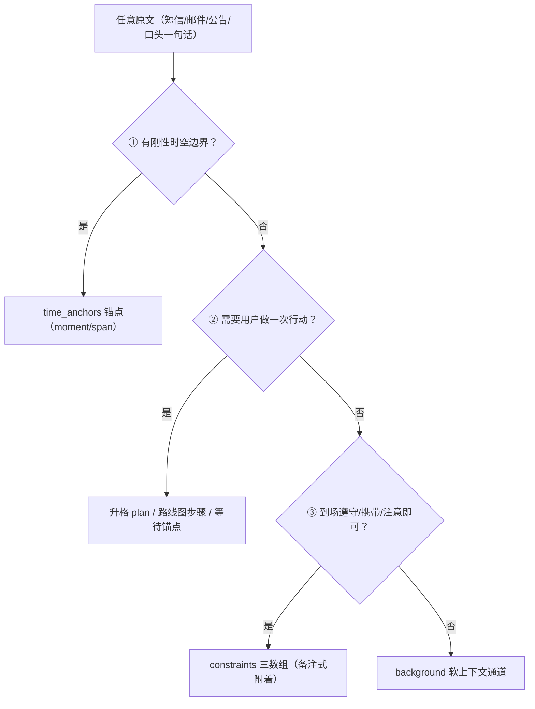
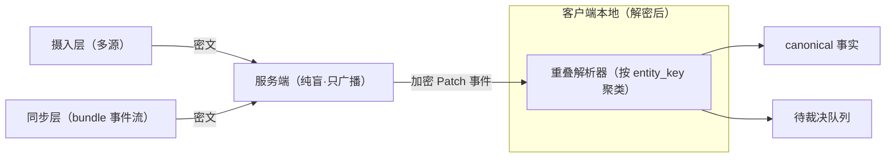

# 事实挂载 · 用户/好友体系 · 外部盲中继 — 设计草案

> **状态**：**定稿已拍板**（2026-10-07 用户拍板：§0 七项+四洞察全部通过；同轮裁决 D2=未归属池宿主挂载 sheet 常驻组；schema 校准 v4——背景侧已占 v3）。拍板留痕=schedule-app §11「事实挂载（artifacts）」「事实摄入与凭证 UI（upsert_facts）」两行；2026-10-07 开工前评审定稿修正 8 项已回改（见 §0 末）；**MVP 六切片已全部落地**（2026-10-08，commit `60c9995`，落地对账见 §8）+ **二期已落地**（2026-10-09 `feat/fact-v15`：临场通关条【分期二】+ 硬红线校验【V1.5】——fact_rules 引擎 + propose/adjust 子树校验 + ActionPassBar + human 角标放行，开工 Blocker 四项与维护性隐患四项裁决见 §9（2026-10-08 拍板））——仅 OCR 图片凭证接入（Q11，V1.5 候补）仍待施工。多人轨（§3–§6）**已于 2026-10-09 用户拍板启动**（Q1–Q10 默认值落定 + 三项工程防线 + Phase 0 停火协议），§13 修正（Q9）已并入 SSOT；实现迁移至 `collab-schedule-draft.md` / `collab-implementation.md`。2026-10-06 起草；2026-10-07 评审收敛（§1/§2 全面重写，收敛记录见 §0）；2026-10-08 施工完成对账 + 二期裁决（§8/§9）。
> **目的**：把「零散事实结构化挂载」「摄入与 AI 结构化管道」「事实看板 UI」与「多人协同/盲中继（多人轨）」合并起草，供评审。
> **标记**：✅ = 已收敛（含 2026-10-07 评审收敛；并入 SSOT 前仍需正式拍板）；❓ = 待定（讨论中，尚未拍板）。
> **关联**：全局 SSOT = `schedule-app.md`（§13 四大铁律现需修正，见 §6）；软背景配套 = `background-context-draft.md`（事实=硬 / 背景=软的分流判据在其 §5）；本体定性 §4（plans=Soul/blocks=Avatar）本草案不修改。

---

## §0 2026-10-07 评审收敛记录

本轮评审将「事实挂载」从概念稿推进到可实施契约。七项收敛结论：

| # | 结论 | 要点 |
|---|---|---|
| 1 | **桌面 AI 是唯一解析器（受控例外见 §1.6）** | 端侧正则/端侧 LLM 否决——双解析器=第二真相；分工铁律「App=台账+裁判，AI=推理」。**移动在途例外（2026-10-09 拍板）**：仅 12306 动车票/国内航司短信/标准酒店确认单 3 类高频凭证，允许端侧「最小确定性模板抽取器」机械速录（纯正则填空、零幻觉、零排程侵入、原文永存可桌面反悔），定性为机械速录而非 AI 推理，严守「App=裁判」 |
| 2 | **独立 `artifacts` 表（schema v4；背景侧已占 v3）** | plans/blocks 挂 JSON 列两案否决（见 §1.1）；plan_id/bundle_id 双可空 + 时间可查询（块-凭证关联已反转至 `blocks.artifact_id`，2026-10-09 修订） |
| 3 | **工具面增补 `upsert_facts`** | 非排程辅助通道，先例=`suggest_user_setting`；读侧零新工具（get_schedule 搭载） |
| 4 | **契约定稿** | 5 类 category + `source_kind` 三级可靠性 + `state/origin` + `time_anchors`（moment/span/rule 三类锚）+ `constraints` 三数组 + `badge` + `attachments` 预留列（恒空，见 §1.2/§1.3） |
| 5 | **展示页不新增 Tab** | 三入口 + 一个全屏凭证 sheet；计划详情「随行凭证」区=聚合主场（§2） |
| 6 | **分享挂载段（仅文本）** | `ACTION_SEND text/plain` 接入 + 挂载 sheet + 未归属池 + raw→structured 提炼闭环；**图片本期不做**（attachments 列预留接口） |
| 7 | **多人/盲中继强制解耦** | §3–§6 多人轨与事实 MVP 分轨推进；§13 地基转向（§6）需用户单独拍板，绝不搭车；**多人轨为规划中的后续阶段**（用户 2026-10-07 确认：本地先行、多人后推），预留策略见 §3.4 |

四个关键设计洞察（评审中确立）：

- **事实存锚点，块存区段**——火车票乘车中段「空白」是分层正确：行动信息天然集中在两端（上车前候车/止检、下车后到站/接驳），中段无可决策事项。乘车期间想做事=plans 分解（SSOT §4「车上 5 小时」已拍板），不是往事实里填内容。
- **事实永不直接上时间轴**——「确定是日程」= AI 据锚点生成/校验 pinned 块，事实作为该块的事实来源挂载显示（§1.4）。
- **归属权在分享瞬间交给人，解析权始终留给 AI**——分享者手里正拿着上下文，最知道属于哪趟行程（§1.7）。
- **四类信息各有归宿**：锚点类管时空、规则类管补全、行动类升格任务、叙事类归背景（§1.6 三刀路由）。

**拍板留痕（2026-10-07）**：七项与四洞察全部通过；同轮裁决 **D2=未归属池 UI 宿主=挂载 sheet 常驻组**（§1.7/§2.1/§8-6 已同步）；§0-2/§1.1/§8-2 schema 校准为 **v4**（背景侧已占 v3，另批迁移）。

**定稿修正（2026-10-07 开工前评审）**：定稿评估报告 8 项核实成立，全部回改——
①**未归属池 App 内派生入口**（§1.7/§2.1/§2.5/§8-6）：挂载 sheet 仅由 ACTION_SEND 触发，不在分享场景的用户对未归属池零可见面（幽灵数据）——计划列表页顶部增「N 条未归属凭证 〉」派生提示行+管理面板（复用常驻组折叠卡片形态），D2 宿主裁决不变；
②**plan_id 投影列双写铁律**（§1.1）：delete_plan detach / 改挂 同事务同步列与 payload JSON，严禁列新 JSON 旧（块-凭证关联已反转至 `blocks.artifact_id`，不再经 artifacts 双写，2026-10-09 修订）；
③**get_schedule 搭载窗对齐实际返回视窗**（§1.6）：无参=当日+次日、days=N 全窗搭载——固定两日窗会让远期硬约束全盲；3 天视窗硬上限外记为已知边界；
④**凭证删除/作废三件套**（§1.2/§1.4/§8-3）：反向销毁防护（删凭证绝不删块，pinned 降格）+ state 增 voided（退票=存证保留、读侧全通道静默）+ DeleteArtifact（仅 human，AI 只可提议）；
⑤**v3 残留校准 4 处**（§1.1×2、§1.2、§3.4）：「v3 可不建…再以 v4 补列」→「v4 可不建…再以 v5 补列」、「v3 建列恒空」→ v4、「多人轨 v5+」→ v5+；
⑥badge UI 渲染防御（§1.2）：maxWidth 96dp + ellipsis，标题空间优先；
⑦跨午夜一致性比对折算口径（§1.3）：绝对时间轴分钟统一折算，禁同日直比；
⑧hero_metrics 命令层截断（§2.2）：超 3 项截前 3 落库不阻断。schedule-app §11 两行已同步校准。

**施工期拍板与裁决留痕（2026-10-08）**：①**出生确认条款**（§1.2：raw 入册以 `verbal`/`verbal` 占位 → 首次 `structured` 回填允许 AI 定 `category`/`source_kind` 终值 → `structured` 后恒不可变）；②**`upcoming_facts` 边界补全**（§1.6：`get_schedule` 追加视窗外 ~14 天 structured 凭证四字段轻量投影）；两项均已同步 schedule-app §11。③**开工 Blocker 四项 + 维护性隐患四项**逐条拍板（含 Q-A/B/C 三选一），见 §9；④**voided 双通道口径**（排程读侧静默 / UI 折叠组可见）与 unvoid 双向，见 §1.2。

---

## §1 事实挂载（Facts / Artifacts）：数据层与摄入管道

**✅ 原则**：零散事实性信息（车票/机票/门票、酒店预订、场馆通知、场地政策、口头一句话）**不能作为普通备注**，必须结构化入 `artifacts` 表；不为每类票务单独建表（拖垮轻量架构）。

### 1.1 存储裁决：独立 artifacts 表（schema v4，✅）

| 方案 | 裁决理由 |
|---|---|
| plans 加 JSON 列 | ❌ 临场查询要全表扫+逐行解析 JSON，无法按时间检索 |
| blocks 加 JSON 列 | ❌ 买票先于排程（块尚不存在）；酒店确认单横跨多日无对应块；块 melted/archived 后凭证挂靠悬空——**凭证必须比块长寿**（改签/退票后事实仍在） |
| **独立 `artifacts` 表** | ✅ 时间检索、比块长寿、跨块挂载三全；v3→v4 分段幂等迁移模式现成（`db.dart` 拾贝模式；背景侧已占 v3） |

表形态要点：`artifacts(id, category, source_kind, state, origin, title, badge, payload TEXT, attachments TEXT, captured_by, plan_id?, bundle_id?, created_at, updated_at, version)`。**块-凭证关联反转（2026-10-09 回改）**：凭证不再持有 `block_id`；反向由 `blocks` 表持有 `artifact_id`（1:N，酒店/门票一证多块各引；往返票按 Leg 拆独立凭证，§9.5-6 二次修订），见 §3.4 / §9.5-6。**schema 版本账目（v0.1.6 校准）**：v4=已交付 MVP 基线（`artifacts.block_id` 在位，commit `60c9995`）；v5=反转关联迁移（`blocks` ADD `artifact_id`、`artifacts` ADD `bundle_id`、DROP `block_id` + payload 投影清洗）与 collab_* 新表合并为一次幂等迁移（collab-implementation §3.1）——存量设备必须先过 v5 再执行反转查询，否则 `no such column` 当场崩溃。

- 元数据列（category/state/origin/title/badge/captured_by）= payload 对应字段的提取投影（过滤/排序用），命令层与 payload 同源写入，payload 为单一真相。
- **投影列双写铁律（2026-10-07 定稿修正，2026-10-09 修订）**：`plan_id` 不在元数据投影中、但为 §1.2 契约 JSON 字段——**所有修改 `plan_id` 的命令（`delete_plan` detach / UpsertFacts 改挂）必须在同一事务内同步更新 SQLite 列与 payload 内对应字段**。块-凭证关联已反转至 `blocks.artifact_id`（§9.5-6），**不再经 artifacts 双写**——`UpsertFacts` 不写块绑定，CONFIRMED 下沉时由客户端按 `target_step_ref`→`collab_block_refs.step_id` 反查后单事务回填 `blocks.artifact_id`（§5.5 / collab §11.3）。严禁列与 JSON 矛盾（第二真相，读 payload 或导出全量 JSON 时即爆）。
- `payload` = §1.2 契约 JSON（单一真相），**首字段固定 `"v": 1`**（契约内嵌版本，反序列化按 v 分支——attachments 启用等契约演进时旧数据零猜测）；`attachments` = §1.2 预留列，MVP 恒存空数组。
- 时间检索：单次行程凭证量级仅十几条，v4 可不建提取冗余列（`json_extract` 或全表过滤足够）；若后续需要再以 v5 迁移补列——迁移模式现成，避免预铺。
- **外键与删除处置（仓库口径：外键 NO ACTION 做护栏，删除处置归命令层）**：`plan_id REFERENCES plans(id)` 不带 ON DELETE；新增 `bundle_id VARCHAR(64)` **弱引用、不设外键**——协同协商期（`PROPOSED`/`STALLED`）凭证挂靠方案包但不持 plan（见 §5.5）。**块-凭证关联反转（2026-10-09）**：凭证不再持 `block_id`，改为 `blocks.artifact_id` 软引用（凭证比块长寿，块删仅置空 artifact_id 不牵连凭证）。`delete_plan` 命令同事务处置两新表：**背景级联销毁**（语境随本体消亡，见背景草案 §2）/ **artifacts detach 至「未归属池」**（plan_id 置 null、`bundle_id` 置 null——凭证=现实存证，删计划≠删现实），结果 note 交代去向「N 条凭证已移入未归属」。**未归属池查询口径收敛为 `plan_id IS NULL AND bundle_id IS NULL`**；`bundle_id = ?` 仅在该 Bundle 详情看板聚合，绝不污染未归属池（§5.5）。
- 导出 JSON（SSOT §11「数据出口=全量」）须带全 artifacts，文档向用户明示凭证含证件/订单等敏感信息。

### 1.2 统一 JSON 契约（定稿 ✅）

```json
{
  "id": "art_d8724",
  "category": "transit",
  "source_kind": "booking",
  "state": "structured",
  "origin": "shared",
  "title": "大理→丽江 动车 D8724",
  "badge": "05车12F",
  "hero_metrics": [
    {"k": "车厢/座位", "v": "05车 12F（靠窗）"},
    {"k": "检票口", "v": "2B"}
  ],
  "time_anchors": [
    {"role": "停止检票", "kind": "moment", "date": "2026-10-20", "min": 525},
    {"role": "发车", "kind": "moment", "date": "2026-10-20", "min": 540},
    {"role": "到达", "kind": "moment", "date": "2026-10-20", "min": 680},
    {"role": "乘车", "kind": "span", "date": "2026-10-20", "start_min": 540, "end_min": 680}
  ],
  "location": "大理站 2B 检票口",
  "constraints": {
    "required_items": ["凭二代身份证进站", "提前 45 分钟到站"],
    "rules": ["全程禁烟", "不可携带自热食品"],
    "notices": ["如遇大风索道可能临时停运"],
    "advance_arrival_minutes": 45,
    "forbidden_weekdays": [],
    "daily_deadline_min": null
  },
  "attachments": [],
  "copyable_code": "E198273645",
  "contact_phone": null,
  "raw_text": "【12306】赵志恒先生，您已购10月20日D8724次大理站09:00开……",
  "plan_id": "<行程/筹备计划id>",
  "target_step_ref": "<协同场景：本凭证对应的 bundle step_uid，CONFIRMED 下沉时经 collab_block_refs 反查回填 blocks.artifact_id；单机摄入/未归属恒为 null>"
}
```

字段规则：

- **枚举收敛**：`category` = `transit | ticket | hotel | venue | verbal`（场馆通知与场地政策合并为 `venue`——通知=带时间锚部分落 time_anchors，政策=长期规则落 constraints）；`source_kind` = `booking`（官方预订凭证）| `announcement`（官方公告/政策）| `verbal`（口头转述）；`state` = `raw | structured | voided`（`voided`=退票/取消作废，2026-10-07 定稿修正——凭证=现实存证，退票本身也是现实，**存证保留不删**；**双通道口径（2026-10-08 拍板，原「读侧全通道静默 + UI 弱化显示」自相矛盾，此处定死）**：①**排程/临场读侧全静默**——不进 get_schedule 搭载/临场通关条候选/一致性比对/凭证计数（SQL 白名单 `state='structured'`，§8 约定 3 照旧）；②**UI 通道单独放行**——凭证子页底部「**已作废 · N 条**」折叠组可见（查看/长按删除，删除仅 human，与「过去的凭证」并列同款折叠卡片）；voided 由 AI actor 经用户对话同意后写入，**可回改（unvoid）：`voided ↔ structured` 双向可行**（AI 须经用户同意 / human 长按），**`raw → structured` 一旦发生不可逆**（出生确认条款同口径）；物理删除仅 human 通道，分工见 §1.4）；`origin` = `shared | quicknote | ai | manual`。
- **出生不可变 + 出生确认（2026-10-08 施工定案）**：`category`/`source_kind`/`origin`/`captured_by` 出生不可变（编辑路径忽略传入，patch 白名单不含），例外一项——**raw 入册以 `verbal`/`verbal` 占位**（系统分享/快记入册零解析，AI 不在场定不了正确类别，猜即第二真相）；**首次** raw→structured 回填视为**出生确认**：命令层允许 AI 定 category/source_kind 终值（枚举严进照旧），structured 后恒不可变。调和三方：必填枚举字段 vs 零解析 raw 入册 vs AI 回填需定正确类别（金样本 A2 终态 = transit/booking）。
- **机读/展示分离**：凡是引擎要用的字段一律数字/日期（`min` 与 blocks 同口径 0..1439），凡是给人看的一律 label 串；「建议到站 08:15」由 `advance_arrival_minutes` 推导，不存第二份。
- **时区锚 `tz`（v0.1.6 跨时区补全，可选字段）**：任一锚点可携带可选 `tz`（UTC 偏移如 `"+09:00"` 或 IANA 名），span 锚另支持可选 `end_tz`（红眼跨日航班）；**缺省即本地墙钟语义，存量数据零迁移**。跨时区行程（北京 14:00 起飞 / 东京 18:00 落地）在出发/到达 moment 锚各带当地 `tz`；凡锚点间 `tz` 互异的时长计算、跨午夜判定与 span 一致性比对，**先按偏移折算绝对时刻再运算**，展示仍格式化为当地墙钟。与 §9.4「禁 `toUtc()`」铁律不冲突：该铁律约束**判定钟 `now_local` 的取法**，不禁止锚间跨时区折算。
- **`badge`**：时间轴微标透出的**单值**（`05车12F`），由 AI 显式指定且仅 booking 类设置——推导 `hero_metrics[0]` 会猜错语义（预约段与预约码谁排第一是语义问题）。命令层**超 12 字符截断**（微标渲染于最小 44dp 高的块卡，UI 空间硬约束——截断优于拒绝），工具描述同步约束；UI 渲染层防御（2026-10-07 定稿修正）：**maxWidth 96dp + ellipsis 硬截断、标题空间优先**——12 全角字符 ≈168dp@14sp，360dp 屏足以挤死标题，命令层+渲染层双层防御缺一不可。
- **`raw_text` 永存原文**，防解析失真；解析置信度低的槽位**宁可留空不猜**——空槽位 UI 逐层隐藏（§2.2），零成本兜底。
- **`constraints` 三数组语义**：`required_items`（要求：需要做/需要带）/ `rules`（禁止：不可以做的事）/ `notices`（提示：中性注意事项）。机读规则参数同挂此处（`forbidden_weekdays` 周几禁排 / `daily_deadline_min` 每日止检止入场）。
- **`attachments` 预留（✅ 接口先立、逻辑不写）**：未来形态 `[{"type": "image", "path": "...", "w": 0, "h": 0}]`；v4 建列恒空、UI 见空忽略、工具面 MVP 不暴露此入参（AI 无图可写），将来图片走 human 通道写入，零迁移演进。
- **`target_step_ref`（协同可选）**：指向本凭证归属的 bundle `step_uid`（如「去程乘车块」）。由发起/成员在 `ATTACH_FACT` 明文 payload 内携带；CONFIRMED 下沉时客户端据其经 `collab_block_refs.step_id` 反查目标 block 并单事务回填 `blocks.artifact_id`（§5.5 / collab §11.3）。单机摄入、未归属凭证恒为 `null`；**块-凭证关联反转后，凭证侧不再存 `block_id`，绑定唯一落点即 `blocks.artifact_id`**。
- **多人预留（✅ 2026-10-07 用户确认：本地先行、多人后推）**：`captured_by`（DEFAULT 'me'）作为身份形状钉子**现在进表**——roster/用户体系落地后回填真实身份；`entity_key`/`merge_state`/`conflict_group`/`subject_ids` 等机器类字段延后不预置（每项=一个可空列迁移+回填，零破坏，见 §3.4 预留清单）。

### 1.3 时间锚三类（time_anchors，✅）

时间结构为**锚点数组**而非单日期字段——单日期模型装不下酒店跨日（入住 10-17 / 退房 10-19），这是契约升级的直接动因。每个锚带一个 `kind`：

| kind | 语义 | 例 | 引擎用途 | UI 渲染 | AI 用途 |
|---|---|---|---|---|---|
| **moment** | 时刻 | 止检 08:45 / 发车 09:00 / 每日 16:00 停止入场 | 临场通关条触发（**判据=role 受控枚举，公式=T_action−advance−120，2026-10-08 裁决见 §9.1**，原「−2h 或 −advance」表述作废；**min≠null 刚性前置**，v0.1.6）；V1.5 红线校验 | 时空网格单行时间，deadline 类加 ⚠ | 提案推理避开 |
| **span** | 区段/持续状态 | 乘车 09:00–11:20 / 入住 10-17~10-19 / 索道进闸段 10:30–11:00 | 与关联块起止**一致性比对**（改签琥珀提示的数据源） | 卡上区间行「10-17 → 10-19 · 3 晚」 | 知道这段时间人在哪 |
| **rule** | 长期规则 | 周一闭馆 / 禁三脚架 / 限带一件行李 | V1.5 红线校验输入 | 规则 Chip 流，**永不上时间轴** | 主动规避 |

- span 支持跨日：`{"kind": "span", "date": "2026-10-17", "end_date": "2026-10-19"}`（`end_date` 缺省=单日）；moment 支持无 `min`（纯日期锚，如入住日）。
- **跨午夜折算口径（2026-10-07 定稿修正）**：跨日 span 与跨午夜块（按开始日归属、不拆段，`end_min < start_min` 视为溢出次日）做一致性比对时，**两侧统一折算绝对时间轴分钟**——锚侧 `(end_date − date) × 1440 + end_min`，块侧 `end_min < start_min` 时 +1440——严禁同日内直接比 start_min/end_min（红眼航班 22:30→次日 06:00 会被误判为负时长/不一致）。
- rule 类的机读参数挂 `constraints`（`forbidden_weekdays` / `daily_deadline_min`），纯文本规则留 `rules`/`notices` 数组。
- **一律日历日**：anchors 的 `date` 与 propose 的 `date` 参数同口径（YYYY-MM-DD）；**严禁拿作息日（wake_time 切割）做日期窗过滤与临场计算**——作息日是日切/复盘口径，日期窗是排程意图口径，混用即第二真相（背景草案 §2 applicable_dates 同款钉子）。

### 1.4 升格语义与一致性（✅）


- **事实层/块层分工**：事实存锚点（边界），块存区段（肉身）——乘车中段在凭证卡上「没有可行动信息」不是缺失；时间轴块只需 pinned 无需内容。
- **改签 SOP**（playbook 定死顺序）：先更 fact（新短信→upsert 同一 artifact）再挪块，同轮对话完成；**挪块由人执行**——乘车块是 pinned（人终审件，和平条款 AI 不可挪），AI 报出新起止引导用户点块改时间；一致性琥珀提示为派生比对（不入库），兜住两步遗漏。
- **反向销毁防护（2026-10-07 定稿修正）**：删除/退订凭证**绝不物理删除块**——凭证可能是块的升格来源，机械级联删块会砸碎用户已有日程骨架。删凭证/凭证 voided 后：关联块失去事实来源挂载（`blocks.artifact_id` 置空 → 🎫 微标自然消失、一致性比对无源自熄），并从 pinned **降格为普通可调块**（解除锚定，交回晨间 propose 重排或用户手动裁决）——改签 SOP 的镜像面：先废（或更）fact 再动块，同轮完成。
- **退票与删除分工（2026-10-07 定稿修正）**：退票/取消=state 置 `voided` 留档（存证不删，§1.2）；物理删除仅 human 通道（清理误分享的无关文本），AI 无删除权、只可提议。
- **升格通道**：moment 驱动块生成与止检红线；span 与块对齐；rule 只约束提案——事实本身永不直接成为时间轴条目。

### 1.5 反哺排程裁决（✅）

| 主张 | 裁决 |
|---|---|
| 钉死骨架 | **零新机制**——事实派生的块就是 pinned 块；`adjust_blocks add` 默认 pinned + 硬行程豁免填充率聚合（memory 口径已拍板） |
| 自动派生赶路缓冲 | **走 playbook 不走引擎**：AI 读 `advance_arrival_minutes` 后在 propose 里自带「前往车站」块（重叠校验天然锁死该段）。**缓冲块不 pinned**——pinned 块 AI 自己也挪不动，改签时反而卡死；普通 AI 块被水流融化后晨间 propose 重排，自愈。机械自动注块会造出用户未确认的块，违反「人=终审」 |
| 行前清单 | **凭证卡自带**（required_items Chip 即清单）+ AI 把「带身份证/氧气」写进 T-1 路线图步骤（金样本 #4 幕 3 既有形态）——零 schema |
| 闭馆日硬红线 | **V1.5 机械校验**：propose/adjust 时校验关联 plan 的 artifacts（forbidden_weekdays 撞星期 / start_min 晚于 deadline_min / daily_deadline_min → `schedule_rejected` 逐条原因）。**范围=本 plan 及递归子树、rule 生效窗=`rule_scope` 必填、刻度不对称（human 放行）——2026-10-08 裁决见 §9.2/§9.3**。MVP 先靠 get_schedule 搭载让 AI 自觉，机械红线二步走——契合「App=裁判」哲学的正规增量，但不与 MVP 搭车 |

### 1.6 摄入管道：三通道与三刀路由（✅）



三刀路由的分界示例：**「提前 45 分钟到站」是规则**（到场遵守即可，留 constraints）；**「提前一天去银行换外币」是行动**（要专门跑一趟，升格筹备线一步）。规则类永不生成任务、永不打勾——它是日程的注释层，唯一离开注释层的出口是第②刀。

摄入三通道（解析主收敛到桌面 AI，端侧零解析；**受控例外**=移动在途场景允许端侧最小确定性模板抽取器，仅覆盖 12306 动车票/国内航司短信/标准酒店确认单 3 类高频凭证，纯正则机械速录、零幻觉、零排程侵入、原文永存可桌面反悔，定性为机械速录而非 AI 推理，见 §0 决策 1）：

| 通道 | 流程 | 定位 |
|---|---|---|
| 桌面对话投喂 | 用户贴短信/邮件/截图（桌面 AI 有视觉）→ AI 解析 → `upsert_facts` | **主通道**，与 dump SOP 同构 |
| 手机快记粘贴 | 复制短信 → 快记 FAB 整段粘贴 → title 原样落库 → 下一轮桌面 AI `list_plans` 见长文本 → 消化：改短标题、原文进 raw_text、要素进槽位；**事实类消化完成后同轮归档原快记 plan**（防长文本孤岛残留，§8 约定 2） | **零成本旁路**（title 字段语义本就「原样保留」，零新 UI） |
| 系统分享（仅文本） | 外部 app 分享面板选「拾光」（`ACTION_SEND text/plain`）→ 挂载 sheet → 见 §1.7 | 分享直达，AI 不在场 |

**图片边界（诚实声明）**：MVP 只接 text/plain——intent-filter 不声明 image 类型，截图在系统分享面板里根本不出现「拾光」目标，从源头杜绝「接进来却读不了」的半成品体验。将来接入候选=端侧 OCR 取字（机械动作，不违反零端侧 LLM——取字是机械的，**解释**仍只归桌面 AI）→ 文本进既有管道；接入深度与时机见 §7-Q11。

**AI 消费（防上下文膨胀纪律）**：`get_schedule` 返回体搭载凭证摘要（category/title/badge/最早 deadline_min，≈100 token/日，照天气投影搭载模式——propose 前必读使硬约束自动到达 AI 视线）；**搭载窗口对齐实际返回视窗（2026-10-07 定稿修正——原固定「当日+次日」会让远期硬约束全盲：周三排周五到周日，days=3 拿得到日程却拿不到周五车票凭证）**：无参=当日+次日、`days=N` 时 N 天全窗搭载；**已知边界**：视窗硬上限 3 天（schedule-app 工具面拍板），视窗外结构化凭证 AI 无读通道——晨间 propose 每日节奏下当日凭证当日达，主流程自洽，「提前多日整段排行程」的远期咨询记为已知边界，必要时 V1.5 挂账；`list_plans` 快照带 state=raw 计数+摘要。**边界补全（2026-10-08 拍板，MCP 端到端实测发现的盲区提前落地）**：`get_schedule` 返回体追加 `upcoming_facts`——视窗末日之后 ~14 天内的 structured 凭证按最早锚 date 升序投影 `date/title/deadline_min/plan_title` 四个轻量字段（不带锚数组/constraints，防上下文膨胀，与 list_plans「归档冷数据不拉」同原则）；AI 对 upcoming_facts 行程做规划时，锚点时间为硬约束（propose 的跨日红线校验二步走不变，MVP 仍靠 AI 自觉避开）。多计划同日时，凭证摘要与背景同款**按计划分组注入**（背景草案 §4 分区装配）。凭证全文只进 UI，不进 AI 上下文。

### 1.7 生命周期与人机分工（✅）

```
系统分享面板选「拾光」（仅 text/plain）
  → ① 原文入册：整段文本原样存为 raw 凭证（state=raw，一字不解析）
  → ② 挂载到计划：挂载 sheet 选目标计划（人指定；找不到 → 「先记下，稍后归属」= plan_id 置空）
  → ③ AI 提炼：下一轮桌面 AI 会话消化 raw → 回填同一条 artifact 槽位（id 不变、原文永存，state=structured；**出生确认**：本次将 category/source_kind 自 verbal 占位定终值，见 §1.2）
```

- 挂载 sheet：预填原文 → 计划搜索/最近/行程例外日置顶 → 确认，两次点击内完成，不过度打断分享原任务；顶部常驻「未归属 N 条」折叠组（未归属池宿主，见下条）。
- **未归属池**：plan_id=null 的凭证派生为「未归属 N 条」折叠组，**宿主=分享挂载 sheet 常驻组**（2026-10-07 D2 拍板——计划详情凭证区按 plan 组织，无宿主条目不进计划页；分享场景顺手归属，AI 对话主动提议归属为主回收通道）；AI 下一轮主动提议归属（「这条 D8724 短信看起来属于云南行，已挂到筹备计划」），人在 app 内长按凭证卡可改挂（human 通道，人=终审）。
- **App 内访问主场（2026-10-07 定稿修正，堵 D2 断层）**：挂载 sheet 仅由系统分享（ACTION_SEND）触发——不在分享动作里的用户对未归属池零可见面（幽灵数据）。**计划列表页顶部增派生提示行「N 条未归属凭证 〉」**（N=0 隐藏；派生计数不入库，与「过去的凭证」同纪律），点击打开**未归属管理面板**（复用挂载 sheet 常驻组的折叠卡片列表形态：查看/长按改挂/删除，删除=DeleteArtifact 仅 human）。D2 宿主裁决不变——详情页不混入未归属条目照旧，只是给常驻组补一个不借道分享的入口；界面文案先入 ui-spec §0.4（词条已备 §2.5）。
- **AI 消化 SOP**（playbook `facts.md`）：`list_plans` 见「N 条原文待提炼」→ 读 raw_text 解析 → `upsert_facts` 回填槽位（含出生确认，见 §1.2）→ 归属建议。将来 MCP prompts 实装时同源收编（SSOT 实现差异 6 的顺带兑现）。

人机分工对照（与对话路径的差异）：

| 环节 | 对话投喂 | 系统分享 |
|---|---|---|
| 提供原文 | 用户贴给 AI | share intent 直达 app（AI 不在场） |
| **归属判断** | AI 按上下文推断 | **人当场选计划** |
| 结构化解析 | AI（同步） | AI（延迟到下一轮会话，不阻塞分享动作） |
| 归属纠正 | 人否决/改 | 人长按改挂 |

---

## §2 事实看板 UI（随行凭证 / Fact Capsule）

**✅ 方案**：基于槽位协议的自适应卡包（Slot Assembler），不为任何门类硬编码 UI。**不新增底部 Tab**（凭证不加第四 Tab；底部现为「日程｜清单｜设置」三 Tab——设置迁入第三 Tab 系 2026-10-08 用户拍板，原「双 Tab 拍板结构不动」就此修订）——三个入口 + 一个全屏凭证 sheet。

### 2.1 页面定位与三入口（✅）

| 入口 | 形态 | 分期 |
|---|---|---|
| ① 计划详情「随行凭证」区 | 计划详情页新增一节（与 spec/路线图/notes/open_items/子树/犒赏并列），列出该 plan（含**子树派生聚合**）名下全部凭证——**一趟旅行的根计划详情页天然就是「行程凭证总览页」**，即「灵活页面」本体，零新导航。每条=紧凑卡（类别图标+title+badge+日期）；全部锚点最晚日历日早于今日的派生折叠进「过去的凭证」组（span 取 end_date）；**`voided` 沉底部「已作废 · N 条」折叠组**（2026-10-08 拍板，§1.2——排程读侧仍全静默，只有 UI 这一条出口）；plan_id=null 条目不进计划页（宿主=挂载 sheet 常驻组+计划列表页未归属入口，见 §1.7） | MVP（voided 折叠组为新增待施工） |
| ② 时间轴 🎫 微标 → 块浮层 | BlockRenderer 来源角标体系（📋/📌）加 🎫，微标文本=`badge` 字段；点块开浮层见通关卡 | MVP |
| ③ 临场通关条 | 今日页顶部派生条：开始前 2h 内的凭证自动吸附（artifacts 按锚点范围查询，**派生不入库**，与补给带同纪律） | 分期二 |

**未归属管理面板（2026-10-07 定稿修正）**：计划列表页顶部「N 条未归属凭证 〉」派生提示行唤起（§1.7），复用挂载 sheet 常驻组形态——不是第 4 个凭证展示入口，是未归属池的 App 内主场。

### 2.2 四层槽位 + 功能动作（✅）

| 层 | 字段 | 渲染规格 | 空态 |
|---|---|---|---|
| Header | category 图标+白话类别、title、日期 | 药丸微标 + 莫兰迪底色（tokens 体系） | — |
| **通关区（Hero）** | `hero_metrics`（≤3 组 KV；AI 传入超 3 项时命令层**截前 3 落库不阻断**——与 badge「截断优于拒绝」同款，工具描述同步约束 ≤3，2026-10-07 定稿修正） | 特大加粗字、高对比底色卡（新 token `voucherSurface`，色系近 sparkCapsule 琥珀**而非庆祝金**——庆祝金语义专属犒劳时刻）。**字级纪律**：SSOT §0.2 拍板「启动第一步 title·large 是全 app 最大的字」，凭证卡数值用 title·medium 级、「马上开始」居于其上，检票口场景两者同屏首屏可见不互相夺焦 | hero_metrics 空 → 整层不渲染 |
| 时空网格 | time_anchors 的 label 化 + location | 双列 KV 紧凑网格；deadline 类加 ⚠ 前缀 | 无锚 → 不渲染 |
| 行动约束 | required_items / rules / notices | Chip 流（Wrap）：🚫 禁止=中性灰（**绝不用红**——禁令不是失败，红色语义全 app 保留）、☑ 要求=清单样式、ℹ 提示=琥珀淡标 | 逐数组判空显隐 |
| 功能动作 | copyable_code→复制；contact_phone→`tel:` 拨号；location→`geo:` 外部地图 | 原生按钮行，**零新权限**（全 intent） | 逐项判空显隐 |
| 溯源 | raw_text 折叠手风琴 + 一致性琥珀提示（§1.4） | 默认折叠「查看原文」；与关联块时间不一致时卡片顶部常驻琥珀条 | raw_text 空 → 不渲染 |

**零任务压力纪律**：约束层是日程的注释层——不打勾、不计数、不进完成率、不生成待办卡；与中性语言禁令、「时间轴保持空灵」同源（§1.6 第②刀是其唯一任务化出口）。

### 2.3 信任分层与微标纪律（✅）

| source_kind | 卡片样式 |
|---|---|
| booking | 完整通关卡样式（Hero 层可亮） |
| announcement | 常规卡 |
| verbal | 💬 弱化卡 + 琥珀「口头信息 · 待核实」角标（sparkStroke token，不引新色） |

- **verbal 永不参与硬红线**——口信可能过时或听错；AI 排程只做软权重（提案避开、理由区注明「据口头信息，建议核实」），核实的主动权留给用户（与「多人可用性假设标注」同一精神）。
- **verbal 三去向**：①带时间锚的话（「老板说周三索道检修」）→ verbal fact + 软权重；②是承诺/等待的话（「小李说周五答复」）→ 主体转**等待锚点**机制（10 分钟唤醒块），fact 留档溯源；③纯偏好 → background 通道。
- **时间轴微标纪律**：仅 AI 显式设置 `badge` 的凭证（基本只有 booking 类）在时间轴块上透出微标——口信、政策不上时间轴。

### 2.4 渲染引擎：Slot Assembler（✅）

单一 `FactDetailSheet(fact)` 按序装配，空层自动消失：Header 药丸 → Hero 通关卡（hero_metrics 非空才渲染）→ 时空网格 → 约束 Chip 流 → 功能按钮行 → 溯源折叠（含一致性提示）。任何类别（车票/索道票/博物馆须知/酒店/口信）都是同一套 Widget 的填空组合，**不存在「第七种页面」**。

类别映射验收例：动车票 hero=`D8724 / 05车12F / 2B检票口`；索道票 hero=`预约段 10:30–11:00 / 预约码 994821`；博物馆须知无 hero（整层消失）、时空网格扛鼎=`周一闭馆 / 16:00 停止入场`；酒店 hero=`确认号 / 入住 10-17 / 离店 10-19`；口信卡=💬+原话+待核实。

### 2.5 词汇表建议（先入 ui-spec §0.4 再上屏，硬纪律）

| 内部术语 | 界面文案 |
|---|---|
| 事实挂载 / artifacts | **随行凭证**（页面/分区名） |
| category 五类 | 交通 / 门票 / 住宿 / 须知 / 口头信息 |
| raw 凭证 | **待提炼的原文** |
| plan_id=null 派生组 | **未归属**；分享时兜底动作=「先记下，稍后归属」 |
| 未归属 App 内入口（定稿修正） | 计划列表页提示行「N 条未归属凭证」→「未归属凭证」管理面板 |
| voided 凭证 | 折叠组「**已作废 · N 条**」；卡面弱化标「**已作废**」（弱化卡，同 verbal 精神） |
| 一致性提示 | 「与日程时间不一致，点此核对」 |
| 溯源折叠 | 「查看原文」 |
| verbal 角标 | 「口头信息 · 待核实」 |
| 过期分组 | 「过去的凭证」 |
| backgrounds 过期折叠组（背景草案 §3/Q6） | 「过去的背景」 |
| applicable_dates 呈现（背景草案 §3/Q6） | 日期角标 `[10.08–10.10]` |

---

## §3 用户与好友体系（多人轨，与事实 MVP 解耦）

> **解耦声明（2026-10-07）**：本节及 §4–§6 为多人轨，与事实 MVP **分轨推进**——事实本地版先行，将来若重开同步只是多一个摄入源，解析逻辑零改写（§4 架构原则）。§13 修正（§6）需用户单独拍板，不与事实 MVP 搭车。

### 3.1 本地 roster（✅ 方向，客户端）

`roster` 表（纯本地，零同步）：

```
roster(id, display_name, relation[me|family|friend|other], is_self, color)
```

- 「我」是一行 `is_self=true` 的种子数据。
- 用于事实归属标签（`captured_by`、`subject_ids`）与分享目标选择。

### 3.2 服务器用户体系（❓→✅ 骨架，细节待定）

> **修订（2026-10-11，账号体系 Plan A 落地）**：本节以下「user_id 客户端自生成 + PoP 自签登录」的匿名骨架已被**用户名+密码账号体系**取代——注册 `POST /v1/users` 携 `username`+`password`+公钥材料（user_id 由服务端发号，PoW 保留、PoP 取消），登录 `POST /v1/auth/login` 纯密码验哈希换双 Token（用户不存在与密码错误同一 401 口径），改密 `POST /v1/auth/change-password`，用户名搜索加好友 `GET /v1/users/lookup` + `POST /v1/friends/request` 与扫码 Ticket 双通道并存。契约 SSOT=relay 仓 README 版本账（Plan A 已实现）；端侧门禁同步改为「登录态判定」，口令解锁层退役（schedule-app §11 拍板行「用户体系 Plan A：登录态门禁」）。**v2 补记（2026-10-11）**：契约新增 logout（双 jti 拉黑）/ 自账户 `GET|PATCH /v1/users/me`（recovery_vault 取回=换机恢复链路闭环）/ 好友关系管理（DELETE 解除三合一 + block 拉黑），并定死三硬约束——refresh 强制轮换（重用即 `TOKEN_REVOKED`）、改密踢会话（纪元 `TOKEN_STALE`）、access 只存内存；端侧对齐见 §11 v2 拍板行。下文保留作设计推演留痕。

**结论（2026-10-06 推导）**：朋友邀约要能被服务器撮合，服务器必须认得「谁是谁」——纯 plan-token 盲中继做不到「A 邀请 B 成为好友」。故服务器需最小用户体系（**Tier 2**，非纯 Tier 1 盲中继）。

最小契约（✅ 骨架，已与冻结契约 relay_protocol.proto v0.1.6-contract 对齐）：

- 注册：`POST /v1/users` —— `user_id`(客户端自生成 UUID) + `identity_key_pub` + `signed_prekey_pub` + `push_token` + `encrypted_profile`(端侧全密文，含昵称/备注) + `signed_pop`(对服务端 challenge 的 Ed25519 签名) + `pow_solution`(Hashcash)。**服务端零明文昵称**——`display_name` 已剔除，昵称仅存 `encrypted_profile`。
- 鉴权：双 Token（access/refresh），详见 `collab-schedule-draft.md §1.4`；请求外层强制 `client_msg_id` + 时间戳，服务端 Redis `SETEX 300` 幂等去重（防重放）。
- 好友：`POST /v1/friends/invite {ticket, encrypted_intro}` —— 凭**好友凭证 Ticket**（二维码/防篡改签名，含短期 nonce + 过期时间 + B 自签名），服务端验签通过才写 `friendships(status=pending, encrypted_intro)`；`encrypted_intro`=A 用 Ticket 内 B 的 **X25519 加密公钥**（`enc_key_pub`=signed_prekey_pub）做 ECIES（X25519+HKDF+AES-256-GCM）加密的自报家门（解纯 UUID 审批死锁；**Ticket 不携 Ed25519 身份钥做加密**——签名钥与加密钥坐标系不同，跨端 ECIES 直用必炸）；杜绝 `to_user` 撞库。
- `POST /v1/friends/accept {invite_id}`（客户端手动批准，不自动）、`GET /v1/friends`（pending/accepted 状态）。

### 3.3 客户端边界策略（✅ 方向）

- **不自动接受陌生入站邀请**：`pending` 邀请默认不自动接受，仅用户手动 approve。
- **封闭朋友圈**：协作仅限本地已知朋友 + 用户显式打开的 plan token；App 不向用户推送随机陌生人的好友/plan 邀请。
- 即：**服务器提供邀请/撮合能力，客户端守边界**（与「不接受另外人的邀请」一致）。

### 3.4 多人轨预留清单（✅ 方向；预留原则 2026-10-07 用户确认）

**预留原则：形状现在钉，机器后补且零破坏。**

- **现在就钉的「形状」**（定义数据语义、成本低）：UUID 主键（已有）、CommandHandler 唯一写入口（已有——未来同步只是多一个写入源走同一管道）、字段级 patch+乐观锁 CAS（已有）、origin/source 溯源字段（已有）、导出 JSON 全量（已有，备份/恢复=同步的地基）、**captured_by（DEFAULT 'me'，2026-10-07 新增进 artifacts 与 backgrounds 两表）**。
- **延后补的「机器」**：每项 = 一个可空列迁移 + 回填，分段幂等迁移模式现成（`db.dart` 拾贝模式），对存量数据零破坏：

| 字段 | 补进时机 | 回填/迁移路径 |
|---|---|---|
| `entity_key` | 多人轨 v5+ | 对存量行跑派生规则回填 |
| `merge_state` / `conflict_group` | 多人轨 v5+ | 存量行默认 canonical |
| `subject_ids` | 多人轨 v5+ | 缺省=本人 |
| `privacy_level` | 中继轨 | 存量默认 local_only |
| `is_deleted`（墓碑） | 中继轨 | 开同步时以「基线快照+此后墓碑」衔接，本地 MVP 真删即可 |
| `ai_visible` | 中继轨（共享场景） | 存量默认可见 |

- `created_by` / `shared_scope` 复用前期多人提案口径，随 roster 一并落地。
- 本地 MVP 的硬删除与未来增量同步的衔接：新设备/新通道首次同步取基线快照，此后变更走墓碑——无需现在预支软删复杂度。

---

## §4 多事实源重叠解析（多人轨）

**✅ 核心洞察**：「重叠」拆成三种不同的事，解法完全不同。

| 类型 | 含义 | 处理 |
|---|---|---|
| **重复 Duplicate** | 同个 `entity_key` 出现两次（如两人各转一次 D8724 短信） | 去重合并为 canonical，保留多来源 |
| **冲突 Conflict** | 同一实体值相左（酒店 A vs 酒店 B） | 标红 `conflict`，人工裁决 |
| **互补 Coverage** | 不重合但构成覆盖（我有酒店你有车票） | 呈现「已覆盖/缺口」地图（§2 等待锚点正面版） |

**✅ 架构原则**：把「事实摄入」与「重叠解析」解耦。无论事实来自本地录入、系统分享、还是（未来）跨设备同步，都进同一个 resolver：



> **⚠ 宿主铁律（2026-10-09 审查修正）**：重叠解析器 **100% 运行于客户端本地 SQLite**，服务端纯盲——它只持 `topology` / `action_type`，读不到事实起止时间、酒店名等明文，在数学上**无法**执行去重/冲突比对/覆盖分析。服务端职责仅限「将带加密 Patch 的事件广播到各设备」；去重与冲突标注由各端解密后在本地完成。任何「服务器帮我比对去重」的设想均属误解，必须杜绝。

- **2026-10-07 注**：本地 MVP 单用户单来源，重叠解析整体延后——本地版由「随行凭证区 + 未归属池」承担呈现；重复/冲突/互补三类处置随多人轨拍板后实装。

---

## §5 外部服务（盲中继 + 用户/好友）（多人轨）

### 5.1 职责边界（✅）

外部服务 = **盲状态机中继（blind state-machine relay）**：内容层面纯盲——**永远看不见事实明文**（座位/身份证/金额/`entity_key` 业务代号）；结构层面持有 `bundles` / `bundle_skeletons` / `team_schedule_events` 两级 FSM，进行 topology Quorum 仲裁、乐观锁与全局 `seq_id` 定序。**服务端不运行任何重叠解析逻辑**（见 §4 宿主铁律）。

### 5.2 服务契约（✅ 骨架，已与冻结契约 v0.1.6-contract 对齐）

**废除独立 Mailbox API（2026-10-09 审查修正）**：原 `POST/GET /v1/mailbox/{plan_id}` 粗粒度 blob 信箱与 `collab-schedule-draft.md §10` 的两级 FSM 事件流平行、且 `?since=` 无定序基准。现统一收敛：

- **事实同步并入 bundle 事件流**：事实增删改 = bundle 内动作 `ATTACH_FACT` / `UPDATE_FACT` / `DETACH_FACT`（枚举见 `relay_protocol.proto`），共用 `team_schedule_events` 的全局 `seq_id` 与 WSS 广播；服务端只认 `action_type` 拓扑，零事实明文、零 `entity_key` 暴露。
- **P2P 瞬时信令保留独立轻量通道**：好友 Ticket 投递、X3DH 密钥协商、FreeMask 探测等非 bundle 事件，走 `relay_messages`（瞬时、TTL 即焚），与持久化事件流解耦。

```
POST /v1/users                         注册（user_id+identity_key_pub+signed_prekey_pub+push_token+encrypted_profile+signed_pop+pow_solution）
POST /v1/auth/challenge                下发 PoW challenge + 预会话 nonce
POST /v1/auth/login                    身份密钥签名登录，领双 Token
POST /v1/auth/refresh                  刷新 access_token
GET  /v1/users/{user_id}/prekey        拉取对方 PreKeyBundle（identity + signed prekey + 签名；服务端原子弹出 1 个 OPK，消耗即删），供 PROPOSE 前 X3DH 包裹 K_bundle
POST /v1/users/me/prekeys              OPK 存量低于阈值时后台静默批量补仓（20~50 个）
POST /v1/friends/invite {ticket, encrypted_intro}   凭 Ticket 发起好友邀请（防撞库）；encrypted_intro=A 用 Ticket 内 B 的 X25519 加密公钥（enc_key_pub=signed_prekey_pub）做 ECIES 加密的自报家门（128B 对齐，解审批死锁）
POST /v1/friends/accept {invite_id}   接受邀请（客户端手动批准）
GET  /v1/friends                       好友列表（pending/accepted；pending 项携带 encrypted_intro 供 B 端侧解密）
GET  /v1/bundles/participating?status=active   换机/冷启动第一步：拉取参与中方案包列表 + 各自 max_seq_id（驱动并发增量 sync；协同 §10.2 归位）
GET  /v1/bundles/{bundle_id}/key-envelopes  拉取**本成员**全版本 K_bundle 信封（换机/REKEY 补拉；服务端落 bundle_members 表，纯盲）
POST /v1/schedule/action              ACCEPT/REJECT/PATCH/VOTE/ADD_SLOT/ADD_MEMBER/ATTACH_FACT/... 单事务写 bundles+skeletons+流水
GET  /v1/schedule/sync?bundle_id=&since_seq=  增量事件拉取（离线重连/跳号补拉）
POST /v1/relay/msg                     投递 P2P 瞬时信令密文（≤256KB，TTL 即焚）
GET  /v1/relay/pending                 拉取本用户全部未过期暂存瞬时信令（离线/冷启动唤醒后批量拉走；在线路径由 WSS ServerFrame.relay 直推，无需此端点）
POST /v1/relay/ack {message_ids}      确认消费，服务端物理 DELETE（阅后即焚）；relay_messages.status 置 'acked'
POST /v1/vault/envelopes               追加上传 MSK 封送的 K_bundle 增量信封（user_key_envelopes，换机恢复用）
GET  /v1/vault/envelopes?since_version=  换机冷启动一次性拉取该用户全量历史密钥信封
```

> 注册/好友接口已剔除 `display_name`；鉴权重放防护见 `collab-schedule-draft.md §1.4`。

> **`ATTACH_FACT` / `UPDATE_FACT` / `DETACH_FACT` 绕过乐观锁（v0.1.3 显式规则）**：三类事实动作**不校验 `bundles.base_revision`、不递增它**，仅原子自增 `max_seq_id` 并写入 `team_schedule_events`——事实是静态凭证挂载，与日程起止/步骤重构互不竞态，否则 B 挂大巴票、C 挂门票会假性 `409 STALE_REVISION` 互打回（防惊群）。`base_revision` 仅作用于同 `step_id` 并发改时段的因果冲突（collab §5.4），以及发起人整体重构。

### 5.3 E2E 信封（✅ 方向，2026-10-09 审查修正）

客户端加密，服务器不可解读。**事实 = bundle 的 `ATTACH_FACT` 动作**，信封随 `team_schedule_events` 走统一密文通道：

```json
{
  "bundle_id": "bundle_yulong",
  "action": "ATTACH_FACT",
  "seq_id": 17,
  "sender_hint": "me",
  "cipher": "<AEAD(K_bundle, artifact_patch)>"
}
```

- `bundle_id` 仅路由；`cipher` 为事实补丁密文（AEAD，512B 填充后等长）。
- **零 `entity_key` 暴露（零知识底线）**：服务端**不接收、不存储任何 `entity_key` / 业务代号**（如车次 `D8724`、预约码 `994821`）。原草案 `entity_keys` 字段已废除——服务端若对明文做去重即击穿零知识。事实级去重由**客户端 resolver**（§4，纯本地）在解密后基于 `entity_key` 完成；传输级去重由 `client_msg_id` 幂等保证。
- 服务端去重策略最终结论：**服务端不做 entity 去重**（纳入客户端 resolver + `client_msg_id` 幂等），避免 HMAC 密钥归属悖论（`K_bundle` 服务端不可得）。
- **事实所有权本地化（Q12，2026-10-09 拍板）**：仅**已关联方案包（`plan_id ≠ null`）**的事实走 `ATTACH_FACT` 广播；**未归属事实（`plan_id = null`）纯属个人私密切片，绝不上中继**，100% 由本地 + BYOS（WebDAV/R2 个人备份）承载换机恢复。各端收到 `ATTACH_FACT` 解密后立即**物化进本地 SQLite `artifacts`**（协商期 `plan_id = NULL`、`bundle_id = '<b_id>'`——凭 `bundle_id` 弱引用挂靠方案包，既不触发 plan 外键死锁、也不污染未归属池）；CONFIRMED 下沉时再批量转正（见 §5.5）。从此成为各成员本地私有资产；Bundle 归档（§5.7）只清事件流，各成员本地凭证完好。中继是**投递通道，不是个人云盘**。
- **团队加密总纲指针（v0.1.5）**：分层密钥体系、三阶段生命周期、成员变更与 `key_ver` 轮转的全文 SSOT 见 `collab-schedule-draft.md §5.3.1`；本节仅承载事实信封专属口径（512B 等长填充、零 entity_key）。

### 5.4 隐私边界（❓ 待定）

- **✅ 保**：服务器看不到事实明文（座位/身份证/金额）。
- **❓ 待定**：服务器**看得到社交图**（谁和谁好友、谁和谁共规划 user_id 边）。是否把好友边也 E2E 加密见 §7-Q1。

### 5.5 Q12 事实所有权本地化（2026-10-09 拍板，收敛为已定）

中继服务是**多人协作的即时通讯管道**，不是**个人的云端网盘**。三层分工：

```
[个人设备 A] ──(个人备份 BYOS/R2)──► 永久存证（全量 artifacts，含 plan_id=null）
     │ ATTACH_FACT 广播
     ▼
[中继 Relay] ──(临时事件流 team_schedule_events，TTL 30-90 天)──► 仅投递、不终身抚养
     │ 端侧单向消费落盘
     ▼
[个人设备 B] ──► 物化进本地 SQLite artifacts ──(个人备份)──► B 的存证
```

- **未归属事实（`plan_id = null`）不上中继**：属个人私密切片，多端换机 100% 由 BYOS / `recovery_vault` 承载；中继不为单人未归属数据开存储。
- **`ATTACH_FACT` 仅作一次性投递包**：发起/成员触发 → 密文 Payload 进 `team_schedule_events` 广播 → 各端收到解密即物化进本地 `artifacts`，此后为本地私有资产。
- **解耦 Bundle 归档与凭证生命周期**：§5.7 物理清理事件流后，各成员本地凭证完好，换机走各自备份，无需去中继死信箱打捞。
- **协商期落盘与下沉绑定（2026-10-09 定案，解法 B）**：收到 `ATTACH_FACT` 解密即 `INSERT artifacts (plan_id=NULL, bundle_id=:b_id, target_step_ref=:step_uid?)`，单一物化路径、不引入暂存表；未归属池查询口径收敛为 `plan_id IS NULL AND bundle_id IS NULL`（`bundle_id=?` 仅在该 Bundle 看板聚合）。CONFIRMED 下沉事务单事务激活：
  > ⚠ **宿主声明**：下列下沉事务 SQL **100% 运行于 Flutter 客户端本地 SQLite（Drift）**，由客户端收到 `CONFIRMED` 事件后单事务执行；`artifacts` / `blocks` / `collab_block_refs` 全是客户端本地表，**服务端对此零可见、零交互**——服务端数据库里根本没有这些表（其结构在 `schema.sql`，与本 SQL 无关），切勿误读为服务端需执行的 DDL。
  ```sql
  -- ① 凭证转正：挂 plan
  UPDATE artifacts SET plan_id = :new_plan_id WHERE bundle_id = :bundle_id;
  -- ② 块-凭证绑定：经 collab_block_refs 反查 step → block，回填 blocks.artifact_id
  --    有 target_step_ref：精准命中；无则按 time_anchor 与 block 时间重叠贪心匹配
  UPDATE blocks b SET artifact_id = :artifact_id
    FROM collab_block_refs r
    WHERE b.id = r.block_id
      AND r.bundle_id = :bundle_id
      AND r.step_id = :target_step_ref;   -- 无 target_step_ref 时改走时间重叠匹配
  ```
  块-凭证关联已反转（§9.5-6）：凭证不再持 `block_id`，由 `blocks.artifact_id` 持有（1:N，酒店/门票一证多块各引；往返票按 Leg 拆独立凭证），故绑定写 `blocks` 侧、不回写 `artifacts`。
- **Bundle 终态凭证 GC（v0.1.6，脱钩转正）**：方案包进入终态 CANCELLED（`CANCEL` 事件广播）或 EXPIRED（`participating` 状态 / 本地 `ABANDONED_LOCALLY` 判定）时，端侧单事务执行：
  ```sql
  UPDATE artifacts SET bundle_id = NULL WHERE bundle_id = :dead_bundle_id;
  ```
  协商期物化的凭证**绝不物理删除**（凭证=现实存证：方案聊崩了，用户买的大巴票还在）——脱钩后自然滑入未归属池（口径 `plan_id IS NULL AND bundle_id IS NULL` 正好命中），计划列表顶部亮提示，由用户手动决定保留 / 改挂个人其他计划 / 长按删除。

---

## §6 §13 修正账（⚠️ 地基级转向，多人轨前置拍板项）

原 §13 四大铁律，本草案多人轨已实质性越过，需正式修正：

| §13 铁律 | 现状 |
|---|---|
| 无多机同步 | ❌ **破**（盲中继 = sync transport） |
| 无外部长期账号 | ❌ **破**（服务器需 user_id + 密钥） |
| 零联系人（服务端） | ❌ **破**（服务器存好友图） |
| 零代发 | ✅ **保**（服务器只中继，不代用户发） |
| 隐私本地化（内容） | ✅ **保**（事实明文仍 E2E） |

> **结论（2026-10-09 拍板通过）**：从「4 铁律全守」修正为「守 零代发 + 内容隐私，放开 同步 / 账号 / 服务端联系人」。**产品灵魂四项（连胜打卡 / 无限层级树 / 手环同步 / 社交分享排行榜）永久不变**——哪怕长出协作能力，拾光依然是安静的个人工具。这是产品地基级转向（单机本地台账 → client-server 多用户产品），**已于 2026-10-09 用户拍板（边界穿透评估）正式并入 SSOT `schedule-app.md §13` 增补『地基转向』注**。该转向与事实 MVP 已强制解耦——事实本地版不含任何服务器组件；多人轨实现见 `collab-schedule-draft.md` 与 `collab-implementation.md`。

---

## §7 待定清单（2026-10-07 更新）

**本地轨已收敛/延后（移出待定）**：契约/存储/工具面/摄入管道/展示页五项见 §0 收敛记录；`entity_key` 生成规则（原 Q4）决策为**本地 MVP 不做、字段不预置**，多人轨再拍。

多人轨保留（2026-10-09 用户拍板，全部落定默认值）：

- **Q1 ✅** 社交图**暂不 E2E 加密**（服务器可见 `user_id` 好友边；全加密成本过高，与「轻量」灵魂冲突）。**匿名隔离底线（拍板补充）**：服务端 `friendships` 表严格只存 `(user_id_a, user_id_b, status, created_at)`，绝不加 nickname/phone 明文；好友备注名/头像走端侧加密 `encrypted_friend_alias`（移出服务端表，存客户端本地或 `encrypted_profile`），服务端只见无意义 UUID 关系对。
- **Q2 ✅（2026-10-09 定调）** 注册 = **开放匿名 PoP 自签**（设计稿 §1.5），**绝不上邀请制**（否则冷启动死锁：首个用户无 Ticket 可取）；不引邮箱/手机验证。防 Sybil = ①注册孤岛无害化（无好友 Ticket 无法触达任何真实用户，刷号全是死号，攻击收益为零）②轻量 PoW + 单 IP 限流(≤3/min) ③OPK 注册瘦身(首批 10~20 个)。**仅好友建联(`/friends/invite`)才需 Ticket**（见 §7.1）。
- **Q3 ✅** 「已知/朋友」= **手动白名单 + 仅双向 accepted 好友**；好友的好友默认不可见（§1.2 网关 ACL 已定）。
- **Q5 ✅ 已收敛** 冲突裁决 = 门限共识（M-of-N + threshold）+ 发起人落槌 `FORCE_FINALIZE`（设计稿 §4.2/§4.4），无需再拍。
- **Q6 ✅** 覆盖缺口：本地版由「随行凭证区+未归属池」承担；跨人 coverage 地图留 Phase 4 UI 时定。
- **Q7 ✅** 密钥 = MSK 本地安全存储 + `recovery_vault` 增量信封（用户可控 WebDAV/R2 备份），换机/丢机可恢复（设计稿 §5.3）。
- **Q8 ✅** 部署 = **自建 VPS + Docker Compose + Caddy 反代**（设计稿 §8.3 备选），不绑 BaaS；push 走 FCM/APNs。
- **Q9 ✅ 已拍板** §13 修正（见 §6），已并入 SSOT `schedule-app.md §13`。
- **Q10 ✅** 中继 = **独立新仓 `shiguang-relay`（Go）**，不复用 `mcp_server`/`mcp_controller`（协议不同：MCP 桥=JSON-RPC/stdio 给桌面 AI，中继=Protobuf/WSS 给人际协同）。
- **Q12 ✅（2026-10-09 拍板）事实所有权本地化**：中继仅作 Bundle 投递通道，非个人云盘。未归属事实(`plan_id=null`)绝不上中继，100% 本地 + BYOS(WebDAV/R2) 承载；`ATTACH_FACT` 仅作一次性投递包，各端收到即物化进本地 `artifacts`；Bundle 归档(§5.7)只清事件流，本地凭证完好，换机走各自 `recovery_vault`/BYOS（详见 §5.5）。

本地轨：

- **Q11 ❓** 图片凭证接入（端侧 OCR 取字 → 文本进既有管道，`attachments` 列预留，零迁移；OCR 引擎选型与批次待拍板）。**不搭车多人轨，单列 pending。**

### §7.1 拍板补充（2026-10-09 工程防线 + 落地锚点）

> 用户边界穿透评估后补充，全部并入契约设计与 `collab-implementation.md` 对应 Phase。

1. **Q1 匿名隔离底线**：`friendships` 服务端表列集收敛为 `(user_id_a, user_id_b, status, created_at)`，无 nickname/phone；好友展示信息（备注/头像）端侧用双方私钥加密后存储，服务端零明文。
2. **隐患1 · Sybil/存储轰炸防线（Phase 1.2 注册）**：
   - **轻量 PoW / Hashcash（仅挡最低级扫描器，非主防线）**：注册前服务端签发随机难度 `challenge`（求 SHA-256 前导 4 个 0 ≈ 2^16 次，GPU 微秒级、对黑产近零成本，故不可依赖）；正常手机端 <50ms 无感，PreKey 入库前校验 PoW，否则 `429`。**真防御 = 注册孤岛无害化（无好友 Ticket 无法触达真实用户）+ 单 IP 限流(≤3/min) + OPK 瘦身**。
   - **IP 级动态速率限制**：注册接口单 IP 每分钟 ≤ 3–5 个账号。
3. **隐患2 · 灾备死穴防线（Phase 1.7/5）**：`docker-compose.yml` 捆绑**定时 `pg_dump | gzip` cron sidecar**（Litestream 仅支持 SQLite、对 PostgreSQL 无效，已剔除），每小时将 PG 快照经客户端免费 Cloudflare R2/S3 异地备份；守住「单机 VPS 炸了 10 分钟内拉起新主机一键还原」底线。
4. **隐患4 · FCM/APNs 出网阻塞防线（Phase 1.6/1.7）**：**异步 Worker 池**（Go 内存带缓冲 `chan PushTask` + 2–3 goroutine）；主事务写 PG + WSS 广播后即返回 HTTP 200，离线用户 Wake Push 名单丢入后台异步消费，绝不拖慢核心 API。
5. **Phase 0 停火协议**：拍板后进入 Phase 0 **只交付 `relay_protocol.proto` + `schema.sql` 两个契约文件并打 tag，绝不写一行 Go 业务代码**；契约锁死后再铺 3 周开发，避免返工扯皮。

---

## §8 草案落点与分期路线（2026-10-07 更新）

**拍板留痕（2026-10-07）**：用户对 §0 七项正式拍板通过（+D2 未归属池宿主=挂载 sheet 常驻组）→ 事实部分已并入 `schedule-app.md`（§11 台账两行：artifacts 表 v4 + 工具面增补 `upsert_facts`，附 `suggest_user_setting` 先例）；§3–§6 多人轨与 §13 修正（Q9）**另批**。

**施工依赖序（2026-10-07 原定）→ 落地对账（2026-10-08）**：

| # | 原定项 | 状态 | 落点（证据） |
|---|---|---|---|
| 1 | 文档四件套 | ✅ | 本草案（§0 留痕 + §9 裁决）／ `schedule-app.md` §11 三行（artifacts 表 v4 + upsert_facts 通道 + 二期裁决）／ `ui-spec.md` §0.4 词汇 + §5 计划详情分区 + §6 角标（含临场通关条文案，2026-10-08）／ `golden-samples.md` #4 附录 A1–A7（附录状态行 2026-10-08 已同步为「MVP 已落地」） |
| 2 | `db.dart` **v4** | ✅ | `_ensureArtifactsTable`（v3→v4 分段幂等）+ 新建库 `_createAll`；含 attachments 预留列 + captured_by 钉子；`repository.exportAll` 六面含 artifacts |
| 3 | 命令层 | ✅（含一处回改） | `UpsertFactsCommand`/`DeleteArtifactCommand`（双写铁律 `Artifact.payloadWithRefs`、badge 12 截断、hero_metrics 截前 3、voided 降 pinned）／ `UpsertBackground`+`MergeBackgrounds`（同批，原子批+终态预算）／ `delete_plan` 两新表：背景级联销毁 ✅、artifacts detach ✅ —— **`blocks.artifact_id` 反转绑定已落地（2026-10-09，db v5 同批：升格流 `addArtifact(bindBlockId:)` 同事务写块侧 + 编辑回填/voided/删除均块侧置空，`artifactForBlock` 反转 JOIN；凭证侧 `block_id` 列与 payload 投影双出列）** |
| 4 | 工具面 | ✅ | `upsert_facts` schema + `get_schedule` 逐日搭载（窗口对齐返回视窗、按计划分组）+ `upcoming_facts`（~14 天四字段投影）；背景侧 +2 `upsert_background`/`merge_backgrounds` |
| 5 | playbook | ✅ | `docs/playbook/facts.md`（三刀路由 + 消化 raw SOP + 快记收尾 + 改签 SOP + 提案反哺 + verbal 三去向） |
| 6 | UI | ✅ | `ACTION_SEND text/plain`（Manifest + MainActivity）→ raw 入册 → 挂载 sheet（未归属常驻组）／ 计划列表页「N 条未归属凭证」提示行 + 管理面板／ 计划详情凭证区（随二批 UX 拆为 `PlanFactsPage` 子页）／ 块浮层嵌通关卡／ 🎫 时间轴微标／ `voucherSurface` token |
| 7 | 分期二：临场通关条 | ❌ **未开工** | 判据与公式已裁决（§9.1/§9.4），等排期 |
| 8 | V1.5：硬红线 / OCR / 去重 | ❌ **未开工** | 红线四项已裁决（§9.2/§9.3）；OCR=Q11 待拍板；去重=多人轨 |

**剩余真待办清单（2026-10-08 核定）**：

| 分期 | 项 | 契约 |
|---|---|---|
| 分期二 | 临场通关条（组件 + 层序 + 折叠 + 跳转 + `role` 枚举化 + 120/30 常量） | §9.1 / §9.4 |
| V1.5 | 硬红线机械校验（`rule_scope` 必填 + 派生失活 + 子树校验 + `rejected_by_facts` + human 角标） | §9.2 / §9.3 |
| V1.5 | OCR 图片接入 | Q11 ❓ 待拍板 |
| 多人轨 | 去重（重复/冲突/互补） | §3–§6 |
| 回改 | 多 span 重叠度贪心比对（`fact_sheet.dart`） | §9.5-5 |
| 回改 | raw→structured 严进 `category`+`source_kind` 必填（`command_handler.dart`） | §9.5-7 |
| ~~回改~~ ✅ 已落地（2026-10-09，db v5 同批） | `delete_plan` 解挂三分支（`blocks.artifact_id` 随块生命周期） | §9.5-8 |
| **新增** | **voided 可见出口**（凭证子页底部「已作废 · N 条」折叠组 + 含 voided 的查询变体） | §1.2 |
| 文档 | `golden-samples.md` #4 附录状态行「施工中」待同步为已落地 | 本表 #1 |

**金样本 #4 增补走查幕**：微信收到索道票短信 → 分享到拾光 → 挂到 c5「玉龙雪山一日」→ 凭证区显示「1 条原文待提炼」→ 桌面 AI 提炼成正式凭证卡 → D5 玉龙雪山日块浮层走查通关卡（hero=预约段/预约码 + 约束 Chip=身份证/氧气/防寒服）。

**测试约定**：一测一文件照旧（repository/commands/tools/ui 分层各增对应测试文件）。

**施工微观约定（2026-10-07 开工评审附注，编码阶段执行）**：
1. **子树凭证聚合单次 I/O**（§2.1）：Repository 不逐子节点发 SQL——用既有内存 PlanTree 先收集目标计划及全部子孙 id，再单条 `SELECT * FROM artifacts WHERE plan_id IN (…) AND state != 'voided' ORDER BY created_at` 完成聚合，防列表滑动查询抖动；
2. **快记消化收尾**（§1.6）：AI 提炼凭证落库后**同轮归档原快记畸形 plan**（playbook `facts.md` 定死），计划列表零残留；
3. **读侧 state 白名单**：一切面向排程/临场的读侧查询（get_schedule 搭载、临场通关条候选）SQL 硬编码 `WHERE state = 'structured'`——raw 原文不消耗排程 prompt token，voided 不出现在检票口与核对提示。

---

## §9 定稿裁决（2026-10-08 用户拍板）：开工 Blocker 与维护性隐患

> **由来**：定稿评估报告确认 MVP 主干逻辑自洽且已施工完毕，但剩余两项真待办（分期二临场通关条、V1.5 硬红线）各卡一个未裁决点，另有四项维护性隐患文档落后于实现。本节为 2026-10-08 用户逐条拍板的落地契约。**§1.3 临场触发、§1.5 红线校验的表述以本节为准**（正文已加指针）。Frontmatter `updated` 同步 2026-10-08。

| # | 裁决 | 分期 |
|---|---|---|
| 1 | 临场判据：`role` 受控枚举 + 分层时相推进公式 | 分期二 |
| 2 | rule 生效窗：凭证级 `rule_scope` **必填** `valid_from`/`valid_to`；**删 `days_of_week`** | V1.5 |
| 3 | 红线范围：本 plan **及递归子树**；跨午夜按块 `date` 归属 | V1.5 |
| 4 | 界面与日口径：通关条层序 + **本地物理时钟**判定 | 分期二 |
| 5 | 多 span 比对：重叠度贪心匹配 | 回改（已落地） |
| 6 | 块-凭证关联反转：`blocks` 持有 `artifact_id`（1:N）；往返票按 Leg 拆独立凭证（二次修订，无父子链），废除 `parent_artifact_id` | 回改（2026-10-09） |
| 7 | raw→structured 严进：`category`/`source_kind` 必填 | 回改（已落地） |
| 8 | `delete_plan` 解挂：复用未归属池 + 块侧 `artifact_id` 按块生命周期分支 | 回改（已落地） |

### 9.1 裁决 1：临场通关条机读判据与时间合成公式（分期二）

**`role` 收敛为受控枚举（废除自由串）**——自由串无法机读判定「哪个 moment 是要行动的时刻」：

```dart
enum MomentRole {
  // ── 行动类（Actionable：参与临场通关条触发）──
  departure, // 发车 / 起飞 / 登船
  deadline,  // 停止检票 / 最晚入园 / 截止交付
  checkin,   // 开放入住 / 验票开放
  checkout,  // 退房截止
  // ── 信息类（Informational：仅展示，不参与触发）──
  arrival,   // 到达目的地（非用户动作）
  reference, // 参考信息（日出日落 / 开放时间）
}
```

- **机读规则**：`kind == 'moment' && role ∈ {departure, deadline, checkin, checkout}` → 有效行动锚点；`arrival`/`reference` 自动忽略。
- **存量兼容（硬要求）**：已落库凭证 `role` 为中文自由串（「发车」「停止检票」）。枚举上线后旧值非法——**读侧容错：未知 `role` 按 `reference` 处理（不触发）+ `[DEGRADE]` 日志；不迁移、不改写 `payload`**（payload 单一真相 + 原文永存）。工具面 `role` 由自由串改枚举且 moment 必填。
- 契约存英文枚举值，UI 出白话（映射见 ui-spec §0.4）；§1.2 示例中的中文 `role` 为旧口径展示值，新写入一律英文枚举。

**合成公式（因果叠加，非二选一）**：

| 量 | 公式 | 说明 |
|---|---|---|
| `T_target` | `T_action − (advance_arrival_minutes ?? 0)` | **全角色统一**：配置 `advance` 才减，缺省（null）不减——`departure`/`checkin` 的「建议提前到站」与 `deadline`/`checkout` 同公式，不再按角色特判（2026-10-09 去 2×2 过拟合） |
| `T_trigger` | `T_target − passLeadMinutes(120)` | 通关条浮现并高亮 |
| `T_dismiss` | `T_action + passDismissAfterMinutes(20)` | **全角色统一**：行动后 20min 自动收折——用户即便过点 10min 仍可能在找检票口/补票/改签，无需「分秒不差到点即收」（原 30min/`deadline`/`checkin` 到点即收特判废除） |

- 常量 `passLeadMinutes = 120` / `passDismissAfterMinutes = 20` 进 `lib/action/rules.dart` 的 `ArtifactRules`（与 `badgeMaxChars=12`、`heroMetricsMax=3` 同款单一出处），命令层/工具描述/UI 同引。
- 例：D8724 发车 09:00、advance=45 → `T_target` 08:15、`T_trigger` 06:15、`T_dismiss` 09:20（全角色同公式，角色仅用于「是否参与临场触发」枚举过滤，见 §1.3）。
- **刚性前置过滤（v0.1.6 仿真补遗）**：有效行动锚点 ⟺ `kind == moment ∧ role ∈ 行动类 ∧ min ≠ null`——`min=null` 的纯日期锚（如仅知日期的酒店 checkin）仅用于跨度展示与 AI 规则推理，**绝不参与分钟级临场计算**：否则公式空指针，或鲁棒回退 `min=0` 后于**前夜 22:00**（00:00−120min）误弹通关条到今日页顶部。

### 9.2 裁决 2：rule 类凭证生效窗（V1.5）

- **载体**=payload 内 `rule_scope: {"valid_from": "2026-10-01", "valid_to": "2026-10-07"}`（纯日期，YYYY-MM-DD）。**`kind=rule` 的锚所属凭证建档时必须显式给出二者**（单日规则两者相等），漏填 → `invalidRequest` + hint 驳回（与裁决 7 同款严进）。
- **plans 表不加 `start_date`/`end_date`**——拒绝为红线预铺字段与 v5 迁移，原「缺省继承 Plan 行程窗」因无数据源而作废。
- **不设「长期有效缺省」**——杜绝一年后同名计划被红线误杀。
- **星期约束 100% 归 `constraints.forbidden_weekdays`**：原提案 `rule_scope.days_of_week` **坚决删除**，只留两个日期字段——同一条「周一闭馆」不得两处表达（第二真相，本草案一贯否决）。
- **生效判定派生不入库**（读时算，与补给带同纪律）：超出 `[valid_from, valid_to]` 的 rule 凭证自动失活、不参与红线；不改 `state`、不需新增管家巡检。
- **未归属（`plan_id=null`）凭证**：长期有效但**归属后才参与红线校验**——避免 AI 提议归属时效期突变。

### 9.3 裁决 3：红线校验范围与星期归属（V1.5）

- **范围**=目标 plan 及其**递归子树**（复用既有内存 `PlanTree`，深度 ≤3，与凭证区子树聚合**同源**，禁写第二套递归）。既不取「当日全部凭证」（防跨 plan 污染），也不限于孤立本 plan（父级旅行大方案下的通用凭证须对子行程生效）。
- **校验集**=`state='structured'`（§8 约定 3 白名单照旧；raw/voided 不参与）。
- **跨午夜块**：星期一律取块 `date`（开始日）的 weekday，**不因溢出次日改判**——10-26（周一）23:30→10-27 01:30 判周一。
- **校验刻度不对称**：
  - AI 通道（`propose_schedule` / `adjust_blocks`）命中 → `schedule_rejected`，拒绝体新增 `rejected_by_facts: [{artifact_id, title, reason}]` 逐条原因，并复用 `available_free_windows`（剔除冲突时段）与 `protection_manifesto`；
  - **human 通道绝不阻断**（用户意志高于一切）：允许落盘，仅在块卡右上角亮琥珀角标「规则提醒：周一闭馆」。

### 9.4 裁决 4：界面层序与日口径（分期二）

```
[今日页容器]
├─ ① 系统级 / MCP 离线 Banner（发生时置顶）
├─ ② 【临场通关条 Action Pass Bar】（处于 [T_trigger, T_dismiss] 时插入）
├─ ③ 昨日遗留区（有未完结事项时展开）
├─ ④ 双轨仪表盘（当日进度与工时水位）
├─ ⑤ 今日主日程时间轴
└─ ⑥ 补给带 / 放工明日概要
```

- 通关条是**高时效行动指引**，插在系统 Banner 下、遗留区上；**不挤掉双轨仪表盘**（拍板核心指标）。
- **折叠纪律**：多条并存时按 `T_action` 最早者展开，其余折叠为胶囊角标「+2」，支持横滑切换。
- **日口径=本地物理时钟判定**：`T_trigger ≤ now_local ≤ T_dismiss`，不依赖页面作息日切换——消除「凌晨 1 点页面显示昨天、通关条按日历日捞今天」的错层。**`date + min` 是本地墙钟，禁用 `toUtc()` 比较**（旅行跨时区场景会错位，恰恰是最高频使用场景）。（v0.1.6 澄清：该铁律约束**判定钟 `now_local` 的取法**；锚点间跨时区折算走 §1.2 `tz` 字段，两者不冲突。）
- **跳转**：点「查看日程」定位该凭证所属 Block；Block 已删/voided → 兜底跳计划详情凭证子页。

### 9.5 维护性隐患定案（5–8）

- **5 多 span 比对选谁**：**重叠度贪心匹配**——优先比对与 Block 时间**重叠区间最大**的 span（重叠度按 §1.3 跨午夜绝对分钟轴折算同口径计算）；均不重叠时取起始最早的有效 span。实现现状（任一 span 命中即亮琥珀条）按此回改，防往返票/入住+索道两段 span 误报。
- **6 块-凭证关联反转（2026-10-09 回改；同日二次修订）**：废除 `artifacts.block_id` 与 `parent_artifact_id`——现实是「块依赖凭证」，**由 `blocks` 持有 `artifact_id`**（1:N，软引用、不设 FK）。**往返票/联程票按通关行程段（Leg）拆为独立凭证（仿真二次修订）**：`badge`/`location`/`hero_metrics`/`target_step_ref` 是单标量通关客体，合并单实体会让返程块弹出两天前去程的检票口/座位；各 Leg 独立持 badge/锚点/`target_step_ref`，仅共享 `raw_text` 副本（原文永存语义不变），**两条平权凭证、零父子链**。接受的副作用：一条短信拆两条 → 未归属池计数 +2（语义诚实：两个物理行程段）；酒店/景区门票等单客体多块引用场景维持 1:N 反转不变。绑定写入**双入口（v0.1.6 补链，单机断链修复）**：升格流=`upsert_facts` 保留 `block_id` 入参、命令层改写**块侧** `blocks.artifact_id`（不再写凭证侧列）；排程流=`propose_schedule` 块项与 `adjust_blocks.add` 增可选 `artifact_id` 入参——两入口同走命令层单点写块侧，单机模式微标/通关卡/一致性比对恢复供数。协同流绑定在 CONFIRMED 下沉时经 `target_step_ref`→`collab_block_refs.step_id` 反查回填（§5.5 / collab §11.3）。
- **7 raw→structured 严进**：`category` 与 `source_kind` **必填**，缺失 → `invalidRequest` + hint 驳回（复用枚举非法同款拒绝码，**不新增错误码**），严禁静默沿用 `verbal`/`verbal` 占位（否则永久挂「口头信息 · 待核实」角标，与 booking 凭证矛盾）。**边界写清**：严进防的是「漏填」，防不了「填错」——AI 拿不准时仍可填 `verbal`/`verbal`（合法组合），真正防线是 playbook 回显义务与工具描述，不得把本条当成「消灭口头标签」的保证。
- **8 `delete_plan` 解挂**：**复用未归属池**（挂载 sheet 常驻组 + 计划列表提示行），**不新造「总凭证箱」**。按块生命周期分支：

| 情形 | 处置 |
|---|---|
| Block 随 Plan 级联删除 | `plan_id = NULL`、`bundle_id = NULL`，关联块 `artifact_id` 置空，降落未归属池 |
| Block 被移出 / 保留 | `plan_id = NULL`、**保留块侧 `artifact_id`**（🎫 微标不丢），降落未归属池但保留挂载 |
| 日切物理删块的自然悬空 | **不写库清外键**，读侧查无此 Block 静默降级（不亮微标、不比对）——守 §1.1「凭证比块长寿」，块删仅置空 `artifact_id` |

### 9.6 施工落点（分期标注）

| 分期 | 落点 |
|---|---|
| 分期二（临场通关条） | 工具面 `role` 枚举化（moment 必填）+ `ArtifactRules` 增 120/30 常量 + 今日页通关条组件（层序/折叠/横滑/跳转）+ 文案先入 ui-spec §0.4 |
| V1.5（硬红线） | `rule_scope` 写入口校验 + 派生失活判定 + `propose`/`adjust` 校验钩子 + `rejected_by_facts` 拒绝体 + human 通道琥珀角标 |
| 回改（已落地项） | 多 span 贪心比对（`fact_sheet.dart`）/ raw→structured 必填（`command_handler.dart`）/ `delete_plan` 三分支（`command_handler.dart`） |
| 测试 | 一测一文件照旧，repository/commands/tools/ui 各层增对应文件 |
