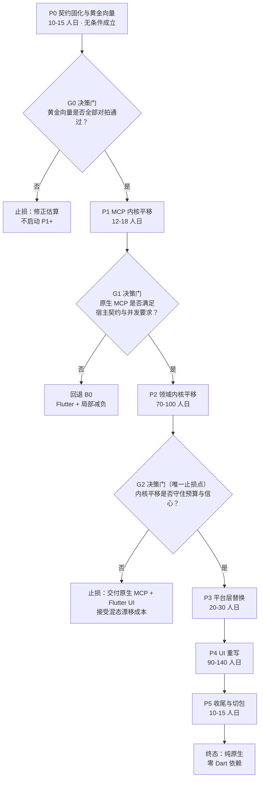

# 拾光转原生 Android：评估与迁移方案

> 上游 SSOT：[schedule-app.md](schedule-app.md)（产品与架构设计）。本文只做**技术栈迁移**的评估与施工计划，不改产品设计；拍板留痕在 schedule-app.md §11 拍板台账（未拍板前本文维持 `status: draft`）。
> 全文「现状」结论均为对仓库的实测值（口径见 §2.1），非估算。

**代号说明**

| 代号 | 含义 |
|---|---|
| `P0`–`P5` | 迁移阶段，定义见 §7 |
| `G0`–`G2` | 决策门，定义见 §7 |
| `R1`–`R8` | 风险登记，定义见 §4 |
| `C1`–`C4` | 启动判据，定义见 §5 |
| `B0`–`B3` | 方案档位，定义见 §6 |

## 1. 结论

**技术可行性高，时点经济性低。**

**决策状态：已拍板走 `B3` 全量迁移档位（2026-11-11，用户拍板「想彻底摆脱 Flutter」）。** 代价是 12–18 人月的功能冻结窗口；风险由 `P0` 契约固化前置 + `G0`/`G1`/`G2` 三道决策门控制（`G2` 是唯一止损点）。方案权衡与备选档否决理由留痕在 `context/decisions.md` 的 native-migration 节。

三条事实决定了这个结论：

1. **迁移的技术前提已经具备。** 项目架构本身以「无头系统」为第一原则——删掉整个 Flutter UI 后，MCP 命令面（mcp + action + data）应能完整运行（[coding-standards.md](../project/coding-standards.md) §1）。这条原则由 `arch-guard` 的 R1–R6 六条红线机械守护，当前 6/6 通过。业务内核（18,669 行 / 60 文件）不 import 任何 Flutter 与平台插件包，跨实现平移不存在结构性阻碍。
2. **UI 与内核的耦合面极窄，UI 重写是纯呈现层工作。** `lib/ui/` 对数据层的直接访问只有 10 个 `repo` 读方法与 17 处订阅点，全部写入走命令面（`CommandHandler`）。重写 20 个页面不触碰任何业务规则，正确性由既有的 12,408 行纯逻辑测试兜底。
3. **但迁移没有廉价的中间终态。** 「原生内核 + Flutter UI」是过渡态而非可交付终态——长期维护两套实现必然漂移。决策实际是二元的：要么承诺走到终态并承担 12–18 人月的功能冻结，要么不转。

由此得到核心判断：**转原生不是技术问题，是产品节奏问题。** 它用「12–18 人月零新功能交付」换取「长期技术栈收敛 + 插件升级风险归零」。这个交换在项目当前节奏下不划算，除非 §5 的启动判据之一成立。

推荐路径：**先做 P0（无条件成立的投入），把决策从信仰之争变成数据驱动，再决定是否投入 P1+。**

## 2. 现状盘点（实测）

### 2.1 口径

行数 = `wc -l`；文件数 = `find`；纯 Dart 判定 = 该文件不 `import` `package:flutter/*` 且不 `import` 19 个平台插件包中的任一个；测试分类 = 是否出现 `testWidgets(`。统计日 2026-11-11。

### 2.2 代码资产分层

| 目录 | 文件 | 行数 | 职责 |
|---|---:|---:|---|
| `lib/ui/` | 30 | 12,160 | 全部 Flutter UI（20 主页 + `collab/` 10 子页） |
| `lib/collab/` | 40 | 9,758 | 协作子系统：身份 / E2EE 封装 / FSM 回放 / 提案 / outbox / relay REST+WSS |
| `lib/action/` | 5 | 4,876 | 命令层：载荷防伪 / 乐观锁 CAS / FIFO 写锁 / 机器可读拒绝码 / 查询层 |
| `lib/relay_proto/` | 3 | 3,054 | relay 契约 protobuf 生成码 |
| `lib/data/` | 5 | 1,883 | 台账存储：`db.dart`（分段幂等迁移）+ `repository.dart` + `storage.dart`（纯 Dart 存储抽象） |
| `lib/mcp/` | 7 | 880 | MCP 内核：JSON-RPC 框架 + 工具面 + 依赖反转端口 |
| `lib/service/` | 6 | 806 | 平台服务层：MCP 总控 / HTTP 传输 / relay 传输 / 前台保活 / 管家日切 / 天气 |
| `lib/models/` | 5 | 738 | 纯数据模型：Plan / ScheduleBlock / FixedSlot / Artifact / Background |
| `lib/update/` | 4 | 334 | 应用内自更新 + 配置热更 |
| `lib/widgets/` | 1 | 262 | 通用组件 |
| `lib/theme/` | 1 | 155 | 视觉令牌单一事实源 |
| `lib/debug/` | 5 | 140 | debug-only 真机调试桥接线（`kReleaseMode` 编译期剔除） |
| `lib/util/` | 1 | 100 | 作息日几何 |
| `lib/` 根 | 3 | 378 | `main.dart` / `app_services.dart` / `mcp_binder_entrypoint.dart` |
| **合计** | **116** | **35,524** | |

迁移相关性分类：

| 类别 | 文件 | 行数 | 占比 |
|---|---:|---:|---:|
| 纯 Dart 业务内核（无 Flutter、无平台插件依赖） | 60 | 18,669 | 52.6% |
| Flutter UI 层（`ui/` + `widgets/` + `theme/` + `main`） | 33 | 12,577 | 35.4% |
| 平台耦合层（sqflite / dart:io / 插件实现） | 19 | 约 4,200 | 11.8% |

### 2.3 UI 与内核的真实边界

`lib/ui/` 的出向 import 全部指向 `lib/ui/` 内部与 `models/` / `action/` / `theme/`，无一条直连 `lib/data/db.dart`（R5 守护）。对数据层的访问面：

| 形态 | 数量 | 说明 |
|---|---:|---|
| `repo.` 读方法调用点 | 27 | 仅 10 个不同方法：`settingsGet`(9) `listPlans`(6) `planById`(2) `artifactsUnattributed`(2) `artifactsForPlans`(2) `settingsAll` `revision` `exportAll` `blocksOnDate` `artifactForBlock` `artifactById` |
| 写入 | 0 | 全部经 `action/` 命令面 |
| 订阅点（`addListener` / `listen`） | 17 | `Repository` 以 `Listenable` 通知（非 `ChangeNotifier`） |

**这条边界是迁移方案的地基**：UI 重写只需实现「命令提交 + 查询读取 + 状态订阅」三个端口，任何业务语义变更都不在 UI 侧发生。

### 2.4 平台依赖清单

在用的 19 个外部包及其在 `lib/` 的 import 次数：

| 类别 | 包 | 次数 | 原生等价物 |
|---|---|---:|---|
| 网络 | `dio` / `web_socket_channel` | 15 / 2 | OkHttp / Ktor |
| 加密 | `cryptography` / `crypto` | 10 / 3 | JCA + Tink + BouncyCastle（**Argon2id 需 BouncyCastle，JCA/Tink 均无**） |
| 存储 | `sqflite` | 7 | `SQLiteOpenHelper` / Room |
| 序列化 | `protobuf` / `fixnum` | 4 / 4 | protobuf-java + Wire（**须从 `.proto` 重新生成**） |
| 平台 | `path_provider` / `shared_preferences` / `flutter_secure_storage` / `flutter_foreground_task` / `package_info_plus` / `flutter_dotenv` / `url_launcher` / `qr_flutter` / `permission_handler` / `mobile_scanner` / `path` | 各 1–2 | Android 原生能力，无难点 |

`open_filex` 在 `pubspec.yaml` 声明但 `lib/` 零引用（自更新已改走原生 `PackageInstaller` 通道）——迁移时直接删除。

平台调用点集中在 19 个「边缘文件」（`data/db.dart`、`update/*`、`service/*`），业务内核只沾 5 个纯 Dart 库（`dio`/`crypto`/`cryptography`/`protobuf`/`fixnum`）。

### 2.5 测试资产

| 类别 | 文件 | 行数 | 迁移价值 |
|---|---:|---:|---|
| 纯逻辑单测（无 `testWidgets`） | 54 | 12,408 | **最高**：业务规则金标准，Kotlin 侧等价成立 |
| Widget 测试 | 29 | 2,333 | 作废（测 Flutter widget 树），需重写或删除 |
| 集成测试 | 0 | 0 | 无既有集成资产 |

全部 84 个测试文件 `import 'package:flutter_test/flutter_test.dart'`，但 `flutter_test` 只是 `dart:test` 的 re-export——54 个纯逻辑文件只用到 `test()` / `expect()` / `group()`，与 Flutter 框架零耦合，断言可 1:1 翻译。

### 2.6 Android 原生侧与工程节奏

- Kotlin 代码仅 2 文件 511 行（`MainActivity.kt` 209 + `ShiguangMcpBinderService.kt` 302），Java 仅 Flutter 自动生成的 `GeneratedPluginRegistrant.java`。零自写 FlutterPlugin、零手抄 AIDL（已迁至官方 SDK `goodhub-mcp-plugin-core`）。
- 已有 3 条跨语言通道：`app.shiguang/installer`（MethodChannel 双向）、`app.shiguang/sharing`（BasicMessageChannel）、`shiguang/mcp_binder`（MethodChannel 双向）。
- MCP 服务端 100% 跑在 Dart VM：`ShiguangMcpBinderService` 在 shiguang 进程内 `new FlutterEngine(this)` 建独立 headless 引擎，执行 `mcp_binder_entrypoint.dart` 的 `mcpBinderMain`，与主 isolate 共用 SQLite（WAL + `busy_timeout=5000`）规避并发写冲突。`mcp-bridge/*.mjs`（372 行 JS）跑在桌面机，只做 stdio ↔ HTTP/relay 传输桥，不是服务端本体。
- 团队：单一作者，近 60 天 80 次提交、近 30 天 20 次提交，近 90 天提交类型分布为 docs 35 / feat 20 / chore 19 / fix 4 / refactor 2。
- 存量债：`docs/design/functional-spec.md` 的 V1.5 候补（通知提醒、日历拖拽编辑、周月视图、Markdown 导出）尚未落地；`docs/design/ui-pages.md` 定义的 20 页交互流与 `docs/project/ui-design.md` 的视觉规范构成 UI 侧剩余工作量主体。

## 3. 成本评估

### 3.1 直接成本

假设：单人、熟练 Kotlin/Compose、有 Android 工程经验、无本项目背景、全职投入、不含设计返工与回归缺陷修复。

| 阶段 | 范围 | 人日 | 风险档 |
|---|---|---:|---|
| `P0` 契约固化与黄金向量 | 抽取跨实现测试向量 | 10–15 | 低 |
| `P1` MCP 内核平移 | `mcp/` 880 + `mcp_controller` 176 + `mcp_binder_entrypoint` 71 + 原生侧 302 | 12–18 | 中 |
| `P2` 领域内核平移 | `action/` + `models/` + `data/` + `collab/` 业务部分 | 70–100 | 高 |
| `P3` 平台层替换 | 存储 / 密钥 / 前台保活 / 扫码 / 权限 / 自更新 | 20–30 | 中 |
| `P4` UI 重写 | `ui/` + `widgets/` + `theme/` 12,577 行 → Compose | 120–175 | 高 |
| `P5` 收尾与切包 | 双轨并存 / 灰度 / Flutter 产物清理 / 发布链切换 | 10–15 | 中 |
| **合计** | | **242–353** | |

单人 = 12–18 人月。两人并行（1 人内核与协议 + 1 人 UI）可把日历工期压到 9–11 人月，代价是 Kotlin 技能双份储备与联调开销。

### 3.2 机会成本

直接成本只是账面数。真实代价是 **12–18 人月内零新功能交付**：V1.5 候补（通知、日历拖拽、周月视图、Markdown 导出）全部延期，协同日程五阶段施工序（`docs/design/collab-implementation.md`）停滞。对单人项目，这是产品节奏的中断，不是工程问题。

另有三项隐性成本：AI 与人的上下文重建（`AGENTS.md` / 项目 skill / `docs/project/index.md` 的代码落点索引全部按 Dart 写，需整体重写）；发布链重建（`scripts/release-r2.sh`、`toolbox run build-apk` / `bump-version` 全部基于 Flutter CLI）；知识断层（Flutter 熟练度 → Compose 的陡坡，单人项目无同行评审对冲）。

### 3.3 估算的不确定性

±40%。主要来自两处不可压缩项：`P2` 的 E2EE 字节级对齐（能否一次通过，见 R1）与 `P4` 的 UI 行为等价（拖拽日历手势、多层浮层的「能跑但不好用」，见 R2）。`P0` 的产出正是用来压缩这两处不确定性的手段。

## 4. 风险登记

| 编号 | 风险 | 概率 | 影响 | 缓解 | 触发信号 |
|---|---|---|---|---|---|
| `R1` | **E2EE 封装字节级不对齐**：AES-256-GCM（12B nonce）+ 512B 定长填充 + `key_ver` 自描述信封 + Ed25519/X25519 + Hashcash PoW + Argon2id KEK | 高 | 高（**静默失败**：跨端解封失败不报错） | `P0` 黄金向量先行，逐算法对拍；Argon2id 明确用 BouncyCastle | 首个跨端解封向量失败 |
| `R2` | **UI 行为等价失败**：横滑/长按手势竞技场（`schedule_page.dart:1586` `RawGestureDetector`）+ 多层浮层（`showModalBottomSheet` + `GlobalActionSheet` + `BlockSheet` 三层嵌套）+ 规范定义但**尚未实现**的三处动效 | 高 | 高（用户感知最强） | 以 `ui-design` + `ui-pages` 规范为准绳重画，不逐行翻译 Flutter 代码；每页配真机走查 | 灰度用户反馈「能跑但不好用」 |
| `R3` | **双轨期数据一致性**：同包名同 SQLite 文件，原生侧 Room 与 sqflite 并存 | 中 | 高（数据损坏） | Room 保持 WAL + `busy_timeout=5000`；P5 前禁止原生侧改 Schema；`P0` 冻结 DDL | 迁移期 SQLite 锁异常 |
| `R4` | **protobuf 双副本分叉**：`lib/relay_proto/` 与 `lib/collab/proto/` 各存一份生成码（各 2,264 行 `.pb.dart`），当前已存在行数分叉 | 已发生 | 中 | `P0` 统一到单一生成目录，`scripts/sync-relay-contract.sh` 改指唯一落点 | 分叉扩大 |
| `R5` | **goodhub AIDL 契约语义漂移**：错误码 `-32000` / `-32603` / `-32001`、`_async` 占位帧 + `onEvent` 终帧切片 | 中 | 高（跨仓契约冻结） | 复用现有 `handleJsonRpc` 路由骨架，只换内核；逐位对照 §11「Binder _async 切片」行 | 宿主侧出现 `-32000` 频次上升 |
| `R6` | **构建与发布链断裂**：Flutter CLI → Gradle-only | 中 | 中 | `P5` 前保留双构建；`toolbox` 工具池同步改造 | 打包流水线失败 |
| `R7` | **迁移期双份实现漂移**：Dart 与 Kotlin 两套核心并存 | 高 | 中 | 明确「混态是过渡态不是终态」；设 G2 决策门，不允许无限期并存 | 两套实现行为分叉 |
| `R8` | **知识与上下文迁移**：Dart/Flutter → Kotlin/Compose 单人断层 | 中 | 中 | `P0` 产出的黄金向量同时充当 Kotlin 侧的行为说明书 | P2 阶段反复回归同一类错 |

## 5. 启动判据

转原生值得启动，当且仅当下列判据之一成立，**且无法用局部手段消解**。逐条给出当前证据：

| 编号 | 判据 | 当前证据 | 结论 |
|---|---|---|---|
| `C1` | 存在 Flutter 层硬阻塞：关键插件长期不维护 / 阻塞 Android 新版本适配 / 阻塞 goodhub SDK 深度集成 | `context/lessons.md` 仅 2 条已归并条目，其中插件 `compileSdk` 冲突已由根 `android/build.gradle.kts` 钳制 `compileSdk≥36` 解决；`open_filex` 为死依赖可删。**无阻塞性记录** | 不成立 |
| `C2` | 体积 / 内存 / 冷启动成为产品指标 | 存在真实开销：goodhub 拉起 Binder 服务时会建独立 FlutterEngine 实例。但该开销可由 `P1` 单独消除，**无需全量迁移** | 部分成立 → 由 `P1` 局部解决 |
| `C3` | Dart isolate 并发模型成为吞吐瓶颈 | 已有缓解：`lessons.md` [mcp-binder] 记录「并行调用汇入单 Dart isolate 串行竞争」，已用 `_async` + `onEvent` 终帧切片协议绕开。**属已缓解的软约束，非硬阻塞** | 部分成立 → 由 `P1` 根治 |
| `C4` | 长期技术栈收敛诉求（插件升级风险、单人维护成本、跨仓一致性） | 主观项。客观支撑：19 个外部包中 3 个平台插件处于「上游不一定跟进 Android 新版本」的风险面（`flutter_foreground_task` / `mobile_scanner` / `flutter_secure_storage`）；插件冲突历史已发生过一次（`lessons.md`） | **成立**（但可由 `B0` 局部缓解） |

**判据汇总**：`C4` 成立，`C1` 不成立，`C2`/`C3` 仅指向局部目标而非全量迁移。

## 6. 方案档位

| 档位 | 内容 | 成本 | 产物 | 适用 |
|---|---|---:|---|---|
| `B0` | **维持 Flutter + 局部减负**：替换 3 个高风险平台插件为原生实现（`flutter_foreground_task` → 原生 `ForegroundService`；`mobile_scanner` + `permission_handler` → CameraX + ML Kit；`flutter_secure_storage` → Android Keystore），删除死依赖 `open_filex` | 5–8 人日 | 插件升级风险面从 3 降到 0；不改业务与 UI | `C4` 成立但无全量迁移意愿 |
| `B1` | **P0 契约固化**：黄金向量 + 契约冻结 + DDL 冻结 | 10–15 人日 | 跨实现金标准；把迁移可行性从估计变为实测 | **无条件推荐**：无论最终转不转都不浪费 |
| `B2` | **P0 + P1（P1 为决策前置）**：MCP 内核平移到 Kotlin + 原生内核接入 | 22–33 人日 | MCP 脱离 FlutterEngine；给出「内核平移可行/不可行」的实测判据 | 想低成本验证全量迁移可行性 |
| `B3` | **全量迁移（P0–P5）** | 242–353 人日 | 纯原生终态（Kotlin + Compose + Room + Wire），零 Dart 依赖 | 承诺走到终态，且 §5 判据成立 |

**已选档位：`B3`**（2026-11-11 拍板）。`B0` / `B1` / `B2` 作为前置或备选记录在案——`B1` 的 `P0` 内容已并入 `B3` 作为第一阶段，`B2` 的 `P1` 内容是 `B3` 的第二阶段。

**关键约束**：`B2` 及以上产生的是过渡态。「原生内核 + Flutter UI」不可作为终态交付——两套实现长期并存必然漂移（R7）。因此启动 `B2` 即隐含「走到 `B3` 终态」的承诺，`G2` 决策门是唯一的止损点。

## 7. 阶段与决策门

| 门 | 位置 | 通过判据 | 不通过时 |
|---|---|---|---|
| `G0` | `P0` 后 | 黄金向量覆盖 E2EE 封装 / FSM 转移 / 命令拒绝码 / DB Schema / MCP 工具返回 / proto 序列化六类，且 Dart 与 Kotlin 双实现逐位一致 | 修正估算或判定高风险项不可平移，停在此处 |
| `G1` | `P1` 后 | 原生 MCP 在并发调用下不触发 `-32000`，宿主侧 AIDL 契约（`_async` 占位 + `onEvent` 终帧 + 三个错误码）行为不变 | 回退 `B0` |
| `G2` | `P2` 后 | 领域内核平移守住 70–100 人日预算，且 12,408 行纯逻辑测试的 Kotlin 移植版全绿 | 止损，交付「原生 MCP + Flutter UI」混态产品 |

## 8. 阶段施工要点

### P0 契约固化与黄金向量

- **产出**：`test/golden/` 下的跨实现向量集（JSON），六类——E2EE 封装往返 / FSM 状态转移表 / 命令拒绝码 / SQLite Schema 快照 / MCP `tools/call` 返回 / relay proto 序列化字节。
- **做法**：以现有 54 个纯逻辑测试为骨架，把「给定输入 → 期望输出」从断言中抽成独立向量文件；同一向量跑 Dart 实现与 Kotlin 实现，比对结果。
- **附带**：冻结 DDL（`lib/data/db.dart` 的 7 段幂等迁移）作为迁移期唯一 Schema 事实源；统一 `lib/relay_proto/` 与 `lib/collab/proto/` 双副本到单一生成目录（R4）。
- **验收**：向量集可被 Dart 侧与 Kotlin 侧同时消费；任一 Rust—Dart 等价性存疑项在此阶段暴露（如 `int` 64 位语义、`typed_data` 端序）。
- **不依赖**：本阶段不需要任何 Kotlin 代码——可用 Dart 侧「实现 + 期望值」先固化期望值。

### P1 MCP 内核平移

- **范围**：`lib/mcp/`（880）+ `lib/mcp_binder_entrypoint.dart`（71）+ `lib/service/mcp_controller.dart`（176）+ `lib/service/http_transport.dart`（114）→ Kotlin；原生侧 `ShiguangMcpBinderService.kt`（302）的 `handleJsonRpc` 路由骨架保留，把 MethodChannel `dispatch` 换成直接方法调用。
- **收益**：goodhub 拉起 Binder 服务时不再创建 FlutterEngine（原 `new FlutterEngine(this)` + headless 入口移除）→ app 被后台拉起跑 MCP 的冷启动与内存占用下降；MCP 并发不再受单 Dart isolate 串行竞争限制（C3 根治）。
- **约束**：`_async` 占位帧 + `onEvent` 终帧切片机制、`-32000` / `-32603` / `-32001` 三个错误码语义、`5s` ready 竞态等待上限——**逐位不变**（schedule-app.md §11「Binder _async 切片」行为红线）。
- **退出条件**：G1 通过。

### P2 领域内核平移

- **范围**：`lib/action/`（4,876）+ `lib/models/`（738）+ `lib/data/`（1,883）+ `lib/collab/` 业务部分（协议生成码除外）→ Kotlin。
- **优先序**：先 `collab/fsm.dart`（858 行纯函数 Reducer，零 I/O / 零时钟 / 零随机）→ `models/` → `action/commands.dart` 与 `command_handler.dart` → `data/repository.dart` → `collab/` 其余。
- **验证**：`action/` 的 4,876 行由 6 个纯逻辑测试文件（`commands_test.dart` 770 + `commands_facts_test.dart` 458 + `fact_rules_test.dart` 215 + `commands_facts_revisions_test.dart` 206 + `commands_facts_redline_test.dart` 188 + `panic_command_test.dart` 92）逐条移植为 Kotlin 单测。
- **高风险项**：`collab/crypto/` + `sealing.dart` + `freemask.dart` 的字节级等价（R1）——必须由 P0 向量护航，禁止凭读码「照抄」。
- **退出条件**：G2 通过。

### P3 平台层替换

| 能力 | 当前 | 目标 |
|---|---|---|
| 台账存储 | `sqflite` | Room 或 `SQLiteOpenHelper`（保持 WAL + `busy_timeout=5000`） |
| 密钥存储 | `flutter_secure_storage` | Android Keystore + `EncryptedSharedPreferences` |
| 前台保活 | `flutter_foreground_task` | 原生 `ForegroundService` + WakeLock/WifiLock |
| 扫码 | `mobile_scanner` + `permission_handler` | CameraX + ML Kit Barcode |
| 二维码渲染 | `qr_flutter` | ZXing 核心 |
| 应用内更新 | `open_filex` + 原生 `PackageInstaller` 通道 | 保留现有原生通道，删除死依赖 |
| 配置热更 | `shared_preferences` / `path_provider` | DataStore / `getExternalFilesDir` |
| 版本号 | `package_info_plus` | `PackageManager.getPackageInfo` |
| 天气 / 外链 | `dio` / `url_launcher` | OkHttp / `Intent.ACTION_VIEW` |
| 联调配置 | `flutter_dotenv` | `BuildConfig` |

迁移期包名保持 `app.shiguang.shiguang`，SQLite 文件路径与既有数据天然一致，无需数据搬迁。

### P4 UI 重写

- **准绳是规范不是 Flutter 代码**：`docs/project/ui-design.md`（色彩/排版 tokens、布局标尺、物理约束、BlockRenderer 形态契约）+ `docs/design/ui-pages.md`（20 页布局与文案清单）已构成完整 UI 事实源。**不逐行翻译 12,577 行 Flutter UI，而是照规范在 Compose 重实现**——这同时消解 R2 的主要来源（照抄手势实现细节）。
- **施工序**：① 设计系统落地（`lib/theme/tokens.dart` 155 行 → Compose `Color`/`Dimens`/`Typography` 单例）→ ② BlockRenderer 组件族 → ③ 主干页（今日页 / 周月视图 / 清单页）→ ④ 浮层族 → ⑤ 协作六页 → ⑥ 设置与引导页。
- **选型**：Compose。声明式模型与 Flutter 同构，与规范里的手势—命令契约（ui-design §5.4）逐条可对应。不选传统 View + XML——需为同一批交互维护两套范式。
- **重点页**：`ui/schedule_page.dart`（2,145 行，34 个 Widget）与 `ui/fact_sheet.dart`（1,075 行，18 个 Widget）是两块硬骨头，各自独立排期。

#### 动效：规范三处待落地，非「复刻」

`ui-design` §3.3 定义了三处动效（长按坍缩 300ms ease-out、右滑融化 400ms、安全线点亮 250ms spring），但代码侧实测**零个 `Animated*` API**——`_melt()`（`schedule_page.dart:1511`）与 `_degrade()`（`schedule_page.dart:1571`）直接执行命令，无动画。全项目唯一显式曲线是 `schedule_page.dart:1005` 的滚动回位（250ms `Curves.easeOut`）。

因此 P4 的动效工作是**按规范首次实现**，不存在「复刻已有动画」的保真负担。曲线按 Flutter 原定义逐位搬运，不做近似：

| Flutter | Compose | 备注 |
|---|---|---|
| `Curves.easeOut` = Cubic(0, 0, 0.58, 1) | `EaseOut` | Compose 1.3+ 的 `EaseOut` 参数与之相同 |
| `Curves.easeInOut` = Cubic(0.42, 0, 0.58, 1) | `EaseInOut` | **不是** `FastOutSlowInEasing` |
| `Curves.fastOutSlowIn` = Cubic(0.4, 0, 0.2, 1) | `FastOutSlowInEasing` | Material 标准曲线 |
| spring | `Spring` / `animateFloatAsState` | 需对齐 damping ratio 与 stiffness |

§3.3 同时约束「手势期间用 transform 不重排，守 60fps；禁整页 setState 驱动的动画」——Compose 的 `graphicsLayer { scaleX/scaleY }` 只触发 draw phase 不触发重组，天然满足；实现时禁用 `animateDpAsState` 之类的布局属性动画。

#### 手势：竞技场抢占，不是嵌套滚动

项目零 `NestedScrollView` / `CustomScrollView` / `SliverAppBar` / `ListView.builder`，不存在嵌套滚动场景。真实手势复杂度在**竞技场仲裁**：`schedule_page.dart:1586` 用 `RawGestureDetector` 注册 `onLongPress`，块上横滑与外层垂直滚动需按 `ui-design` §3.4 阈值仲裁——水平初位移 >20dp 且 `|Δx/Δy| > 2.0` 才由块接管，否则无条件交还外层。

Compose 侧用 `Modifier.pointerInput` + `awaitPointerEventScope` 做显式抢占，阈值直接取规范常量（`StGesture.pageSwipeDp` 已存在对应物）。另需实现：长按 400ms 触发 + 按住期间 scale 0.98 呼吸、右滑过 45% 卡点吸附 + `HapticFeedback.mediumImpact`、左滑过 35% 呼出抽屉。

#### 排版基线

项目全库零 `leadingDistribution` 设置，Compose 侧对应设置 `PlatformTextStyle(includeFontPadding = false)` 以消除 Android 系统字体额外上下边距，避免文字视觉偏下。此项与 `ui-design` §2 排印 token 对齐后一并验收。

#### 细节分类账本

细节损失不是均匀的，按「规格是否已固化」分五类，处置强度递减：

| 类 | 定义 | 本项目内容 | 迁移损失 |
|---|---|---|---|
| A | 规格与代码双固化 | `lib/theme/tokens.dart` 155 行（`StColors` / `StScale` 标尺 / `StMotion` 动效时长 / `StGesture` 手势阈值）——**纯数值、零 Flutter 依赖** | 零，逐字翻成 Kotlin 常量对象 |
| B | 规格固化、实现需重写 | `ui-design` §5.1–§5.4 BlockRenderer 形态矩阵 + `ui-pages` 20 页布局 | 可控，照规格重画 |
| C | 规格固化、实现尚未落地 | §3.3 三处动效（`StMotion` 已给时长常量，动画本身未实现） | 无「丢」，属首次实现 |
| D | 无规格、靠框架隐式约定 | 控件默认度量、主题继承链（`Theme.of(` 117 处） | **丢失高发区** |
| E | Flutter 特有机制 | SnackBar 时长、Stack fit、`animateTo` 对齐、build 中副作用 | 需专门机制，见下表 |

A 类是本项目相对通用案例的最大优势：`StScale.dpPerMinute = 1.0`、`StMotion.collapseMs = 300`、`StGesture.axisRatioMin = 2.0` 这类值**不经过 Flutter 渲染层**，迁移时无需任何反查或目测。

#### 七个已知丢失点与解法

| # | 丢失点 | 实测规模 | 机理 | 解法 |
|---|---|---|---|---|
| 1 | SnackBar 任意时长 | **98 处**，显式 1s×1 / 2s×12 / 3s×11 / 8s×1 | Compose `SnackbarDuration` 只有 `Short`(4s) / `Long`(10s) / `Indefinite` | 自建 `SnackbarHost` + `LaunchedEffect { delay(ms); dismiss() }` 恢复任意时长；改写为 4s/10s 属节奏变更，需产品确认，不可默认 |
| 2 | Stack → Box 尺寸语义 | **8 处**（`schedule_page` 4 / `app_shell` / `quick_note_fab` / `collab_canvas` / `scan_page`） | Flutter `Stack` 默认 loose fit、`Positioned.fill` 撑满父级；Compose `Box` 默认 `propagateMinConstraints=false`，无 `Positioned.fill` | 逐处显式化：`Positioned.fill` → `Modifier.matchParentSize()`；`Positioned` → `BoxScope.align`；`Stack` → `Box(Modifier.fillMaxSize())` |
| 3 | 滚动对齐语义 | `schedule_page.dart:1002` `goNow()` 用 `_scroll.animateTo(clamped)` | Flutter `animateTo` 的 alignment 是「目标在视口中的相对位置」，Compose `animateScrollToItem(index, offset)` 是「像素偏移」，两者不等价 | 按 `StScale.dpPerMinute` 与视口高换算成像素 offset；「回到现在」写成显式函数 + 单测断言目标像素值 |
| 4 | build 中副作用 | `app_gate.dart` 在 `build` 内 `ListenableBuilder` + revision 比较 + `scheduleMicrotask(_reload)` | Flutter 靠 `setState` 驱动重跑 build；Compose 重组粒度是函数级，副作用不自动重跑 | 改 `LaunchedEffect(repo.revision) { ... }`；状态用 `remember { mutableStateOf }`；派生值用 `derivedStateOf` |
| 5 | 控件默认度量 | `Theme.of(` 117 处；手写 `EdgeInsets` 218 处；`contentPadding` 16 处 | Flutter `Text` 默认 14sp、`IconButton` 48×48 触控区、`ListTile` 默认间距、`Card` 默认 margin 4——Compose 多为无默认或不同 | 全部显式化并对照 `ui-design` §2 排印 token + §3.1 标尺；触控区显式 `minimumInteractiveComponentSize` |
| 6 | 浮层参数体系 | `showModalBottomSheet` / `showDialog` **31 处** | 两套参数几乎不重合（`isScrollControlled` vs `sheetState`/`sheetMaxWidth`，`backgroundColor` vs `containerColor`，`constraints` vs `sheetMaxWidth`） | 逐处建参数对照表；Compose `ModalBottomSheet` 的 `sheetMaxWidth` 默认 640dp 与移动端全宽不符，须显式放开 |
| 7 | 文本基线 | 全库 0 处 `leadingDistribution` | Flutter 默认含 leading distribution；Compose 侧 Android 系统字体额外上下边距使文字视觉偏下 | `PlatformTextStyle(includeFontPadding = false)`，与 §2 排印 token 一并验收 |

#### 保真四道工序

| 工序 | 动作 | 产出 | 验收线 |
|---|---|---|---|
| 量化基线 | `tokens.dart` 逐字翻成 Kotlin 常量对象；把 `ui-design` §1–§3 规范值与 token 做一次对账，缺项补 token | `StColors` / `StScale` / `StMotion` / `StGesture` 四组 Kotlin 常量 | 155 行数值逐项一致，无一靠目测 |
| 像素基线 | 迁移前用**现有** debug 桥按「页面 × 状态」采集基线图（`lib/debug/shiguang_debug_screenshot.dart` 走 `RenderRepaintBoundary.toImage`，`main.dart` 已挂全局 `RepaintBoundary` key，`/debug/screenshot` 端点现成）；迁移后用 Compose `captureToImage()` 采同尺寸同状态图做像素 diff | 基线图集 + diff 报告 | 差异归零或有据可依的显式豁免 |
| 交互对拍 | 把 §3.4 手势阈值写成 Compose 手势测试脚本（`performTouchInput` 精确位移与时长），断言落库命令与拒绝码 | 手势对拍用例 | 与现有纯逻辑测试的期望值逐条一致 |
| 状态穷举 | 每页登记状态空间（空态 / 加载 / 正常 / 错误 / 边界 / 折叠态），逐状态建基线 | 页面 × 状态清单 | 清单满覆盖，禁止「看着像就算过」 |

像素基线是本项目**最大的保真杠杆且基建已存在**：它把「细节丢了没有」从主观判断变成可度量、可回归的数字指标。缺了它，P4 的 120–175 人日里会有相当比例消耗在反复目测对齐上。

### P5 收尾与切包

- 双轨并存期收敛：Flutter 包名与原生包名分离（原生用 `.native` 后缀或独立 applicationId），共用同一 SQLite 文件与同一 relay 契约，灰度切流。
- 构建与发布：`scripts/release-r2.sh` / `toolbox run build-apk` / `bump-version` 切到 Gradle-only；`toolbox` 工具池同步改造（R6）。
- 清理：删除 Flutter 工程产物、`pubspec.yaml`、`lib/`、`test/` 中的 Dart 部分；`AGENTS.md` 与项目 skill 的命令事实源整体重写。

## 9. 迁移期工程基建

| 项 | 要求 |
|---|---|
| 双轨数据 | 同 SQLite 文件、WAL 模式、`busy_timeout=5000`；原生侧在 `P5` 前禁止修改 Schema（R3） |
| 契约事实源 | `.proto` 以 `../shiguang-relay` 为唯一出处，Kotlin 侧由 Wire/kotlinx 从同一文件生成；本地生成码收敛到单一目录（R4） |
| 测试形态 | 黄金向量 = 双实现共用；Dart 侧保留作为迁移期回归基准，`P5` 后随 Dart 侧一并退场 |
| 门禁 | 迁移期沿用现有四道（`arch-guard` / `analyze` / `test` / `e2e-check`），Kotlin 侧对应补齐 lint + 单测 + 仪器测试；goodhub 契约变更走跨仓评审（R5） |
| 文档 | 迁移相关的设计拍板回 schedule-app.md §11 拍板台账留痕；过程态（进度、对拍日志、缺陷）入 epic devlog，不进 `docs/` |

## 10. 未决事项

已决（2026-11-11 拍板）：驱动痛点 = 彻底摆脱 Flutter → 选 `B3` 全量迁移档位；接受 12–18 人月功能冻结窗口。

待决：

1. **`P4` 是否由 Kotlin 重写还是先做规范外的最小实现**：若目标是「先有能用的原生版，再补齐视觉」，可在 `P4` 内部分两级交付（骨架级 → 规范级），但骨架级不可作为终态发布。
2. **是否需要保留 Dart 侧作为 relay 契约的参考实现**：`../shiguang-relay` 仓的服务端与客户端生成码同源，建议在 `P5` 前保持 Dart 侧可编译，用于契约回归对拍。
3. **像素基线的采集窗口**：`P4` 开工前必须采完基线，否则无基线可对——需在 `P3` 期间确认真机可用与「页面 × 状态」清单的枚举范围。
4. **迁移期是否冻结新需求**：功能冻结窗口内是否允许仅加不改的只读功能，需按 `G0` 结果定。
