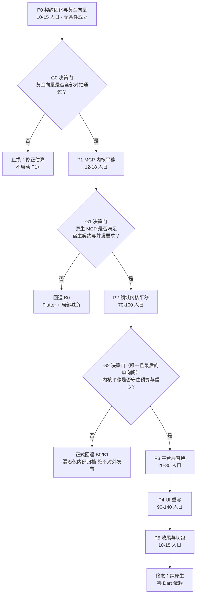

# 拾光转原生 Android：评估与迁移方案

> 上游 SSOT：[schedule-app.md](schedule-app.md)（产品与架构设计）。本文只做**技术栈迁移**的评估与施工计划，不改产品设计；拍板留痕在 schedule-app.md §11 拍板台账（未拍板前本文维持 `status: draft`）。
> 全文「现状」结论均为对仓库的实测值（口径见 §2.1），非估算。

**代号说明**

| 代号 | 含义 |
|---|---|
| `P0`–`P5` | 迁移阶段，定义见 §7 |
| `G0`–`G2` | 决策门，定义见 §7 |
| `R1`–`R8` | 风险登记，定义见 §4 |
| `C1`–`C4` | 启动判据，定义见 §5 |
| `B0`–`B3` | 方案档位，定义见 §6 |

## 1. 结论

**技术可行性高，时点经济性低。**

**决策状态：已拍板走 `B3` 全量迁移档位（2026-11-11，用户拍板「想彻底摆脱 Flutter」）。** 代价是 12–18 人月的功能冻结窗口；风险由 `P0` 契约固化前置 + `G0`/`G1`/`G2` 三道决策门控制（`G2` 是唯一且最后的单向阀：不通过即正式回退 `B0`/`B1`，混态不对外发布）。

**执行定位：本次迁移按 Spec-Driven Refactoring（以规范为准绳的架构级重构）执行**——既非逐行直译（旧框架的妥协与过期 workaround 会被原样搬进新栈，Day-1 就背上「原生外壳、Flutter 灵魂」），也非推倒重来（避免第二系统综合症与工期无限延期）。

| 区域 | 内容 | 处置 |
|---|---|---|
| **开刀区** | 状态流转机制（`Listenable` → UDF）、设计系统组件化（令牌 → 原语组件库）、并发与事务调度（单写队列 + 调度器分工）、时钟**触发**层（冷启动 → 时间事件驱动）、对象图与路由（DI + 类型安全路由） | 允许重构实现结构，以规范为准绳重做；每项都须有机械门禁与验收判据兜底 |
| **禁飞区** | 契约六类语义（协议 / 命令面 / 拒绝码 / E2EE 封装字节 / proto wire format / DDL）、`StGesture` 手势阈值与 `StMotion` 时长曲线、64 位列语义与列宽单位、SQLite Schema 与 7 段幂等迁移历史 | **外部可观察行为与契约逐位不变**；越界改动不报错但会静默失配（与 §4 `R1` / `R5` 同族），判定靠 `P0` 黄金向量与 `P4` 像素基线 |方案权衡与备选档否决理由留痕在 `context/decisions.md` 的 native-migration 节。

三条事实决定了这个结论：

1. **迁移的技术前提已经具备。** 项目架构本身以「无头系统」为第一原则——删掉整个 Flutter UI 后，MCP 命令面（mcp + action + data）应能完整运行（[coding-standards.md](../project/coding-standards.md) §1）。这条原则由 `arch-guard` 的 R1–R6 六条红线机械守护，当前 6/6 通过。业务内核（18,669 行 / 60 文件）不 import 任何 Flutter 与平台插件包，跨实现平移不存在结构性阻碍。
2. **UI 与内核的耦合面极窄，UI 重写是纯呈现层工作。** `lib/ui/` 对数据层的直接访问只有 10 个 `repo` 读方法与 17 处订阅点，全部写入走命令面（`CommandHandler`）。重写 20 个页面不触碰任何业务规则，正确性由既有的 12,408 行纯逻辑测试兜底。
3. **但迁移没有廉价的中间终态。** 「原生内核 + Flutter UI」是过渡态而非可交付终态——长期维护两套实现必然漂移。决策实际是二元的：要么承诺走到终态并承担 12–18 人月的功能冻结，要么不转。

由此得到核心判断：**转原生不是技术问题，是产品节奏问题。** 它用「12–18 人月零新功能交付」换取「长期技术栈收敛 + 插件升级风险归零」。这个交换在项目当前节奏下不划算，除非 §5 的启动判据之一成立。

推荐路径：**先做 P0（无条件成立的投入），把决策从信仰之争变成数据驱动，再决定是否投入 P1+。**

## 2. 现状盘点（实测）

### 2.1 口径

行数 = `wc -l`；文件数 = `find`；纯 Dart 判定 = 该文件不 `import` `package:flutter/*` 且不 `import` 19 个平台插件包中的任一个；测试分类 = 是否出现 `testWidgets(`。统计日 2026-11-11。

### 2.2 代码资产分层

| 目录 | 文件 | 行数 | 职责 |
|---|---:|---:|---|
| `lib/ui/` | 30 | 12,160 | 全部 Flutter UI（20 主页 + `collab/` 10 子页） |
| `lib/collab/` | 40 | 9,758 | 协作子系统：身份 / E2EE 封装 / FSM 回放 / 提案 / outbox / relay REST+WSS |
| `lib/action/` | 5 | 4,876 | 命令层：载荷防伪 / 乐观锁 CAS / FIFO 写锁 / 机器可读拒绝码 / 查询层 |
| `lib/relay_proto/` | 3 | 3,054 | relay 契约 protobuf 生成码 |
| `lib/data/` | 5 | 1,883 | 台账存储：`db.dart`（分段幂等迁移）+ `repository.dart` + `storage.dart`（纯 Dart 存储抽象） |
| `lib/mcp/` | 7 | 880 | MCP 内核：JSON-RPC 框架 + 工具面 + 依赖反转端口 |
| `lib/service/` | 6 | 806 | 平台服务层：MCP 总控 / HTTP 传输 / relay 传输 / 前台保活 / 管家日切 / 天气 |
| `lib/models/` | 5 | 738 | 纯数据模型：Plan / ScheduleBlock / FixedSlot / Artifact / Background |
| `lib/update/` | 4 | 334 | 应用内自更新 + 配置热更 |
| `lib/widgets/` | 1 | 262 | 通用组件 |
| `lib/theme/` | 1 | 155 | 视觉令牌单一事实源 |
| `lib/debug/` | 5 | 140 | debug-only 真机调试桥接线（`kReleaseMode` 编译期剔除） |
| `lib/util/` | 1 | 100 | 作息日几何 |
| `lib/` 根 | 3 | 378 | `main.dart` / `app_services.dart` / `mcp_binder_entrypoint.dart` |
| **合计** | **116** | **35,524** | |

迁移相关性分类：

| 类别 | 文件 | 行数 | 占比 |
|---|---:|---:|---:|
| 纯 Dart 业务内核（无 Flutter、无平台插件依赖） | 60 | 18,669 | 52.6% |
| Flutter UI 层（`ui/` + `widgets/` + `theme/` + `main`） | 33 | 12,577 | 35.4% |
| 平台耦合层（sqflite / dart:io / 插件实现） | 19 | 约 4,200 | 11.8% |

### 2.3 UI 与内核的真实边界

`lib/ui/` 的出向 import 全部指向 `lib/ui/` 内部与 `models/` / `action/` / `theme/`，无一条直连 `lib/data/db.dart`（R5 守护）。对数据层的访问面：

| 形态 | 数量 | 说明 |
|---|---:|---|
| `repo.` 读方法调用点 | 27 | 仅 10 个不同方法：`settingsGet`(9) `listPlans`(6) `planById`(2) `artifactsUnattributed`(2) `artifactsForPlans`(2) `settingsAll` `revision` `exportAll` `blocksOnDate` `artifactForBlock` `artifactById` |
| 写入 | 0 | 全部经 `action/` 命令面 |
| 订阅点（`addListener` / `listen`） | 17 | `Repository` 以 `Listenable` 通知（非 `ChangeNotifier`） |

**这条边界是迁移方案的地基**：UI 重写只需实现「命令提交 + 查询读取 + 状态订阅」三个端口，任何业务语义变更都不在 UI 侧发生。

### 2.4 平台依赖清单

在用的 19 个外部包及其在 `lib/` 的 import 次数：

| 类别 | 包 | 次数 | 原生等价物 |
|---|---|---:|---|
| 网络 | `dio` / `web_socket_channel` | 15 / 2 | OkHttp / Ktor |
| 加密 | `cryptography` / `crypto` | 10 / 3 | JCA + Tink + BouncyCastle（**Argon2id 需 BouncyCastle，JCA/Tink 均无**） |
| 存储 | `sqflite` | 7 | `SQLiteOpenHelper` / Room |
| 序列化 | `protobuf` / `fixnum` | 4 / 4 | **protobuf-javalite**（`com.google.protobuf:protobuf-javalite`，**须从 `.proto` 重新生成**；runtime 已定案，见 §9） |
| 平台 | `path_provider` / `shared_preferences` / `flutter_secure_storage` / `flutter_foreground_task` / `package_info_plus` / `flutter_dotenv` / `url_launcher` / `qr_flutter` / `permission_handler` / `mobile_scanner` / `path` | 各 1–2 | Android 原生能力，无难点 |

`open_filex` 在 `pubspec.yaml` 声明但 `lib/` 零引用（自更新已改走原生 `PackageInstaller` 通道）——迁移时直接删除。

平台调用点集中在 19 个「边缘文件」（`data/db.dart`、`update/*`、`service/*`），业务内核只沾 5 个纯 Dart 库（`dio`/`crypto`/`cryptography`/`protobuf`/`fixnum`）。

### 2.5 测试资产

| 类别 | 文件 | 行数 | 迁移价值 |
|---|---:|---:|---|
| 纯逻辑单测（无 `testWidgets`） | 54 | 12,408 | **最高**：业务规则金标准，Kotlin 侧等价成立 |
| Widget 测试 | 29 | 2,333 | 作废（测 Flutter widget 树），需重写或删除 |
| 集成测试 | 0 | 0 | 无既有集成资产 |

全部 84 个测试文件 `import 'package:flutter_test/flutter_test.dart'`，但 `flutter_test` 只是 `dart:test` 的 re-export——54 个纯逻辑文件只用到 `test()` / `expect()` / `group()`，与 Flutter 框架零耦合，断言可 1:1 翻译。

### 2.6 Android 原生侧与工程节奏

- Kotlin 代码仅 2 文件 511 行（`MainActivity.kt` 209 + `ShiguangMcpBinderService.kt` 302），Java 仅 Flutter 自动生成的 `GeneratedPluginRegistrant.java`。零自写 FlutterPlugin、零手抄 AIDL（已迁至官方 SDK `goodhub-mcp-plugin-core`）。
- 已有 3 条跨语言通道：`app.shiguang/installer`（MethodChannel 双向）、`app.shiguang/sharing`（BasicMessageChannel）、`shiguang/mcp_binder`（MethodChannel 双向）。
- MCP 服务端 100% 跑在 Dart VM：`ShiguangMcpBinderService` 在 shiguang 进程内 `new FlutterEngine(this)` 建独立 headless 引擎，执行 `mcp_binder_entrypoint.dart` 的 `mcpBinderMain`，与主 isolate 共用 SQLite（WAL + `busy_timeout=5000`）规避并发写冲突。`mcp-bridge/*.mjs`（372 行 JS）跑在桌面机，只做 stdio ↔ HTTP/relay 传输桥，不是服务端本体。
- 团队：单一作者，近 60 天 80 次提交、近 30 天 20 次提交，近 90 天提交类型分布为 docs 35 / feat 20 / chore 19 / fix 4 / refactor 2。
- 存量债：`docs/design/functional-spec.md` 的 V1.5 候补（通知提醒、日历拖拽编辑、周月视图、Markdown 导出）尚未落地；`docs/design/ui-pages.md` 定义的 30 个 UI 单元交互流与 `docs/project/ui-design.md` 的视觉规范构成 UI 侧剩余工作量主体。

## 3. 成本评估

### 3.1 直接成本

假设：单人、熟练 Kotlin/Compose、有 Android 工程经验、无本项目背景、全职投入、不含设计返工与回归缺陷修复。

| 阶段 | 范围 | 人日 | 风险档 |
|---|---|---:|---|
| `P0` 契约固化与黄金向量 | 抽取跨实现测试向量 + 基线采集器与 84 组状态基线采集签字 + Kotlin 侧架构护栏 + 边界向量语义评审 + proto runtime 定案与字节向量 + 写事务阈值实测（§9.1） | 19–32 | 低 |
| `P1` MCP 内核平移 | `mcp/` 880 + `mcp_controller` 176 + `mcp_binder_entrypoint` 71 + 原生侧 302 + 启动时序分层（Core/UI 隔离） | 13–20 | 中 |
| `P2` 领域内核平移 | `action/` + `models/` + `data/` + `collab/` 业务部分 + 时钟基建与写队列收敛 + 存储层选型与 64 位列映射 + Manual DI 装配 | 76–108 | 高 |
| `P3` 平台层替换 | 存储 / 密钥 / 前台保活 / 扫码 / 权限 / 自更新（含 Android 14+ 前台服务类型与保活规格 + 三层模块图与混淆规则） | 24–38 | 中 |
| `P4` UI 重写 | `ui/` + `widgets/` + `theme/` 12,577 行 → Compose（含丢失点 #8 #9 + 类型安全路由契约 + 原语组件库 + 异常与日志纪律） | 132–194 | 高 |
| `P5` 收尾与切包 | 双轨并存 / 灰度 / Flutter 产物清理 / 发布链切换 / 隔离包名 dogfood 构建 / Release 构建验收链 | 13–20 | 中 |
| **合计** | | **277–412** | | | |

单人 = 12–18 人月。两人并行（1 人内核与协议 + 1 人 UI）可把日历工期压到 9–11 人月，代价是 Kotlin 技能双份储备与联调开销。成本经五次上修：① 像素基线采集按 §10 决定 3 前移至 `P0` 末期–`P1`（`P0`/`P1` 各 +2–5 人日，`P4` 目测对齐消耗相应下降——总量不变，仅时序前移）；② AI 辅助施工规程的护栏与验收基建 +11–19 人日（§9.1，含 84 组状态基线采集与人工签字 3–6）；③ proto runtime 定案与字节向量、时钟基建与写队列收敛、丢失点 #8 #9、隔离包名 dogfood 构建 +7–13 人日；④ 工程地基五项补齐（存储层选型与 64 位映射、Manual DI、类型安全路由、后台服务规格、启动时序分层）+9–14 人日；⑤ Day-2 运维规范五项（Release 混淆与验收链、三层模块图、异常与日志纪律、设计系统原语组件库、新功能流水线）+8–13 人日。五次上修的性质是**补齐此前缺失的地基**而非估算失准——初版 242–353 只覆盖了「照规范重画」的工时，既没算「让原生工程真能跑起来」的接入成本，也没算「此后 1–3 年不腐化」的运维基建。合计由初始 242–353 上修至 **277–412 人日**（12–18 人月口径不变）。`P0`/`P1` 各设 25 个工作日时间盒（§7），超期 30% 触发强制复盘。

### 3.2 机会成本

直接成本只是账面数。真实代价是 **12–18 人月内零新功能交付**：V1.5 候补（通知、日历拖拽、周月视图、Markdown 导出）全部延期，协同日程五阶段施工序（`docs/design/collab-implementation.md`）停滞。对单人项目，这是产品节奏的中断，不是工程问题。

另有三项隐性成本：AI 与人的上下文重建（`AGENTS.md` / 项目 skill / `docs/project/index.md` 的代码落点索引全部按 Dart 写，需整体重写）；发布链重建（`scripts/release-r2.sh`、`toolbox run build-apk` / `bump-version` 全部基于 Flutter CLI）；知识断层（Flutter 熟练度 → Compose 的陡坡，单人项目无同行评审对冲）。

### 3.3 估算的不确定性

±40%。主要来自两处不可压缩项：`P2` 的 E2EE 字节级对齐（能否一次通过，见 R1）与 `P4` 的 UI 行为等价（拖拽日历手势、多层浮层的「能跑但不好用」，见 R2）。`P0` 的产出正是用来压缩这两处不确定性的手段。

## 4. 风险登记

| 编号 | 风险 | 概率 | 影响 | 缓解 | 触发信号 |
|---|---|---|---|---|---|
| `R1` | **E2EE 封装字节级不对齐**：AES-256-GCM（12B nonce）+ 512B 定长填充 + `key_ver` 自描述信封 + Ed25519/X25519 + Hashcash PoW + Argon2id KEK | 高 | 高（**静默失败**：跨端解封失败不报错） | `P0` 黄金向量先行，逐算法对拍；Argon2id 明确用 BouncyCastle | 首个跨端解封向量失败 |
| `R2` | **UI 行为等价失败**：横滑/长按手势竞技场（`schedule_page.dart:1586` `RawGestureDetector`）+ 多层浮层（`showModalBottomSheet` + `GlobalActionSheet` + `BlockSheet` 三层嵌套）+ 规范定义但**尚未实现**的三处动效 | 高 | 高（用户感知最强） | 以 `ui-design` + `ui-pages` 规范为准绳重画，不逐行翻译 Flutter 代码；每页配真机走查 | 灰度用户反馈「能跑但不好用」 |
| `R3` | **双轨期数据一致性**：同包名同 SQLite 文件，原生侧 Room 与 sqflite 并存；`ShiguangMcpBinderService` 与主进程**同进程**（无独立 `android:process`），故真实并发形态是**同进程多写者**（Dart 主 isolate + headless 引擎 isolate，`P5` 双轨期再叠加 Kotlin 侧）；WAL 允许多读单写，多写者仍会 `SQLITE_BUSY` | 中 | 高（数据损坏） | ① Kotlin 侧写事务统一走单线程写队列（Room `transactionExecutor` + 单线程协程分发器）；② 双轨期 Dart 侧禁长事务独占（FSM 批量写入必须分片）；③ 保留 WAL、`busy_timeout=5000` **严禁下调**，P5 前两端禁改 DDL；单次写事务持锁阈值由 `P0` 实测后固化（不预设 100ms）——**已实测（2026-11-14，真机 3B161700Y0600000 进程内、真实文件库 WAL + busy_timeout=5000 生效环境，N=200）：single p50 1.01 / p95 1.9 / p99 2.7 / max 7.07ms，dual（双写者竞争）p50 1.03 / p95 3.06 / p99 3.66 / max 4.51ms → 阈值固化 = 单次写事务持锁 **10ms**（dual p99 向上取整档，2.7 倍余量；Kotlin 单写队列超阈值事务告警/分片）**，实测工具=调试桥 `db_benchmark` 动作（`lib/debug/debug_db_benchmark.dart`，可复跑） | 迁移期 SQLite 锁异常；打卡类轻量写被长事务挤掉 |
| `R4` | **protobuf 双副本分叉**：`lib/relay_proto/` 与 `lib/collab/proto/` 各存一份生成码（各 2,264 行 `.pb.dart`），当前已存在行数分叉 | 已发生 | 中 | `P0` 统一到单一生成目录，`scripts/sync-relay-contract.sh` 改指唯一落点 | 分叉扩大 |
| `R5` | **goodhub AIDL 契约语义漂移**：错误码 `-32000` / `-32603` / `-32001`、`_async` 占位帧 + `onEvent` 终帧切片 | 中 | 高（跨仓契约冻结） | 复用现有 `handleJsonRpc` 路由骨架，只换内核；逐位对照 §11「Binder _async 切片」行 | 宿主侧出现 `-32000` 频次上升 |
| `R6` | **构建与发布链断裂**：Flutter CLI → Gradle-only | 中 | 中 | `P5` 前保留双构建；`toolbox` 工具池同步改造 | 打包流水线失败 |
| `R7` | **迁移期双份实现漂移**：Dart 与 Kotlin 两套核心并存 | 高 | 中 | 明确「混态是过渡态不是终态」；设 G2 决策门，不允许无限期并存 | 两套实现行为分叉 |
| `R8` | **知识与上下文迁移**：Dart/Flutter → Kotlin/Compose 单人断层 | 中 | 中 | `P0` 产出的黄金向量同时充当 Kotlin 侧的行为说明书 | P2 阶段反复回归同一类错 |

## 5. 启动判据

转原生值得启动，当且仅当下列判据之一成立，**且无法用局部手段消解**。逐条给出当前证据：

| 编号 | 判据 | 当前证据 | 结论 |
|---|---|---|---|
| `C1` | 存在 Flutter 层硬阻塞：关键插件长期不维护 / 阻塞 Android 新版本适配 / 阻塞 goodhub SDK 深度集成 | `context/lessons.md` 仅 2 条已归并条目，其中插件 `compileSdk` 冲突已由根 `android/build.gradle.kts` 钳制 `compileSdk≥36` 解决；`open_filex` 为死依赖可删。**无阻塞性记录** | 不成立 |
| `C2` | 体积 / 内存 / 冷启动成为产品指标 | 存在真实开销：goodhub 拉起 Binder 服务时会建独立 FlutterEngine 实例。但该开销可由 `P1` 单独消除，**无需全量迁移** | 部分成立 → 由 `P1` 局部解决 |
| `C3` | Dart isolate 并发模型成为吞吐瓶颈 | 已有缓解：`lessons.md` [mcp-binder] 记录「并行调用汇入单 Dart isolate 串行竞争」，已用 `_async` + `onEvent` 终帧切片协议绕开。**属已缓解的软约束，非硬阻塞** | 部分成立 → 由 `P1` 根治 |
| `C4` | 长期技术栈收敛诉求（插件升级风险、单人维护成本、跨仓一致性） | 主观项。客观支撑：19 个外部包中 3 个平台插件处于「上游不一定跟进 Android 新版本」的风险面（`flutter_foreground_task` / `mobile_scanner` / `flutter_secure_storage`）；插件冲突历史已发生过一次（`lessons.md`） | **成立**（但可由 `B0` 局部缓解） |

**判据汇总**：`C4` 成立，`C1` 不成立，`C2`/`C3` 仅指向局部目标而非全量迁移。

## 6. 方案档位

| 档位 | 内容 | 成本 | 产物 | 适用 |
|---|---|---:|---|---|
| `B0` | **维持 Flutter + 局部减负**：替换 3 个高风险平台插件为原生实现（`flutter_foreground_task` → 原生 `ForegroundService`；`mobile_scanner` + `permission_handler` → CameraX + ML Kit；`flutter_secure_storage` → Android Keystore），删除死依赖 `open_filex` | 5–8 人日 | 插件升级风险面从 3 降到 0；不改业务与 UI | `C4` 成立但无全量迁移意愿 |
| `B1` | **P0 契约固化**：黄金向量 + 契约冻结 + DDL 冻结 | 19–32 人日 | 跨实现金标准；把迁移可行性从估计变为实测 | **无条件推荐**：无论最终转不转都不浪费 |
| `B2` | **P0 + P1（P1 为决策前置）**：MCP 内核平移到 Kotlin + 原生内核接入 | 32–52 人日 | MCP 脱离 FlutterEngine；给出「内核平移可行/不可行」的实测判据 | 想低成本验证全量迁移可行性 |
| `B3` | **全量迁移（P0–P5）** | 277–412 人日 | 纯原生终态（Kotlin + Compose + SQLiteOpenHelper/SQLDelight + protobuf-javalite），零 Dart 依赖 | 承诺走到终态，且 §5 判据成立 |

**已选档位：`B3`**（2026-11-11 拍板）。`B0` / `B1` / `B2` 作为前置或备选记录在案——`B1` 的 `P0` 内容已并入 `B3` 作为第一阶段，`B2` 的 `P1` 内容是 `B3` 的第二阶段。

**关键约束**：`B2` 及以上产生的是过渡态。「原生内核 + Flutter UI」不可作为终态交付——两套实现长期并存必然漂移（R7）。因此启动 `B2` 即隐含「走到 `B3` 终态」的承诺，`G2` 决策门是唯一的止损点。

## 7. 阶段与决策门

| 门 | 位置 | 通过判据 | 不通过时 |
|---|---|---|---|
| `G0` | `P0` 后 | 黄金向量覆盖 E2EE 封装 / FSM 转移 / 命令拒绝码 / DB Schema / MCP 工具返回 / proto 序列化六类，且 Dart 与 Kotlin 双实现逐位一致 | 修正估算或判定高风险项不可平移，停在此处 |
| `G1` | `P1` 后 | 原生 MCP 在并发调用下不触发 `-32000`，宿主侧 AIDL 契约（`_async` 占位 + `onEvent` 终帧 + 三个错误码）行为不变 | 回退 `B0` |
| `G2` | `P2` 后 | 领域内核平移守住 70–100 人日预算，且 12,408 行纯逻辑测试的 Kotlin 移植版全绿 | **正式回退 `B0`/`B1`**：混态产物仅留内部归档参考、绝不对最终用户发布；宣告 `B3` 路线终结并做技术复盘 |

> **G2 已通过（2026-11-17 用户签字，D29）**：四模块 739/739 全绿 + 黄金向量 11 组绿 + dispatch 27/27 全量原生；goodhub 宿主联调经用户拍板跳过（风险随 P3/P4 暴露）。终态锁定，Dart 侧绝对只读，P3/P4 启动。

**`G2` 是唯一且最后的单向阀**（2026-11-11 拍板）：通过即锁定终态——立即启动 `P3`/`P4`，Dart 侧进入**绝对只读**（仅作契约抓包对照，任何逻辑变更一律禁止），物理删除统一在 `P5` 前夜；不通过则正式回退 `B0`/`B1`，已投入的黄金向量与原生资产保留为内部归档参考（打 tag + `legacy-reference/` 归档，不进发布产物），混态包不对外发布。

**阶段时间盒（日历上限）**：`P0` ≤ 25 个工作日、`P1` ≤ 25 个工作日。任何阶段超期 30% 即强制触发架构复盘，复盘产出必须且仅能是三选一闭环动作——① 方案修正（重新核算人月并补齐资源）；② 削减非核心边缘场景（以达成阶段退出基线为准）；③ 触发决策门止损退出。复盘无闭环动作则该阶段不予通过。

## 8. 阶段施工要点

### P0 契约固化与黄金向量

- **产出**：`test/golden/` 下的跨实现向量集（JSON），六类——E2EE 封装往返 / FSM 状态转移表 / 命令拒绝码 / SQLite Schema 快照 / MCP `tools/call` 返回 / relay proto 序列化字节。
- **做法**：以现有 54 个纯逻辑测试为骨架，把「给定输入 → 期望输出」从断言中抽成独立向量文件；同一向量跑 Dart 实现与 Kotlin 实现，比对结果。
- **附带**：冻结 DDL（`lib/data/db.dart` 的 7 段幂等迁移）作为迁移期唯一 Schema 事实源；统一 `lib/relay_proto/` 与 `lib/collab/proto/` 双副本到单一生成目录（R4）；proto runtime 定案为 **protobuf-javalite**（与 Dart 侧 `protobuf` 插件的 proto3 wire format、presence 规则同构），并补三组字节级边界向量——空消息、含默认值标量（`0` / `""` / `false`）的消息、含未知字段的向前兼容消息。
- **时间基准向量**：`scheduleDayOf`（`lib/util/schedule_day.dart`）已是纯函数（时间走参数注入），向量化只需钉住五个注入时刻——DST 跳变（`America/New_York` 2026-03-08 与 2026-11-01）、闰日 2024-02-29、作息日切临界（`wake_time` 00:01 前后各 5 秒）、时区骤变（`Asia/Shanghai` → `UTC`）、32 位秒溢出（2038-01-19 03:14:07 UTC）。运行期触发机制（改时钟 / 切时区 / 后台过夜后的重算）属 `P2` 时钟基建，不在向量层。
- **验收**：向量集可被 Dart 侧与 Kotlin 侧同时消费；任一 Rust—Dart 等价性存疑项在此阶段暴露（如 `int` 64 位语义、`typed_data` 端序）。
- **不依赖**：本阶段不需要任何 Kotlin 代码——可用 Dart 侧「实现 + 期望值」先固化期望值。

### P1 MCP 内核平移

- **范围**：`lib/mcp/`（880）+ `lib/mcp_binder_entrypoint.dart`（71）+ `lib/service/mcp_controller.dart`（176）+ `lib/service/http_transport.dart`（114）→ Kotlin；原生侧 `ShiguangMcpBinderService.kt`（302）的 `handleJsonRpc` 路由骨架保留，把 MethodChannel `dispatch` 换成直接方法调用。
- **收益**：goodhub 拉起 Binder 服务时不再创建 FlutterEngine（原 `new FlutterEngine(this)` + headless 入口移除）→ app 被后台拉起跑 MCP 的冷启动与内存占用下降；MCP 并发不再受单 Dart isolate 串行竞争限制（C3 根治）。
- **约束**：`_async` 占位帧 + `onEvent` 终帧切片机制、`-32000` / `-32603` / `-32001` 三个错误码语义、`5s` ready 竞态等待上限——**逐位不变**（schedule-app.md §11「Binder _async 切片」行为红线）。
- **启动时序分层**：`Application.onCreate()` 只初始化 Core（SQLite 连接、命令面、AIDL 路由器），图形 / Compose 主题 / 页面预加载推迟到首个 `Activity.onCreate()`；MCP 被宿主 bind 拉起时不得经过任何 UI 初始化路径——延续 schedule-app §11「`mcp_binder_entrypoint` 独立装配不经 `AppServices`」的既有分离，守死 §4 R5 的 5s ready 预算（超时即 `-32000`）。Flutter 侧现状已印证必要性：`app_services.dart` 的 bootstrap 串行执行 `mcp.restoreIfNeeded()` → `RemoteConfigStore.load()` → `Housekeeper.dailyCutIfNeeded()`，均为重量级 I/O。
- **退出条件**：G1 通过。
- **收官形态（2026-11-14 D8 拍板：混合态）**：协议面 Kotlin 化（:core:mcp 内核，mcp-rejection 17 case 对拍已绿）+ **tools/call 业务面双轨期经 channel `toolface_call` 桥回 Dart 工具面**（业务工具平移在 P2，原生后切换收口）——协议语义与红线逐位不变，C3 根治达成时点=P2 工具面原生后。

### P2 领域内核平移

- **范围**：`lib/action/`（4,876）+ `lib/models/`（738）+ `lib/data/`（1,883）+ `lib/collab/` 业务部分（协议生成码除外）→ Kotlin。
- **优先序**：先 `collab/fsm.dart`（858 行纯函数 Reducer，零 I/O / 零时钟 / 零随机）→ `models/` → `action/commands.dart` 与 `command_handler.dart` → `data/repository.dart` → `collab/` 其余。
- **验证**：`action/` 的 4,876 行由 6 个纯逻辑测试文件（`commands_test.dart` 770 + `commands_facts_test.dart` 458 + `fact_rules_test.dart` 215 + `commands_facts_revisions_test.dart` 206 + `commands_facts_redline_test.dart` 188 + `panic_command_test.dart` 92）逐条移植为 Kotlin 单测。
- **高风险项**：`collab/crypto/` + `sealing.dart` + `freemask.dart` 的字节级等价（R1）——必须由 P0 向量护航，禁止凭读码「照抄」。
- **时钟基建**：定义 `TimeProvider` 接口，由宿主**运行时**注册系统广播（`ACTION_TIME_TICK` 分钟级、`ACTION_TIME_CHANGED` 用户改时钟、`ACTION_TIMEZONE_CHANGED` 时区切换；`ACTION_TIME_TICK` 自 Android 8 起不可静态注册），并在 `Lifecycle.Event.ON_RESUME` 前台恢复时重算作息日。现状缺口：日切只有冷启动 `Housekeeper.dailyCutIfNeeded()` 触发（`app_services.dart:109`），既无定时器也无广播驱动，常驻后台过夜或用户改时钟后界面会停在昨天。UI 层与 ViewModel 禁止直取 `System.currentTimeMillis()` / `Instant.now()`（§9.1.2）。
- **写路径收敛**：Kotlin 侧写事务统一走单线程写队列，双轨期 Dart 侧批量写入分片（R3 缓解三条）。
- **退出条件**：G2 通过。

### P3 平台层替换

| 能力 | 当前 | 目标 |
|---|---|---|
| 台账存储 | `sqflite` | `SQLiteOpenHelper` 或 SQLDelight（保持 WAL + `busy_timeout=5000`；**不引入 Room**——既有库无 `room_master_table`，其 `identity_hash` 校验会在首启抛 `IllegalStateException`；所有 64 位列用 Kotlin `Long`，毫秒时间戳当前约 1.76e12，必然溢出 `Int`） |
| 密钥存储 | `flutter_secure_storage` | Android Keystore + `EncryptedSharedPreferences` |
| 前台保活 | `flutter_foreground_task` | 原生 `ForegroundService` + WakeLock/WifiLock |
| 扫码 | `mobile_scanner` + `permission_handler` | CameraX + ML Kit Barcode |
| 二维码渲染 | `qr_flutter` | ZXing 核心 |
| 应用内更新 | `open_filex` + 原生 `PackageInstaller` 通道 | 保留现有原生通道，删除死依赖 |
| 配置热更 | `shared_preferences` / `path_provider` | DataStore / `getExternalFilesDir` |
| 版本号 | `package_info_plus` | `PackageManager.getPackageInfo` |
| 天气 / 外链 | `dio` / `url_launcher` | OkHttp / `Intent.ACTION_VIEW` |
| 联调配置 | `flutter_dotenv` | `BuildConfig` |

迁移期包名保持 `app.shiguang.shiguang`，SQLite 文件路径与既有数据天然一致，无需数据搬迁。

- **后台服务规格（Android 14 / 15 强监管）**：`ForegroundService` 必须声明 `android:foregroundServiceType` 与对应权限（如 `FOREGROUND_SERVICE_DATA_SYNC`），否则 `startForeground()` 抛 `SecurityException`；Android 13+ 需运行时申请 `POST_NOTIFICATIONS`（不授权则前台通知不可见，服务本身仍运行）；Android 12+ 后台启动 FGS 受限（`ForegroundServiceStartNotAllowedException`）；过夜日切需 `SCHEDULE_EXACT_ALARM`（Android 13+ 需用户授权）与电池白名单引导（`REQUEST_IGNORE_BATTERY_OPTIMIZATIONS`）；**Android 15 对 `dataSync` 类 FGS 新增 6 小时 / 24 小时配额**——长期常驻的 MCP 服务**不得**选 `dataSync`，应选 `specialUse`（需向应用市场说明理由）或 `connectedDevice`。保留 Flutter 侧已实测的 Doze 结论：应答须持 CPU 锁 + Wi-Fi 锁，无锁即假死超时（`lib/service/foreground_task_init.dart` 注释）。

### P4 UI 重写

- **准绳是规范不是 Flutter 代码**：`docs/project/ui-design.md`（色彩/排版 tokens、布局标尺、物理约束、BlockRenderer 形态契约）+ `docs/design/ui-pages.md`（页面布局与文案清单，30 个 UI 单元 = `lib/ui/` 20 主页文件 + `collab/` 10 子页）已构成完整 UI 事实源。**不逐行翻译 12,577 行 Flutter UI，而是照规范在 Compose 重实现**——这同时消解 R2 的主要来源（照抄手势实现细节）。
- **输入源权威性闭环**：生成通道只吃四份规范资产——`ui-design.md` + `ui-pages.md` + Kotlin 侧 tokens 常量对象 + `P0` 采集的真机基线截图。旧 Flutter 代码仅用于产出「行为清单 / 状态空间 / 动效意图」三件套**诊断草稿**，须经**人工审阅并正式写回** `ui-design` / `ui-pages` 之后，生成通道方可引用；严禁把未入库的 AI 中间提取物直接当实现输入——转述不是契约，契约的权威性来自人工审阅 + 冻结 + 可被引用。
- **施工序**：① 设计系统落地（**三层**：令牌 `tokens.dart` 155 行 → Compose 常量对象 → `ShiguangTheme` 主题包裹器 → **原语组件族** `ShiguangScaffold` / `ShiguangButton` / `ShiguangCard` / `ShiguangBottomSheet`，组件内建丢失点 #2 #5 #6 #8 的修复，新页面自动继承合规）→ ② BlockRenderer 组件族 → ③ 主干页（今日页 / 周月视图 / 清单页）→ ④ 浮层族 → ⑤ 协作十页 → ⑥ 设置与引导页。
- **发布档约束**：不设骨架级发布档。上列次序是内部施工序，不是发布批次——模块可各自推进，但每个模块进入端到端合流前须先在内部达成规范级（`ui-design` §1–§5 + `ui-pages` 逐页对照），合流时整包交付；骨架级只作内部中间态，不得对外发布（见 §10 决定 1）。
- **选型**：Compose。声明式模型与 Flutter 同构，与规范里的手势—命令契约（ui-design §5.4）逐条可对应。不选传统 View + XML——需为同一批交互维护两套范式。
- **重点页**：`ui/schedule_page.dart`（2,145 行，34 个 Widget）与 `ui/fact_sheet.dart`（1,075 行，18 个 Widget）是两块硬骨头，各自独立排期。

#### 动效：规范三处待落地，非「复刻」

`ui-design` §3.3 定义了三处动效（长按坍缩 300ms ease-out、右滑融化 400ms、安全线点亮 250ms spring），但代码侧实测**零个 `Animated*` API**——`_melt()`（`schedule_page.dart:1511`）与 `_degrade()`（`schedule_page.dart:1571`）直接执行命令，无动画。全项目唯一显式曲线是 `schedule_page.dart:1005` 的滚动回位（250ms `Curves.easeOut`）。

因此 P4 的动效工作是**按规范首次实现**，不存在「复刻已有动画」的保真负担。曲线按 Flutter 原定义逐位搬运，不做近似：

| Flutter | Compose | 备注 |
|---|---|---|
| `Curves.easeOut` = Cubic(0, 0, 0.58, 1) | `EaseOut` | Compose 1.3+ 的 `EaseOut` 参数与之相同 |
| `Curves.easeInOut` = Cubic(0.42, 0, 0.58, 1) | `EaseInOut` | **不是** `FastOutSlowInEasing` |
| `Curves.fastOutSlowIn` = Cubic(0.4, 0, 0.2, 1) | `FastOutSlowInEasing` | Material 标准曲线 |
| spring | `Spring` / `animateFloatAsState` | 需对齐 damping ratio 与 stiffness |

§3.3 同时约束「手势期间用 transform 不重排，守 60fps；禁整页 setState 驱动的动画」——Compose 的 `graphicsLayer { scaleX/scaleY }` 只触发 draw phase 不触发重组，天然满足；实现时禁用 `animateDpAsState` 之类的布局属性动画。

#### 手势：竞技场抢占，不是嵌套滚动

项目零 `NestedScrollView` / `CustomScrollView` / `SliverAppBar` / `ListView.builder`，不存在嵌套滚动场景。真实手势复杂度在**竞技场仲裁**：`schedule_page.dart:1586` 用 `RawGestureDetector` 注册 `onLongPress`，块上横滑与外层垂直滚动需按 `ui-design` §3.4 阈值仲裁——水平初位移 >20dp 且 `|Δx/Δy| > 2.0` 才由块接管，否则无条件交还外层。

Compose 侧用 `Modifier.pointerInput` + `awaitPointerEventScope` 做显式抢占，阈值直接取规范常量（`StGesture.pageSwipeDp` 已存在对应物）。另需实现：长按 400ms 触发 + 按住期间 scale 0.98 呼吸、右滑过 45% 卡点吸附 + `HapticFeedback.mediumImpact`、左滑过 35% 呼出抽屉。

#### 排版基线

项目全库零 `leadingDistribution` 设置，Compose 侧对应设置 `PlatformTextStyle(includeFontPadding = false)` 以消除 Android 系统字体额外上下边距，避免文字视觉偏下。此项与 `ui-design` §2 排印 token 对齐后一并验收。

#### 细节分类账本

细节损失不是均匀的，按「规格是否已固化」分五类，处置强度递减：

| 类 | 定义 | 本项目内容 | 迁移损失 |
|---|---|---|---|
| A | 规格与代码双固化 | `lib/theme/tokens.dart` 155 行（`StColors` / `StScale` 标尺 / `StMotion` 动效时长 / `StGesture` 手势阈值）——**纯数值、零 Flutter 依赖** | 零，逐字翻成 Kotlin 常量对象 |
| B | 规格固化、实现需重写 | `ui-design` §5.1–§5.4 BlockRenderer 形态矩阵 + `ui-pages` 30 个 UI 单元布局与 §8 状态矩阵 | 可控，照规格重画 |
| C | 规格固化、实现尚未落地 | §3.3 三处动效（`StMotion` 已给时长常量，动画本身未实现） | 无「丢」，属首次实现 |
| D | 无规格、靠框架隐式约定 | 控件默认度量、主题继承链（`Theme.of(` 117 处） | **丢失高发区** |
| E | Flutter 特有机制 | SnackBar 时长、Stack fit、`animateTo` 对齐、build 中副作用 | 需专门机制，见下表 |

A 类是本项目相对通用案例的最大优势：`StScale.dpPerMinute = 1.0`、`StMotion.collapseMs = 300`、`StGesture.axisRatioMin = 2.0` 这类值**不经过 Flutter 渲染层**，迁移时无需任何反查或目测。

#### 已知丢失点与解法（九项）

| # | 丢失点 | 实测规模 | 机理 | 解法 |
|---|---|---|---|---|
| 1 | SnackBar 任意时长 | **98 处**，显式 1s×1 / 2s×12 / 3s×11 / 8s×1 | Compose `SnackbarDuration` 只有 `Short`(4s) / `Long`(10s) / `Indefinite` | 自建 `SnackbarHost` + `LaunchedEffect { delay(ms); dismiss() }` 恢复任意时长；改写为 4s/10s 属节奏变更，需产品确认，不可默认 |
| 2 | Stack → Box 尺寸语义 | **8 处**（`schedule_page` 4 / `app_shell` / `quick_note_fab` / `collab_canvas` / `scan_page`） | Flutter `Stack` 默认 loose fit、`Positioned.fill` 撑满父级；Compose `Box` 默认 `propagateMinConstraints=false`，无 `Positioned.fill` | 逐处显式化：`Positioned.fill` → `Modifier.matchParentSize()`；`Positioned` → `BoxScope.align`；`Stack` → `Box(Modifier.fillMaxSize())` |
| 3 | 滚动对齐语义 | `schedule_page.dart:1002` `goNow()` 用 `_scroll.animateTo(clamped)` | Flutter `animateTo` 的 alignment 是「目标在视口中的相对位置」，Compose `animateScrollToItem(index, offset)` 是「像素偏移」，两者不等价 | 按 `StScale.dpPerMinute` 与视口高换算成像素 offset；「回到现在」写成显式函数 + 单测断言目标像素值 |
| 4 | build 中副作用 | `app_gate.dart` 在 `build` 内 `ListenableBuilder` + revision 比较 + `scheduleMicrotask(_reload)` | Flutter 靠 `setState` 驱动重跑 build；Compose 重组粒度是函数级，副作用不自动重跑 | 改 `LaunchedEffect(repo.revision) { ... }`；状态用 `remember { mutableStateOf }`；派生值用 `derivedStateOf` |
| 5 | 控件默认度量 | `Theme.of(` 117 处；手写 `EdgeInsets` 218 处；`contentPadding` 16 处 | Flutter `Text` 默认 14sp、`IconButton` 48×48 触控区、`ListTile` 默认间距、`Card` 默认 margin 4——Compose 多为无默认或不同 | 全部显式化并对照 `ui-design` §2 排印 token + §3.1 标尺；触控区显式 `minimumInteractiveComponentSize` |
| 6 | 浮层参数体系与软键盘避让 | `showModalBottomSheet` / `showDialog` **31 处** | 两套参数几乎不重合（`isScrollControlled` vs `sheetState`/`sheetMaxWidth`，`backgroundColor` vs `containerColor`，`constraints` vs `sheetMaxWidth`）；Android 15+ 强制 Edge-to-Edge 下 Sheet 与 IME 联动挤压，输入框被键盘遮挡或展开高度被锁死——Flutter 侧 `viewInsets.bottom` 默认开箱即用 | 逐处建参数对照表；Compose `ModalBottomSheet` 的 `sheetMaxWidth` 默认 640dp 与移动端全宽不符，须显式放开；所有含输入的 Sheet 统一接入 `Modifier.imePadding()` 与 `WindowInsets.ime` 联动 |
| 7 | 文本基线 | 全库 0 处 `leadingDistribution` | Flutter 默认含 leading distribution；Compose 侧 Android 系统字体额外上下边距使文字视觉偏下 | `PlatformTextStyle(includeFontPadding = false)`，与 §2 排印 token 一并验收 |
| 8 | 手势抢占、预测性返回与返回栈层级 | 块级左滑 35% 呼出抽屉、右滑 45% 卡点吸附 + 三层 Sheet 嵌套（`showModalBottomSheet` + `GlobalActionSheet` + `BlockSheet`） | Android 14+ 预测性返回（Predictive Back）是系统级边缘手势，与块级横滑撞车会出现边缘抖动或抽屉被系统 `Finish` 抢断；Flutter 侧返回键由 `ModalRoute` 自动逐层消费，原生侧无此框架约定 | ① 屏幕左右边缘 24dp 设为系统手势保留区，块级横滑在保留区内不接管；② 嵌套浮层强制接入 `PredictiveBackHandler` / `BackHandler` 逐层压栈消费，禁止透传至页面级返回；③ 验收时在开启预测性返回的设备上验证 35% 抽屉与 45% 卡点不被系统抢夺 |
| 9 | 进程查杀与 Activity 重建状态恢复 | 30 个 UI 单元 + 31 处浮层的展开态与编辑暂存态 | 单 Activity 架构下状态默认只在内存：进程被系统 OOM 查杀后全部归零；开发者选项「不保留活动」下 Activity 销毁会连带 `ViewModelStore` 清空，ViewModel 一并丢失——进程未死时 ViewModel 本可存活，两条路径需分别覆盖 | ① 滚动偏移、当前 Tab、浮层展开态走 `rememberSaveable`；② 核心编辑暂存态收敛到 `SavedStateHandle`；③ 验收强制开启「不保留活动」做全页面回滚走查，并另做一次进程被杀后的恢复验证 |

#### 保真四道工序

| 工序 | 动作 | 产出 | 验收线 |
|---|---|---|---|
| 量化基线 | `tokens.dart` 逐字翻成 Kotlin 常量对象；把 `ui-design` §1–§3 规范值与 token 做一次对账，缺项补 token | `StColors` / `StScale` / `StMotion` / `StGesture` 四组 Kotlin 常量 | 155 行数值逐项一致，无一靠目测 |
| 像素基线 | **采集窗口前移至 `P0` 末期–`P1`**（见 §10 决定 3）：用 `P0` 新建的基线采集器（页面导航驱动 + 状态注入 + 固定设备与 DPR）按 `ui-pages` §8 登记的 **84 组状态空间**采集基线图；迁移后用 Compose `captureToImage()` 采同尺寸同状态图做像素 diff | 基线图集 + diff 报告 | 差异归零或有据可依的显式豁免 |
| 交互对拍 | 把 §3.4 手势阈值写成 Compose 手势测试脚本（`performTouchInput` 精确位移与时长），断言落库命令与拒绝码 | 手势对拍用例 | 与现有纯逻辑测试的期望值逐条一致 |
| 状态穷举 | 状态空间已在 `ui-pages` §8 登记并分档（A 高危 2 页 × 5 静态态 / B 协作 9 页 × 4 态 / C 基础设置 14 页 × 2 态 / D 组件外壳 5 个 × 2 态 = 84 组；A 档 S4 手势中间态转交互对拍） | 页面 × 状态矩阵 | 清单满覆盖，禁止「看着像就算过」 |

像素基线是本项目**最大的保真杠杆且基建已存在**：它把「细节丢了没有」从主观判断变成可度量、可回归的数字指标。缺了它，P4 的 123–180 人日里会有相当比例消耗在反复目测对齐上。采集窗口因此前移到 `P0` 末期–`P1`（§10 决定 3），抢在依赖重构与 Gradle 升级破坏 Flutter 编译环境之前完成存档。

### P5 收尾与切包

- 双轨并存期收敛：Flutter 包名与原生包名分离（原生用 `.native` 后缀或独立 applicationId），共用同一 SQLite 文件与同一 relay 契约，灰度切流。
- 构建与发布：`scripts/release-r2.sh` / `toolbox run build-apk` / `bump-version` 切到 Gradle-only；`toolbox` 工具池同步改造（R6）。
- 清理：删除 Flutter 工程产物、`pubspec.yaml`、`lib/`、`test/` 中的 Dart 部分；`AGENTS.md` 与项目 skill 的命令事实源整体重写。

## 9. 迁移期工程基建

| 项 | 要求 |
|---|---|
| 双轨数据 | 同 SQLite 文件、WAL 模式、`busy_timeout=5000` **严禁下调**；原生侧在 `P5` 前禁止修改 Schema（R3）；**同进程多写者**（Dart 主 isolate + headless 引擎 isolate，`P5` 双轨期再叠加 Kotlin 侧）——Kotlin 侧写事务统一走单线程写队列，双轨期 Dart 侧禁长事务独占（批量写入分片）；单次写事务持锁阈值已实测固化 = **10ms**（2026-11-14 真机 N=200，dual p99 3.66ms 上取整档；复跑工具=调试桥 db_benchmark） |
| 契约事实源 | `.proto` 以 `../shiguang-relay` 为唯一出处，Kotlin 侧由 **protobuf-javalite**（`com.google.protobuf:protobuf-javalite`）从同一文件生成；本地生成码收敛到单一目录（R4）；proto3 presence 与未知字段按字节级向量对拍 |
| 内部里程碑构建 | 单人项目的阶段正反馈用内部 dogfood 包：独立 `applicationId`（如 `app.shiguang.shiguang.dogfood`）+ 独立 SQLite 文件，**严禁与正式环境库共写**（R3） |
| 测试形态 | 黄金向量 = 双实现共用；Dart 侧保留作为迁移期回归基准与 relay 契约参考实现，**保留至 `P5` 前夜**（§10 决定 2），`P5` 后随 Dart 侧一并退场 |
| 门禁 | 迁移期沿用现有四道（`arch-guard` / `analyze` / `test` / `e2e-check`），Kotlin 侧对应补齐 lint + 单测 + 仪器测试；goodhub 契约变更走跨仓评审（R5） |
| 文档 | 迁移相关的设计拍板回 schedule-app.md §11 拍板台账留痕；过程态（进度、对拍日志、缺陷）入 epic devlog，不进 `docs/`；任务台账 `context/epics/native-migration/todos.md` 按**阶段前缀**（`P0｜`–`P5｜`）组织并按阶段排序，执行时按阶段取用，避免提前进入后续阶段的实现项 |
| AI 施工护栏 | 人机分工与机械防线见 §9.1（两通道输入 / 禁止清单 / Kotlin 侧双层护栏 / 像素 diff 规格 / 边界向量语义评审闸门） |
| 存储与既有库兼容 | **不引入 Room**——Room 打开既有 sqflite 库时会校验内置 `room_master_table` 的 `identity_hash`，旧库无此表 → 首启即抛 `IllegalStateException` 崩溃；存储实现走 `SQLiteOpenHelper` 或 SQLDelight，沿用 `lib/data/` 的三层形态（storage 抽象 / repository / db）。若未来仍要用 Room，必须提供无损校验迁移并显式注入匹配当前 schema 的 `room_master_table`，schema 一变即须同步。**所有 64 位列强制 Kotlin `Long`**：`created_at` / `updated_at` / `expires_at` / `seq` 等为毫秒级，当前值约 1.76e12，**必然**溢出 `Int`（上限 2.147e9）——Dart `int` 是 64 位有符号，映射必须对等 |
| 对象图与 DI | **纯手写 Manual DI**：`AppContainer` 单例在 `Application.onCreate()` 构造，UI 侧只取引用；ViewModel 一律经统一 `Factory` 接入 `Repository` 与 `CommandHandler`，**禁止无参默认构造**，禁止在 Composable 内 `new` 单例；**禁止引入 Hilt**（kapt/ksp 注解处理与代码生成负担）与多套 DI 混用；容器必须在无 UI 进程可独立构造（与「启动时序隔离」同构）。**状态流转终态**：`Repository` 对外只暴露只读 `StateFlow`，ViewModel 单一输入 `UiEvent` → 单一输出不可变 `UiState`，Composable 为纯函数；禁「事件回调里再查一次 repo」的反向拉取式 API |
| 协程调度器分工 | 写事务 → **单写队列**（单线程协程分发器，见「双轨数据」行）；网络与磁盘读 → `Dispatchers.IO`；纯计算与加密 → `Dispatchers.Default`（Argon2id 派生、E2EE 封装解封、proto 序列化均属 CPU 密集，放 IO 会占满磁盘池并饿死网络请求）；跨调用方一律结构化并发（`coroutineScope` / `supervisorScope`），**禁止 `GlobalScope`**；Composable 内禁用裸作用域（见 §9.1.2 禁止清单） |
| 路由契约 | **Type-Safe Navigation**（`navigation-compose` + `kotlinx.serialization`，属路由参数序列化，与 proto 的 `.proto` 生成无关），目的地一律 `@Serializable` sealed class/interface，**严禁手写字符串路由**；**浮层族不进 NavHost**（`BlockSheet` / `GlobalActionSheet` / `QuickNoteFab` / `RejectPanel` / `ActionPassBar` 用 sheet 与 dialog 承载，保证返回键逐层消费，见丢失点 #8）；返回结果以 `SavedStateHandle` 回传，不引入全局事件总线；**当前无 DeepLink 与外部唤醒导航需求**（MCP 工具面无「打开某页」），仅登记契约，不预建 deep link 基建 |
| 后台服务规格 | Android 14+ 必须声明 `android:foregroundServiceType` 与对应权限，否则 `startForeground()` 抛 `SecurityException`；Android 13+ 需运行时申请 `POST_NOTIFICATIONS`（不授权则前台通知不可见）；Android 12+ 后台启动 FGS 受限（`ForegroundServiceStartNotAllowedException`）；过夜日切需 `SCHEDULE_EXACT_ALARM`（Android 13+ 需用户授权）与电池白名单引导（`REQUEST_IGNORE_BATTERY_OPTIMIZATIONS`）；**Android 15 对 `dataSync` 类 FGS 新增 6 小时 / 24 小时配额**——长期常驻的 MCP 服务不得选 `dataSync`，选 `specialUse`（需向应用市场说明理由）或 `connectedDevice`；保留 Flutter 侧已实测的 Doze 结论（应答须持 CPU 锁 + Wi-Fi 锁，无锁即假死超时） |
| 启动时序隔离 | `Application.onCreate()` 只初始化 **Core**（SQLite 连接、命令面、AIDL 路由器），**图形 / Compose 主题 / 页面预载推迟到首个 `Activity.onCreate()`**；MCP 被宿主 bind 拉起时不得经过任何 UI 初始化路径——延续 schedule-app §11「`mcp_binder_entrypoint` 独立装配不经 `AppServices`」的既有分离，守死 §4 R5 的 5s ready 预算（超时即 `-32000`） |
| 构建与混淆（Release 验收） | **R8 须显式配死**（代码缩减 + 资源缩减 + 混淆——flutter 插件不设 minifyEnabled，AGP 默认关；2026-11-15 实证本项目 release 此前从未缩减，已在 release 块显式开启+四条 keep 配死），Debug 跑通不代表发布质量。四条必须配死：① **AIDL 跨进程面**——`com.zzh.goodhub.mcp` 包名与方法签名永久冻结（schedule-app §11「Binder _async 切片」行），须 `-keep class com.zzh.goodhub.mcp.** { *; }`；实测 `goodhub-mcp-plugin-core` 三个版本 AAR **均未随包分发 consumer proguard 规则** → 应用侧必须自带 keep 规则兜底，并推动 SDK 仓补发 consumer rules ② **protobuf-javalite**——官方 AAR 自带 consumer rules，但自定义消息类型仍需确认未被裁切 ③ **BouncyCastle**（Argon2id 依赖 Provider 反射加载，规则缺失即 `NoSuchAlgorithmException` 静默失败）——须 `-keep class org.bouncycastle.** { *; }` ④ **kotlinx.serialization 路由实体**——`@Serializable` 类与 `$serializer` 字段须 keep。**验收纪律：基线回归与 AIDL 跨端调用一律用 Release 构建跑**，禁以 Debug 包代表发布质量 |
| 模块图与依赖边界 | 三层，**`:core:*` 必须是 pure JVM 模块**（非 Android library），否则 12,408 行纯逻辑测试的 Kotlin 移植版只能跑 instrumented test（慢一个数量级）：`:core:tokens`（纯数值令牌，毫秒级编译）→ `:core:model`（数据模型 + 领域纯函数 + 命令面 + reducer + proto 契约 + **存储接口**）→ `:app`（SQLite 实现 + Compose UI + 平台层 + AIDL/MCP 服务 + DI 容器）。存储实现留 `:app`——`lib/data/storage.dart` 的既有存储抽象正好作为 core 层接口；不做十几层微模块化，只在 Gradle 维护成本与编译膨胀之间取三点 |
| 异常与日志纪律 | **全局收敛**：根协程作用域用 `SupervisorJob` + 统一 `CoroutineExceptionHandler`，`Application.onCreate` 注入 `Thread.setDefaultUncaughtExceptionHandler`（崩溃记录与上报，**不防崩**）；Composable 内**禁止**裸 `CoroutineScope(Dispatchers.IO)`（用 `rememberCoroutineScope()`，否则泄漏）；**异常分类表**：可预期异常必须降级为**机器可读拒绝码**（§10 铁律「拒绝码逐位不变」，属契约），不可预期异常才允许崩。**日志隔离**：Debug 完整、Release 只留错误码与事件 ID，**严禁输出用户日程正文、命令载荷、E2EE 密钥材料**；延续 `lib/debug/` 的 `kReleaseMode` 编译期剔除纪律（移植期不引入 Timber 等新依赖时以 `android.util.Log` + 门面收敛） |
| 设计系统组件库 | 设计系统是**三层**：令牌（`StColors` / `StScale` / `StMotion` / `StGesture`）→ 主题包裹器（`ShiguangTheme`，把令牌绑进 `CompositionLocal`，锁定「跟随系统 / 浅色 / 深色」三档与排版基线）→ **原语组件**（`ShiguangScaffold` / `ShiguangButton` / `ShiguangCard` / `ShiguangBottomSheet`）。原语组件是**丢失点的一次性修复**：安全区避让、48dp 触控区、IME 避让、逐层返回拦截、浮层 Z 序全部内建 → 后续新页面自动继承合规，而不是每次靠人记得（丢失点 #2 #5 #6 #8）。组件库是 `P4` 的**收敛产物**（规范 → 组件 → 页面），不得反向成为生成通道的输入源（否则与 §8「输入源权威性闭环」形成循环） |

### 9.1 AI 辅助施工规程（人机分工与机械防线）

迁移期的主要产出由 AI 生成，最大的风险不是 AI 写不出代码，而是两类**静默劣化**：一是把 Flutter 代码里的框架隐式妥协（控件默认度量、SnackBar 固定时长、Stack loose fit、build 内副作用、`animateTo` 对齐语义）不加甄别地翻译成畸形原生代码；二是在「顺手现代化」中改动了可观察语义（把 FIFO 写锁换成无序并发、把 CAS 冲突策略改成覆盖写）。前者伤手感，后者伤正确性且不报错。

三条总原则：

1. **AI 只做实现与提议，不做定义**——协议 / 命令面 / 拒绝码 / E2EE 封装字节 / proto wire format / DDL 六类语义在 `P0` 冻结后，禁止任何 AI 提议的改动。
2. **生成与校验分两通道**——生成通道禁读 Flutter 实现体（防畸形搬运），校验通道只读行为清单（防丢交互意图）。
3. **「做到了」由机器判据或人工签字确认**——不由 AI 自证闭环。

#### 9.1.1 两通道输入

| 通道 | 输入 | 禁止 | 产出 |
|---|---|---|---|
| 生成通道（写实现） | `docs/project/ui-design.md` 规范 + `docs/design/ui-pages.md` 页面与文案 + Kotlin tokens 常量对象 + 目标状态截图 | 原 Flutter Widget 实现体 | Compose 代码 + `@Preview`（Normal / Empty / Loading 三态） |
| 校验通道（写验收） | 原 Flutter 文件的**行为清单**：交互意图（点按 / 长按 / 横滑 / 左滑）+ 触发阈值 + 落库命令与拒绝码 + 反馈形式（SnackBar / 触感 / 动效） | 把实现体当实现参考照抄 | 交互缺失自查报告 + 交互对拍用例 |
| 内核通道（`P2`） | 算法规范 + 黄金向量输入输出契约 | 重写业务逻辑设计；改动并发语义 | 纯 Kotlin `data class` + 纯函数 `reduce(state, event): State` |

行为清单的**抽取本身要人工过目一次**再交 AI 使用——否则清单会把实现细节编进去，退化成变相的逐行直译。

#### 9.1.2 禁止清单（AI 不得自行决定的事项）

| 禁止项 | 具体口径 | 理由 |
|---|---|---|
| 契约定义权 | 禁止改动协议 / 命令面 / 拒绝码 / E2EE 封装字节 / proto wire format / DDL 六类语义；禁止新增、重命名或重排 MCP 工具 | 迁到 Kotlin 的是实现不是契约；冻结期改动要 Dart 测试 / 黄金向量 / Kotlin 实现三处同步 |
| 并发语义「现代化」 | 禁止把 FIFO 写锁改为无序并发；禁止改乐观锁 CAS 的冲突语义；禁止使用 Java `synchronized` 与 `java.util.concurrent` 旧并发类（`Channel` / `Mutex` 仅作实现载体） | 锁序与 CAS 冲突结果是可观察语义，属契约；改了就静默失配 |
| 魔数 | Compose 代码内不得出现未在 tokens 定义的尺寸 / 时长 / 阈值数值（白名单只减不增） | A 类 token 是零 Flutter 依赖的纯数值事实源，迁移本应零损失 |
| Context 穿透 | 禁止把 `Context` / `Activity` 作为 Composable 参数或字段持有；统一 `LocalContext` / `CompositionLocal` 现取 | 规避生命周期泄漏与隐式依赖 |
| 第三方手势库 | 手势竞技场只用 `Modifier.pointerInput` + `awaitPointerEventScope` 自实现，阈值取 `StGesture` 常量 | 引入不可控手势库会让 45% / 35% 卡点与 20dp / 2.0 阈值变得不可控 |
| 脚手架式 MVI | 仅「有状态机的页」（今日页 / 块浮层 / 协作流程）用 `UiState + UiEvent` sealed；简单展示页用 hoisted state + lambda 回调 | 事件通道传大对象会踩 Compose stability 陷阱，触发额外重组；形式合规换不来可维护 |
| 逐行直译 | 禁止把 Flutter Widget 逐行转成 Compose | §8 已知丢失点清单：框架隐式妥协会整段搬进原生侧 |
| 系统时钟直取 | UI 层与 ViewModel 禁止直接调用 `System.currentTimeMillis()` / `Instant.now()`；时间一律经 `TimeProvider` 注入 | 宿主改时钟、切时区、后台过夜后作息日必须重算，否则界面停在昨天 |
| 并发写数据库 | Kotlin 侧禁止为写操作开并发协程：所有写事务走单线程写队列；双轨期 Dart 侧禁长事务独占（批量写入分片） | 同进程多写者 + WAL 单写者模型；长事务会让后到的轻量写（打卡）触发 `SQLITE_BUSY` |
| 提前删除 Dart 侧 | `G2` 通过后 Dart 侧进入绝对只读（仅作抓包对照），物理删除统一在 `P5` 前夜 | 提前删掉回归基准，`P3`/`P4` 的对拍失去参照 |
| 黑盒手势修饰符 | 块级横滑 / 抽屉呼出 / 长按仲裁**严禁**使用 `Modifier.swipeable` / `Modifier.draggable`（自带 fling 与 settle 阈值，会抹杀 `StGesture` 的 20dp / 2.0 / 45% / 35% 物理定义）；一律用 `pointerInput` + `awaitPointerEventScope` 显式状态机 | 卡点位置与触感不可控 = 手势契约丢失，且不可度量 |
| 「原生手感更佳」覆盖规范 | 严禁以「Android 平台惯例」「原生手感更佳」为由替换或覆盖已拍板的数值、阈值与动效曲线 | 规范值是契约；原生惯例不构成改契约的理由 |
| 规范缺项自创 | AI 遇规范未定义处（缺失状态分支、未定义弹簧刚度等）**严禁**自行填数，必须打断并输出 `[SPEC_GAP]` 报告，等待人工补齐规范 | 缺项自创是魔数禁止项的合法化包装；规范缺项必须回流人工拍板 |
| 64 位列用 `Int` | Kotlin 侧读 `created_at` / `updated_at` / `expires_at` / `seq` 等 64 位列**必须**用 `Long`，**严禁**用 `Int` | Dart `int` 是 64 位有符号；毫秒时间戳当前约 1.76e12，`Int` 上限 2.147e9 → 溢出即读库崩溃 |
| DI 混用与默认构造 | 全局只用 `AppContainer` 一套 Manual DI，**严禁**混入 Hilt / Koin / 手写 `ViewModelProvider.Factory` 三套写法；ViewModel **严禁**无参默认构造，禁止在 Composable 内 `new` 单例 | 多套 DI 会让 AI 产出写法分裂，测试无法 Mock、`Context` 泄漏、ViewModel 生命周期错乱 |
| Release 日志泄露 | Release 构建**严禁**输出用户日程正文、命令载荷、E2EE 密钥与信封；只留错误码与事件 ID | Logcat 可被任意本机应用读取，本项目内容高度私密（schedule-app §13 私密后花园） |
| Composable 内裸协程作用域 | Composable 内**严禁** `CoroutineScope(Dispatchers.IO).launch`，必须用 `rememberCoroutineScope()`；根作用域须 `SupervisorJob` + 统一 `CoroutineExceptionHandler` | 裸作用域随组合离开不取消 → 泄漏；未捕获异常直接杀进程 |
| 依赖「官方应该带了」混淆规则 | AIDL 接口、protobuf 消息、`@Serializable` 实体、BouncyCastle Provider 必须在 `proguard-rules.pro` **显式**配死 keep | 实测 `goodhub-mcp-plugin-core` AAR 三个版本均未随包分发 consumer rules；Debug 跑通不代表 Release 可用 |
| 反向拉取 + 局部可变状态副本 | ViewModel **不得**持有「事件回调里再查一次 repo」的反向拉取式 API；页面**不得**持有与 `UiState` 并行的可变数据副本；一切状态经只读 `StateFlow` 单向流出 | Flutter 侧 `Listenable` 只发「变了」的通知（实测 17 个订阅点），反向拉取是既有写法；不显式禁掉，它会在 Kotlin 侧复活成「StateFlow + 局部 setState」混合体，State Hoisting 形同虚设 |
| 迁移期禁飞区（外部可观察行为边界） | 迁移期**禁止**改动四类：① 契约六类语义（协议 / 命令面 / 拒绝码 / E2EE 封装字节 / proto wire format / DDL）② `StGesture` 手势阈值与 `StMotion` 时长曲线 ③ 64 位列语义与列宽单位 ④ SQLite Schema 与 7 段幂等迁移历史。**允许**重构的只有实现结构：状态流转机制、设计系统组件化、协程与事务调度、时钟触发层、对象图与路由 | 禁飞区越界改动**不报错但静默失配**（与 §4 `R1` / `R5` 同族）；判定靠 `P0` 黄金向量与 `P4` 像素基线 |

#### 9.1.3 Kotlin 侧机械护栏（两层）

**第一层：正则护栏**——`scripts/agent-tools/arch-guard-kotlin.sh`，与既有 `arch-guard.sh` 同构（`--json` 单行结论 / `--self-test` 坏样本金丝雀 / 由 `pre-commit-gate` 按改动范围分派），六条规则：

| 编号 | 规则 | 对应 Dart 侧 |
|---|---|---|
| `K1` | UI 层不得引用 db / storage / 网络层 | `R5` UI 直连 Db + `R1` UI 直连 repo 写 |
| `K2` | Compose 代码不得出现裸 dp / sp 数值（白名单只减不增） | —（Dart 侧靠 `tokens.dart` 单一来源） |
| `K3` | 禁止 `synchronized` 与 `java.util.concurrent` 旧并发类 | — |
| `K4` | Composable 参数或字段不得持有 `Context` / `Activity` | —（Dart 侧无对应规则） |
| `K5` | 对外暴露的属性不得为 `MutableStateFlow`（只读暴露） | — |
| `K6` | 禁止可变的全局单例（tokens 常量对象除外） | — |

**第二层：类型级护栏**——Konsist 规则集，**`P4` 起生效**（`P0` / `P2` 阶段 Kotlin 源码尚未成形，规则无对象可扫）：① UI 包不得依赖 data / storage / network 包；② `*ViewModel` 对外暴露属性必须是 `StateFlow` 而非 `MutableStateFlow`；③ Composable 不得直接调用 Repository / Dao；④ 仓库层不得 import Compose。

两层分工：正则管「禁模式」，Konsist 管「依赖方向与类型形态」（正则表达不了类型级约束）。

#### 9.1.4 像素 diff 规格（介质一致 + 分区域判据）

- **采集器（`P0` 窗口内新增）**：现有 `/debug/screenshot` 端点只截当前整屏、无页面驱动、尺寸随机身 DPR，撑不起「页面 × 状态」基线 → 须补页面导航驱动 + 状态注入 + 固定分辨率与固定 DPR（同一台真机、同一系统版本、同一字体版本），产物 = 基线图集 + 每张的（页面, 状态, 设备, DPR, hash）清单。
- **人工签字**：84 组基线入库时**人工过目一次并签存档**；此后差异才交 AI 归因。「规范级」达成的判定落到清单勾稽（页面 × 状态 × 基线 hash），不接受「AI 说完成了」。
- **判据分区域**：图形区做像素 diff，阈值按区域设定（背景 / 卡片 / 装饰 ≤ 0.5%，抗锯齿边缘用掩膜容差）；文字区**不做像素判定**，改结构断言（文本内容 + 文本基线 y + 行盒高度 + 字号）——Flutter 与 Compose 排版引擎不同造成的亚像素差异会被误判为缺陷。
- **介质一致**：不用 Robolectric / layoutlib 的渲染结果与真机基线直接比（字体 hinting、阴影模糊有系统性差异，会产出大批假差异）；原生侧必须同介质采图（真机 instrumentation 采图）。
- **系统手势与返回栈**：在开启预测性返回的设备上验证块级 35% 抽屉与 45% 卡点不被系统抢夺；返回键须先关最上层浮层、逐层消费（丢失点 #8）。
- **进程查杀与重建**：开启开发者选项「不保留活动」做全页面回滚走查，另做一次进程被杀后的恢复验证（丢失点 #9）。
- **意图等价 ≠ 放弃视觉量化**：手感层（手势跟手、动效驱动方式）允许按 Compose 原生底层实现——`graphicsLayer` 只走 draw phase，不复刻 Flutter 的 Widget 内部私有实现；视觉层（静态布局与像素位置）**绝不豁免**——图形区容差掩膜像素 diff + 文字区结构基线断言是绝对红线，不得以「框架差异」「两端物理引擎不同」为由免责。

#### 9.1.5 黄金向量语义评审闸门（防「对拍自证闭环」）

- AI 只可**提出**边界向量候选（如乱序包 / 重复帧 / 过期 revision），不可直接固化为金标准。
- 每个候选必须人工确认语义（该输入在规范中属合法、拒绝还是忽略），确认后才进 `test/golden/`。
- 理由：对拍只能证明两端一致，不能证明一致地正确。向量由 AI 提取、实现也由 AI 生成时，两端共享同一误解，对拍会全绿。语义评审是唯一破环点。

#### 9.1.6 Kotlin 侧行为清单抽取模板（生成通道输入）

生成通道**禁读 Flutter 实现体**（§9.1 AI 施工规程）——Kotlin 侧「照规范重写」所需的行为细节由本模板从 Flutter 侧抽取，**抽取结果须人工过目**后方可作为生成通道输入。每个待迁移单元（页面 / 组件 / 命令）一份，落 `docs/design/native-migration/behavior/<单元名>.md`：

| 字段 | 填写口径 | 来源（人工核对面） |
|---|---|---|
| 交互意图 | 该单元为用户/AI 完成什么（一句话，§4 术语映射词汇） | ui-pages 对应页节 |
| 触发与阈值 | 手势/点击的触发条件与数值阈值（StGesture 阈值逐字，禁现推） | `tokens.dart` 手势 token + BlockRenderer 矩阵（ui-design §5） |
| 状态空间 | 页面 × 状态枚举（引用 ui-pages §8 登记的态编号 S1–Sn，不新增） | ui-pages §8 |
| 落库命令与拒绝码 | 触发的 ScheduleCommand 与机器可读拒绝码（`ActionErrorCode` 枚举值逐字） | `lib/action/command_handler.dart` 行为清单（人工核对后剥离实现细节） |
| 反馈形式 | 成功/失败的 UI 反馈（snackbar / 横幅 / 徽标 / 触觉），文案引用 ui-pages §9 串 | ui-pages §9 |
| 黄金向量指针 | 该单元涉及的向量集与 case id 前缀（E2EE / FSM / 拒绝码 / Schema / toolface / proto / time-basis） | `test/golden/README.md` |
| 像素基线指针 | 基线图与 manifest 条目（31/84 组现状） | `test/golden/baseline/manifest.json` |

抽取纪律：① 只抽**行为**（输入→输出/反馈），不抽实现结构（实现由 Kotlin 按规范重写）；② 数值类字段（阈值/时长/曲线）**逐字引用 tokens.dart**，标注 token 名；③ 拒绝码逐字引用枚举名，禁翻译改写；④ 人工过目签字后入库，生成通道只吃本清单与规范文档，不吃 Flutter 代码。

#### 9.1.7 成本与门禁

| 项 | 阶段 | 人日 |
|---|---|---|
| `arch-guard-kotlin.sh` 六条正则 + self-test 金丝雀 + pre-commit 接入 | `P0` | 1–2 |
| 基线采集器（导航驱动 + 状态注入 + 固定 DPR） | `P0` | 2–3 |
| 84 组状态基线采集与人工过目签字（枚举范围已定稿于 `ui-pages` §8） | `P0` | 3–6 |
| 边界向量语义评审（AI 提候选 + 人工确认） | `P0` | 2–3 |
| Konsist 规则集（四条类型级规则） | `P4` | 1–2 |
| 像素 diff 管线（分区域阈值 + 文字区结构断言 + 同介质采图） | `P4` | 1–2 |
| Prompt 模板库（生成通道 / 校验通道 / 禁止清单三套） | `P4` | 1 |
| **合计** | | **11–19（`P0` 8–14 / `P4` 3–5）** |

Kotlin 侧门禁四道，与 Dart 侧同构：`arch-guard-kotlin` / `analyze` + `detekt` / 单元与向量对拍 / e2e + 像素 diff；接入 `pre-commit-gate` 与 CI。

#### 9.1.7 速查表

| 阶段 | AI 的正确用法 | AI 的禁忌用法 | 产出的可维护性保障 |
|---|---|---|---|
| `P0` 向量 | 从 Dart 单测提取输入输出对、提出边界向量候选 | 把候选直接固化为金标准；重写业务逻辑设计 | 语言无关的 JSON 金标准（语义经人工确认） |
| `P2` 内核 | 生成纯 Kotlin `data class` + 纯函数 `reduce` | 改动并发语义；使用旧并发类或过度设计模式 | 纯 Kotlin 内核，由移植后的 12,408 行断言守护 |
| `P4` UI | 按 `ui-design` 规范 + Kotlin tokens 生成 Compose 组件与 Preview | 逐行直译 Flutter Widget；为形式而形式套 MVI 模板；引入第三方手势库 | State Hoisting + 零魔数 + 依赖方向由脚本与类型规则双向守护 |
| 门禁 | 辅助编写护栏规则与自动化测试脚本 | 用肉眼替代自动化判据 | 规则由 CI 机械守护，越权代码无法合入 |

## 10. 拍板结论

**迁移期全部拍板结论记于本节（2026-11-11），无剩余未决项。** 本节即挂载文档的**决策日志专节**（dev-loop §4 ①：epic 过程日志中的决策与权衡条目归档于此）；拍板留痕另见 schedule-app.md §11 拍板台账对应行，权衡对比见 context/decisions.md 的 native-migration 节。

已决（2026-11-11 拍板）：驱动痛点 = 彻底摆脱 Flutter → 选 `B3` 全量迁移档位；接受 12–18 人月功能冻结窗口。

同日拍板（迁移执行口径四项）：

1. **`P4` 只发布规范级，不设骨架级过渡发布**：骨架级仅作内部开发中间态，**不得对外发布**；按模块（清单页 / 今日页 / 协作页等）逐个在内部达成规范级（`ui-design` §1–§5 + `ui-pages` 逐页对照）后再端到端合流，整包交付。理由：个人工具类产品的用户对日历拖拽手感、浮层阻尼、动效呼吸感极其敏感，骨架级中间态既损留存又拉长工期。
2. **Dart 侧参考实现保留至 `P5` 前夜**：`P0` 阶段给 Dart 仓打迁移前基线 tag 或归档进 `legacy-reference/` 目录，保持可编译；`P2` relay 契约联调时让 Dart 客户端与 Kotlin 客户端**同时连本地 mock-server 抓包对拍**，作为协议断言失败的首选定位手段（`../shiguang-relay` 仓服务端与客户端生成码同源，契约差异只会出在两端实现）。
3. **像素基线采集窗口前移至 `P0` 末期–`P1`**：不等 `P3`——`P2`/`P3` 期间的依赖重构与 Gradle 升级可能破坏 Flutter 编译环境，届时采图会从「顺手做」变成额外负担。趁当前 Flutter 工程稳定可跑，即刻采完 **84 组状态基线**（枚举范围已定稿于 `ui-pages` §8：30 个 UI 单元 × 状态空间，A 档 S4 手势中间态转交互对拍不进采图）并入库存档，人工过目签字后方可作为 P4 对拍基准。原待决 3 表述「需在 `P3` 期间确认真机可用与状态清单枚举范围」作废，由本条覆盖。
4. **迁移期新需求无条件绝对冻结**：不设「仅加不改的只读功能」例外。任一变更需在 Dart 测试 / 黄金向量 / Kotlin 实现三处同步，单人项目在 12–18 人月窗口内为此付出的工期代价是指数级的。唯一开口是阻断 `P0`–`P5` 施工或 `G0`–`G2` 判定的缺陷修复——那属既有缺陷收敛，不属新需求。
5. **`G2` 是唯一且最后的单向阀**：**通过**即锁定终态——立即启动 `P3`/`P4`，Dart 侧进入**绝对只读**（仅作契约抓包对照，任何逻辑变更一律禁止），物理删除统一在 `P5` 前夜；**不通过**则**正式回退 `B0`/`B1`**，已投入的原生内核与混态产物仅留作内部归档参考（打 tag + `legacy-reference/`，不进发布产物），**绝不对最终用户发布混态包**，并宣告 `B3` 路线终结、做技术复盘。理由：对外发布混态包等于同时背负两套运行时的维护债务与发版包体积惩罚，且违背「彻底摆脱 Flutter」的初心；把混态锁死为内部参考工程，既保住 `P0`/`P1`/`P2` 积累的黄金向量与原生代码资产，又彻底切断向用户交付残血半成品的侥幸空间。
6. **动效物理参数与基线状态矩阵定稿**（2026-11-11）：弹簧阻尼 **0.75** / 刚度 **400**（= Material 3 `motion.spring.default`），安全线点亮表述改为「spring 单次，**名义感知时长 ≈250ms**」（spring 无固定时长，250ms 是感知窗口径而非动画时长参数）；三条曲线控制点（ease-out `Cubic(0,0,0.58,1)` / ease-in-out `Cubic(0.42,0,0.58,1)` / fast-out-slow-in `Cubic(0.4,0,0.2,1)`）与弹簧参数以 `tokens.dart` `StMotion` **纯数值**为单一事实源，Kotlin 侧逐字翻译为 `CubicBezierEasing` / `Spring`，严禁实现时现推参数或以「原生手感更佳」覆盖；像素基线枚举范围定稿 = **84 组静态基线**（30 个 UI 单元：A 高危 2 页 × 5 静态态 / B 协作 9 页 × 4 态 / C 基础与设置 14 页 × 2 态 / D 组件外壳 5 个 × 2 态），登记于 `ui-pages` §8 为唯一权威出处，A 档 S4 手势中间态转交互对拍不进采图，权限态须 `adb shell pm revoke` 重置后复采，采完**人工过目签字**方可作 `P4` 对拍基准。
7. **原生工程地基五项定案**（2026-11-11，见 §9 表）：① **不引入 Room**（既有 sqflite 库无 `room_master_table`，其 `identity_hash` 校验会在首启抛 `IllegalStateException`）——存储走 `SQLiteOpenHelper` / SQLDelight，所有 64 位列强制 `Long`（毫秒时间戳当前约 1.76e12，必然溢出 `Int`）；② **纯 Manual DI**（`AppContainer`，禁 Hilt 与多套混用，ViewModel 禁无参默认构造）；③ **类型安全路由**（`@Serializable` sealed 目的地，浮层族不进 NavHost，当前无 DeepLink 需求故不预建基建）；④ **后台服务规格**（`foregroundServiceType` + `POST_NOTIFICATIONS` + 精确闹钟与电池白名单；**Android 15 的 `dataSync` 6 小时配额**是长期常驻 MCP 服务的硬约束，不得选 `dataSync`）；⑤ **启动时序分层**（`Application.onCreate()` 只做 Core，UI 初始化推迟到首个 Activity，守死 5s ready 预算）。
8. **Day-2 长期开发与发布运维规范定案**（2026-11-11，见 §11）：管的是迁移完成后 1–3 年的新功能迭代（V1.5 候补与协作后续阶段）不再长出新写法。五条——① **Release 构建是唯一发布质量代表**（R8 全开；AIDL 跨进程面 / protobuf 消息 / BouncyCastle Provider / 序列化实体四条 keep 规则显式配死，禁依赖「官方应该带了」——实测 `goodhub-mcp-plugin-core` AAR 无 consumer rules）；② **三层模块图**（`:core:tokens` → `:core:model`（含存储接口）→ `:app`，`:core:*` 必须是 pure JVM 模块，否则 12,408 行纯逻辑测试的移植版只能跑仪器测试）；③ **异常与日志纪律**（根作用域 `SupervisorJob` + 统一 handler；可预期异常降级为机器可读拒绝码——拒绝码属契约；Release 严禁输出日程正文、命令载荷与密钥材料）；④ **设计系统三层**（令牌 → `ShiguangTheme` → `Shiguang*` 原语组件，组件内建丢失点修复，新页面自动继承合规；组件库是收敛产物，不得反向成为生成通道输入）；⑤ **新功能四步流水线**（Domain 纯函数 → Data 只读 StateFlow + 单写队列 → UI 状态提升 + 原语组件 → 视觉与交互对拍，终以四道机械门禁卡口）。**另附迁移后黄金向量来源变更的硬规矩**：`P5` 后 Dart 侧退场，期望值只能人工构造，对拍退化为「Kotlin 实现 vs 人工期望值」，故新命令期望值必须人工审阅签字后方可进 `test/golden/`（§11.2）。

## 11. Day-2 长期开发与发布运维规范（迁移完成后沿用）

迁移完成只是把存量功能跑起来；本节管的是**此后 1–3 年的新功能迭代**（V1.5 候补：通知提醒、日历拖拽编辑、周月视图、Markdown 导出；以及协作域后续阶段）不再重蹈「每加一个功能就长出一套新写法」。§9 是不变的地基，本节是每天的流水线。

### 11.1 新功能标准流水线

| 步 | 位置 | 动作 | 产出与门禁 |
|---|---|---|---|
| 1 Domain | `:core:model` | 定义 Command / Payload / 拒绝码与纯函数 Reducer | JUnit 纯逻辑单测（跑在 JVM，不需仪器） |
| 2 Data | `:core:model` + `:app` | 仓储暴露只读 `StateFlow`；写事务经 Actor / Channel 单线程排队入库 | 单写队列门禁 + 64 位列映射断言 |
| 3 UI | `:app` | 定义 `UiState` / `UiEvent`，写符合 State Hoisting 的纯 Composable 与 `@Preview` | 一律调用 `Shiguang*` 原语组件，不重复写避让逻辑 |
| 4 视觉与交互 | `:app` | 按 `ui-pages` §8 状态矩阵补状态与截图 | 像素 diff + 交互对拍（§9.1.4） |
| 闸 | 机械门禁 | `arch-guard-kotlin`（K1–K6）+ Konsist 四条 + 向量对拍 + 像素 diff | 任一不过不得合入 |

### 11.2 迁移后黄金向量来源的变更

`P5` 前，黄金向量的期望值由 **Dart 侧实现**生成（Dart 侧作为参考实现，见 §10 决定 2）——那是一条**双实现对拍**链路。`P5` 后 Dart 侧物理删除，新命令的期望值只能**人工构造**（由规范条款与既有行为推导），此后「对拍」退化为「Kotlin 实现 vs 人工期望值」。

后果：§9.1.5 的**对拍自证闭环**风险在迁移后**升高**（失去独立第二实现）。Day-2 硬规矩：

- 新命令的期望值必须**经人工审阅签字**后才能进 `test/golden/`（与像素基线签字同级）；
- 每个新命令至少配一条**边界用例**（空 / 极值 / 非法输入）与一条**拒绝码用例**；
- 拒绝码集合的变更视为**契约变更**（§10 铁律），走跨仓评审，不得由单次需求顺手扩。

### 11.3 发布纪律

- **Release 构建是唯一发布质量代表**：R8 全开（代码缩减 + 资源缩减 + 混淆）；基线回归与 AIDL 跨端调用一律用 Release 包跑，Debug 仅用于开发期反馈。
- 混淆规则集中在 `android/app/proguard-rules.pro` 分区管理（AIDL / protobuf / 加密 Provider / 序列化实体 / 反射），保守化「只增不减」，规则变更随发布说明留痕。
- 发布前必过链路：`arch-guard-kotlin` → analyze + detekt → 单测与向量对拍 → e2e 与像素 diff（Release 包）→ goodhub 跨端 AIDL 调用实测。

### 11.4 编译速度守护

- `:core:tokens` 与 `:core:model` 保持纯 JVM 且依赖最小（编译秒级），**不在 core 模块引入任何 Android 依赖或注解处理**；
- `:app` 承担 Compose 编译成本；开启 Compose Compiler 报告（`composeCompiler { reportsDestination }`）跟踪稳定性与编译时长；
- 新增依赖前评估其对构建链与冷编译时间的影响（§4 R6）。

### 11.5 日志与隐私

Debug 完整、Release 只留错误码与事件 ID；**用户日程正文、命令载荷、E2EE 密钥与信封一律不出现在任何日志**；排障靠事件 ID 回查本地加密日志，不靠明文日志。

## 决策日志
- [2026-11-17] [决策]: D29（2026-11-17 用户拍板「通过」）：**G2 决策门签字通过——B3 终态锁定**。终核证据：①四模块全测 739/739 绿（0 失败 0 跳过，2026-11-17 实测）+ arch-guard 6 条过 + 黄金向量 11 组绿 + dispatch 27/27 全量原生（swap_block 双轨桩 2026-11-17 退役）；②内核平移远省于 70–100 人日预算（AI 辅助施工，无超期复盘触发）；③真机手工项清算状态：S4 手势对拍已收口（六组时序+位移实证，2 UNCERTAIN 消标）、AppShell 三手势回调已接线（2026-11-17 三落库用例绿）、**goodhub 宿主联调用户拍板跳过**（风险随 P3/P4 继续暴露，非 G2 阻断）、tap_node 边界/进程杀 UI 段/IME 冲突态/设计性等价项挂 Day-2 清算（D28 已裁决）。**随签字生效**：Dart 侧进入绝对只读（仅作契约抓包对照，任何逻辑变更一律禁止），物理删除统一在 P5 前夜；立即启动 P3/P4
- [2026-11-16] [决策]: D28（2026-11-16 用户拍板，两问合并）：B 档 36 组像素基线采集——① 宿主选 **原生 Compose 侧采**（P4 验收对象=Kotlin UI；`collab_seed_cipher` 已在本宿主真机打通；否决：Flutter 参考实现采——需另起双账号密文播种且验收对象错位）+ ② S3/S4 采集口径选 **转交互对拍+真机手工项**（A 档 S4 先例：手势/登录态中间态不进采图，36 组清单保留但每页仅 2 静态态可采，S3/S4 转交互对拍与手工清算；否决：静态注入——B 档 relay 登录态资源不可静态 seed）；按裁决接原生侧 debug_baseline_seed 对应物 + capture stage5
- [2026-11-15] [决策]: D24（2026-11-15 用户「同意默认」整批）：PlanDetail 族三清单（behavior/{plan_detail,plan_background,plan_facts}.md）过目转正 + **A=F1 修规范对齐实现**——ui-pages §5 详情页 spec 渲染改写为「整段纯文本 + `## 路线图` 章派生进度行「▶ 当前进度 N/M」」，Checklist 记号=AI 生成 spec 的内容书写约定非渲染形态（D13-b/D19 先例）+ **B=plan_facts 先施工**——FactCard 按清单 §C 最小形态页内实现、通关 sheet（showVoucherSheet）挂浮层族轮（UNCERTAIN 消标随彼轮），页面骨架不被阻塞；随过目默认项：F2 首帧闪「这条计划不存在了」=Kotlin 三态 UiState 消除（装配自由度非行为差异）/F3 编辑态清空字段不可达（trim 空=null=不改动）现状平移/端口缺口 G1=listBackgrounds 缺 scope·planId 与 G2=artifactsForPlans 缺 includeVoided=Expand 补参（D16/N7 先例）/基线 plan_detail PLAN_S1/S2 同 sha256 疑点挂收口轮核对；否决备选：A=字面量平移现状（规范渲染缺位永久失真）、B=调序先施工浮层族凭证面（页面骨架被浮层轮阻塞）
- [2026-11-15] [决策]: D23（2026-11-15 用户「同意默认」整批）：N8c 四清单（behavior/{onboarding,app_gate,update_page,mcp_settings}.md）过目转正 + mcp 平移深度=**A 本轮随行全件**（HttpTransport/McpController/前台服务 specialUse）+ RemoteConfigStore 走 AppContainer 注入 + 默认源 buildConfigField 注入 + 分享通道改进程内 SharedFlow 直投 + restore 推首 Activity + ①步按钮联动规范改注（ui-pages §2——预填即满足主按钮恒可用）+ 其余照抄项全过；否决备选：B=页面先行控制器挂账 P4 收尾（mcp 调试页真机可调试性延后）；N8c 施工解冻
- [2026-11-15] [决策]: D22（2026-11-15 用户裁决「默认转正」）：settings_subpages 编辑器三子页行为清单（behavior/settings_subpages.md）过目转正——N8b 施工输入
- [2026-11-15] [决策]: D21（2026-11-15 用户裁决「默认转正」）：settings_page 行为清单（behavior/settings_page.md）过目转正 + 路由 P8 组补第六目的地（PrefsSettings 目的地补录，候选 21→22 实数回写）——N8a 施工输入
- [2026-11-15] [决策]: D20（2026-11-15 用户裁决「默认转正」）：plans_page 清单页行为清单（behavior/plans_page.md）过目转正——N7 施工输入；PlanDetail 页面本体随 PlanDetail 轮另抽施工（清单范围注记在册）
- [2026-11-15] [决策]: D19（2026-11-15 用户裁决「默认转正」）：schedule_page §H/§I 周月实现级微度量清单过目转正 + P7 对拍发现=**修规范对齐实现**（§I proposed 点阵改 primary 实心——实现已是全 app 唯一月历点阵形态；否决：反向补空心=无行为收益的像素变更）；N6 施工解冻
- [2026-11-15] [决策]: D13（2026-11-15 用户裁决，复述合并+裁决单抛两问）：schedule_page 行为清单（behavior/schedule_page.md，::auto 抽取）过目转正——P1 安全线徽章+spring=规范为准补实现（随 N4 已施工）；P2 电量三档=**修规范对齐实现**（ui-pages §3.1 已改「紧凑三档横排」，窄屏 363dp 信息完整优先留痕）；P3 查询面补口当轮完成（gapsIn/weekOverview/monthOverview/TimelineMath/artifactForBlock）；P4 F9/F10/F11 按 D12 随③施工（F9/F10 已施工）；P5 15min 吸附+2h 守卫窗=**字面量平移现状**（不随最小块粒度设置联动，解耦 propose 机械校验）；否决备选：规范为准改 segmented（挤压窄屏行宽）、吸附随设置联动（跨层耦合 propose 校验面）
- [2026-11-15] [决策]: D14（2026-11-15 用户裁决）：Compose 宿主接线选 **①调试入口 Activity**——NativeMainActivity（debug 源集 ComponentActivity，exported=false，adb 拉起，startDestination=Today），Flutter 主路径（MainActivity/DebugMainActivity）零影响，P5 切包时并入/替换主入口；否决备选：②Main 直接切 Compose（破坏双轨期 Flutter 主路径）、③暂不接线（真机走查链路悬空）
- [2026-11-15] [决策]: D12（2026-11-15 用户四问裁决，全「同意默认」）：BlockRenderer 行为清单（behavior/block_renderer.md，::auto night 抽取）过目转正 + F1–F12 对拍候选处置——A 组 9 条=规范为准补实现（F1 proposed 虚线/F2 skipped ⊘+降饱和 lineThrough 保留/F3 missed 叠加层全日期适用·今日走遗留区/F4 凭证微标 96dp/F6 长按 0.98 呼吸态/F8 碰撞亮橙线/F9 保护区虚线框含 freeFlow/F10 当前时刻线/F11 昨夜灰带；F1–F4·F6·F8 随②族、F9–F11 随③时间轴层）；F7=镜像现状改规范（车道等宽分栏 N≥2，双列特例，§3.4 已写回）；F5=投影块归属协作⑤轮（§5.3 注记）；F12=融化绑 plan 补记附问挂 Day-2（§5.4 标注+todos P5 登记）。裁决前核验三件：F10 像素级复核（S1 基线无时刻线，疑影=字形+网格线）/F3 精化（missed 日切产生·历史日回看适用）/F5 坐实（投影仅协作域）；否决备选：逐条裁决（12 问串行耗轮次）、镜像现状（9 条规范缺口照抄即规范永久失真）
- [2026-11-15] [决策]: D11（2026-11-15 用户裁决）：密钥安全区存量处置选 **C 不迁移**——flutter_secure_storage v11（Tink 自有格式）与 Kotlin AndroidSecretStore（EncryptedSharedPreferences 独立文件）不同源，P5 切包不写迁移代码：存量 MSK/身份私钥作废、协同面重置（重登录/重注册，本地 collab 密文族随 identity 作废）；§5.3「MSK 对用户全程无感」在迁移窗一次性破例；否决备选：A 桥迁（同进程内存传递→Keystore 封存→哈希对账删旧，多一套一次性桥接面）、B Kotlin 直解 v11 格式（无契约耦合，升版即碎）。P5 收尾清单新增「协同存量重置执行」项
- [2026-11-14] [决策]: D9（2026-11-14 用户拍板）：collab_bundles.key_version 列「名不副实」整族现修——读面（Dart fromMap/Kotlin fromRow 读 key_ver→改读 key_version 真列）+ 写面（recordEvent 加 rekey 旗标同事务 +1，engine 按 e.action==REKEY 传旗标；取值口径=FSM keyVersion+1，与密文 keyVer 无关）+ 两端回归钉；否决备选：读面现修+写路径挂 engine 轮（用户选全修）、整族挂账（跨期悬置已知错读）
- [2026-11-15] [决策]: 路线排序（2026-11-15 用户指令）：goodhub 真机联调挂账后移，本体开发先行——P2 工具面切换收口后直接开 P3 平台层（骨架→密钥→R8 配死），goodhub 联调/release R8 真机冒烟/UNCERTAIN 消标统一挂真机轮；否决备选：联调阻塞本体（真机缺席期间窗口空转）
- [2026-11-15] [决策]: R8 显式配死（::auto night 节点⑤）：flutter 插件不设 minifyEnabled（grep flutter_tools gradle 零命中实证），release 此前实际从未缩减——§9「R8 默认开启」前提失真已修正；release 块显式 isMinifyEnabled+isShrinkResources+proguardFiles + 四条 keep 分区（AIDL com.zzh.goodhub.mcp.**/GeneratedMessageLite 子类/BouncyCastle/kotlinx.serialization）；minifyReleaseWithR8 实跑零缺类；真机 release 冒烟验收挂真机轮；否决备选：仅加 proguardFiles 不动开关（开关仍关=规则空挂）、延后 P5 再开（发版验收链 R8 项缺失，暴露越晚越贵）
- [2026-11-14] [决策]: D10（2026-11-14 用户四问裁决）：relay 传输族选型——①HTTP=OkHttp（接受新依赖）②WSS=OkHttp WebSocket（attachWss 镜像 Dart 具体类，wss_client 批内前置）③connectivity=core 接口+DrainScheduler 逻辑本轮/真实现 P3 :app④四批照案（批1 传输入口/批2 action·sync·keys/批3 peers·friends+auth+relay_session/批4 connectivity+engine）；relay 落点 :core:model/collab/relay（OkHttp 纯 JVM 不破三层铁律，需独立模块时再 Expand-Contract）；否决备选：JDK 内置双件（零依赖但拦截/心跳自建）、Ktor（依赖树重）、frames 最小接口（新形状溯源弱）
