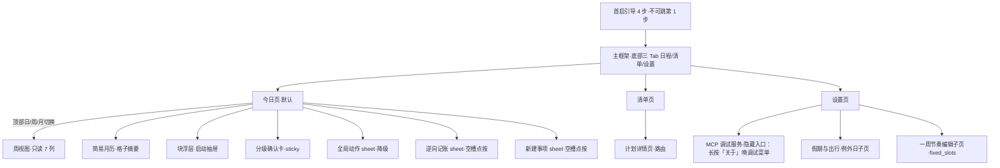
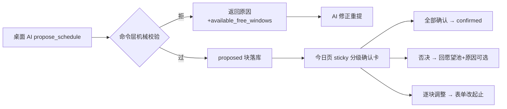

# 拾光页面布局稿（ui-pages）

> 页面级布局设计稿：信息架构、各页面纵向结构与交互流。**视觉规范（tokens/标尺/动效/物理约束）与文案词汇表零外引于** [`../project/ui-design.md`](../project/ui-design.md)（§1–§4），本文只做页面编排，不复制规范正文、不定义新 token、不新增词汇表词条（新文案先入 ui-design §4 再上屏）。机制定义回 [schedule-app.md](schedule-app.md)（§11 拍板台账）。

## 1. 信息架构与导航

- 三 Tab：**日程**（默认）｜**清单**｜**设置**。快记入口两 Tab 常驻=右下角 FAB+键盘吸附展开抽屉。设置=底部第三 Tab。
- 周视图 = 日程 Tab 内顶部「日｜周」segment 切换（只读 7 列、点块跳日）。

## 2. 首启引导（4 步）

| 步 | 内容 | 组件 | 文案要点 |
|---|---|---|---|
| ① 作息边界（**必填不可跳**） | 起床/睡觉两个 time picker | 大号时间选择卡 | 「一切安排以此为界」；未完成无法进入主框架（排程硬校验的 UI 前置） |
| ② 一周节奏（可跳） | 模板三选：上班族/学生/**自由职业** | 模板卡 + 周模板编辑器（工作日/周末两套，按时段增删） | 自由职业=留空直接过：「没有固定安排是完全正常的」 |
| ③ 排程数值偏好（可跳） | 最小块粒度（15/30/60 segmented）、单日新增排量上限（slider） | 表单 | 「上限是休息权的模型支撑，不是效率指标」 |
| ④ 关于你（**可跳但推荐**） | 身份画像 + 我的偏好，两个多行输入 | 多行文本域（带示例占位） | 「这两项是 AI 排程的地基，建议填一下；可稍后在「设置」页随时修改」；空值不写、非空走 human 通道 |

完成即写 settings+fixed_slots；底部主按钮态（禁用/可用）随第①步填写联动；④为空可不填直接「开始使用」。

## 3. 今日页（执行主场）——纵向结构

单页滚动（CustomScrollView），自上而下。

### 3.1 双轨仪表盘条

`🔥 今日核心 1 项 ｜ 🛡️ 自由留白 4.5h ｜ 🏅 今日底线守住啦`——徽章未点亮灰 outline、点亮金色填充+单次微动效（点亮文案见 ui-design §4.1）；旁列电量三档 segmented（⚡/🔋/🪫，日切重置为 🔋 平稳；切 🪫 即触发机械降档，含晚点选的水流重算）。

### 3.2 昨日遗留区

有 missed 才渲染，空态消失。逐条卡片三键——补勾（自动带「补记」标）/顺延今日/退回愿望池。断流保护期整区转 archived 淡出视图。

### 3.3 快记入口

右下角 FAB（tooltip「记一笔」，草稿在盘亮琥珀点）→ 键盘吸附抽屉（输入框+一颗星+可选截止日 chip+「收入清单」）；永不关门（放工守卫例外条款=守卫态 FAB 恒在）；草稿三字段静默 KV、中途收起零询问。

### 3.4 分级确认卡

有 proposed 提案时 sticky 于时间轴上方——页内卡片而非独立页，确认成本最低。火种卡突出（火种形态渲染+决策理由+缓冲保护说明），「其余 N 项日常推进」折叠区，三键=确认全部/否决（原因可选输入，AI 下轮参考）/逐块调整（进入逐块表单）。

**两态收缩（小屏视口防遮挡）**：展开态（默认）展示「今日核心」卡完整详情（为什么排在这+缓冲保护说明）+操作；用户下滑浏览时间轴时平滑坍缩为 **44dp 吸顶胶囊** `[⚡ AI 排程建议：重点攻坚 1 项，顺带推进 3 项 · 点击查看理由]`——随时可审且不遮视线；胶囊态保留「一键确认」快速通道，否决/逐块需点开展开。

### 3.5 时间轴（主体）

竖轴聚焦窗 = wake−1h ~ sleep；跨午夜块头部渲染为顶部「昨夜」灰带（BlockRenderer 负责，ui-design §5）；当前时刻线=主题色 1dp 细线（不用红）；空槽点按 → 新建事项 sheet（「新建事项/从清单选」提名）或逆向记账 sheet（过去时段 → 「刚才做了什么」）。

### 3.6 全局动作（降级 sheet）

时间轴 header 右侧图标钮 → sheet 标题「**遇到突发情况？**」，三选项：`☕ 今天下午全清空（剩余计划退回清单）` / `⏳ 整体往后推 2 小时` / `🪫 今天精力见底，全部切换为 5 分钟启动版`；底部附注「**你的固定日程和自己排的事项不会被改动**」；两段式第二段确认，human 块永不动、无负罪感标记。**降级优先于微调**，故一级直达。

### 3.7 放工守卫态

sleep−2h 触发：隐藏遗留区/清单入口/推进提示，转静默视图（今日完成面+明日概要）；快记永不关门（FAB 恒在）。

层叠 Z 序（全局规则）见 ui-design §3.2。

## 4. 周视图与简易月历（只读）

- **周视图**：列=周一..周日（含选中日所在周，‹周››翻周）；列时间窗同日视图聚焦窗；块=BlockRenderer 简化渲染（紧凑卡：状态/来源着色、label 单行截断，无手势无浮层），点块跳日视图并定位该块。固定安排浅灰背景带；今日列头高亮；零编辑能力。
- **简易月历**：月头「‹ 2026年10月 ›」翻月；格子**摘要渲染**（月格空间约束，全量渲染只在日/周承载）：日期号 + 状态点阵（每块一点：done=主色实心 / missed=中性灰 / proposed=主色空心 / human=灰；超出 4 点收敛「+N」）+ 🔥（当日火种达成）/ 🎂（有庆祝块）微标 + 例外日小标签。**今日高亮圈**；点格跳日视图——日视图日期参数化，可回看历史（账本视图）。
- **同源纪律**：三视图与三日水位线同源——同一 SQLite 派生投影（blocksInRange 单查询分组），零第二真相；全部只读（编辑走日视图表单/手势）。

## 5. 清单页（三分区）

- 快记 FAB 常驻（同今日页，右下角）。
- **三分区单页滚动**（同一数据的分组视图，非 tab）：
  1. **今天**——今日有块的 plan；
  2. **当下推进中**——有未来排期块的 plan；
  3. **待安排**——按四象限分组（Q1 重要×紧急 / Q2 重要 / Q3 紧急 / Q4 愿望池），**空组隐藏**；Q4 组名「愿望池」；**收纳区折叠置底**（标签「收起的旧想法 · N 条」，展开后才见条目——冷藏机制的视觉对应，界面不出现「冷藏」字眼）。
- **条目卡片**：title + 象限色点 + 「待确认 N 项」角标 + 🔥/🎂 标记 + deadline chip（临近转琥珀）；确定型计划显示 roadmap 进度「N/M 步」。
- 长按条目：归档/删除/挂起 bottom sheet。
- **详情页**（全页路由，内容多不用浮层；查看态默认，四字段表单进右上「编辑」态、保存回查看态不关页）：spec（含 `## 路线图` 渲染：Checklist，`(ACTIVE)` 步 ▶ 高亮、`[x]` 划线）/ notes（**首行启动第一步**高亮框）/ open_items（可内联作答）/ reward_spec / 子树（≤3 级缩进）/ **背景**与**随行凭证**两区为**子页入口行**（背景子页/凭证子页各自承载 CRUD，空态文案见 ui-design §4.6/§4.7）/ 「排期」快捷动作主按钮。

## 6. 块浮层（启动抽屉）

bottom sheet（85% 高，可拖拽关闭），自上而下：**「马上开始」第一步**（title·large，全 app 最大字）→ 关联凭证时首屏嵌**通关卡**（hero 通关区/时空网格/约束 Chip/复制·拨号·导航/查看原文；hero 数值 title·medium 不夺「马上开始」的焦点）→ 确定型长任务附 Roadmap（当前步 ▶+N/M 进度，探索型该区替换为 notes 进展摘要）→ spec/notes 关键上下文 → plan 链接（跳详情）→ 行动按钮区（依状态给：确认三键 / 打卡 done / +30min「心流专注中」/ 只做 5 分钟 / 换件轻松的 / 暂缓收回）。

## 7. 关键交互流

其余流按既有机制直译：降级两段式（一级选范围→二级确认→原子执行+中性摘要+可撤销）；逆向记账（空槽点按→挂已有 plan 或孤立 label→confirmed+done 落库，**事实通道豁免校验**，UI 全程无「补排程」暗示）；日切 digest（晨间首开：遗留区+AI 排程入口同屏）。

## 8. 空态与边界态

| 态 | 呈现 |
|---|---|
| 愿望池空 | 「池子空空的——想到什么就记下来，30 秒的事」+快记条聚焦 |
| 今日无块 | 「留白的一天，自由流动区已备好。想让 AI 排一排？打开桌面 AI 说『帮我排今天』」+手动创建入口 |
| 断流保护期（界面文案「轻装重启」） | 遗留区 archived 淡出+「生活有时需要喘息，过去的事已安全归档，今天从一件小事开始」 |
| 放工守卫 | 静默视图（§3.7） |

## 9. 各页文案清单

> 各页具体字符串（自 ui-design §4 移入——规范侧只留封闭术语映射，页面串随页面演进住本文）。**录入纪律**：新概念词先入 ui-design §4 映射表，页面串入本节对应组，均先入表再上屏；中性语言三准则与 tone 见 ui-design §4。

### 9.1 今日页与仪表盘

| 位置 | 界面文案 | 说明 |
|---|---|---|
| 安全线点亮提示 | 「核心任务已搞定，今天底线已守住，剩余时间完全归你」 | 徽章文案映射（今日底线守住啦）见 ui-design §4.1 |
| 放工明日概要 | 静默视图第二行「明天有 N 项安排，最早 HH:MM「标题」。」/「明天还没有安排——想到什么随时记，快记条不打烊。」 | §3.7 静默视图 |
| 回到现在 | 日视图 header 文字钮「回到现在」（仅今日显示，居警告图标左侧） | 时间轴打开即定位当前时刻线，翻页/浏览后一键回「现在」 |

### 9.2 框架与引导

| 位置 | 界面文案 | 说明 |
|---|---|---|
| 底部导航 | **日程** ｜ **清单** ｜ **设置** | 三 Tab；默认日程；设置=底部第三 Tab |
| 快记入口 | FAB tooltip「记一笔」（草稿在盘亮 6dp 琥珀点，无文字）；抽屉 hint「记一笔，30 秒的事」；星=标重要；截止日 chip「截止」；保存钮「收入清单」 | 零细节捕获；永不关门（守卫态 FAB 恒在） |
| 引导① | 「几点起床？几点睡觉？」+ 注「一切安排以此为界」 | 必填不可跳，未填不能进主框架 |
| 引导② | 「一周里哪些时间是有固定安排的？」；预设**上班族 / 学生 / 自由职业**；自由职业注「没有固定安排是完全正常的」 | 可跳过 |
| 引导③ | 「最小块粒度」「单日新增排量上限」+ 注「上限是休息权的模型支撑，不是效率指标」 | 可跳过；完成钮「开始使用」 |
| 引导④ | 「关于你」：身份画像 + 我的偏好，两个多行输入，带示例占位 | 可跳过但推荐；注「这两项 AI 排程的地基，建议填一下；可稍后设置页改」；空值不写、非空走 human 通道（不受外观 uiOnly 限制） |
| 设置页 | 目录形态：本页留 AI 建议/作息边界/外观（三段「跟随系统｜浅色｜深色」）/应用更新/数据出口；编辑器簇降为**子页入口行**（图标+名称+摘要+›）——「一周节奏」「假期与出行」「排程偏好」三个独立子页；页尾**「关于」区**（标题 + 注「用户本地持有的日程台账。」）；**MCP 调试服务为隐藏入口**：长按「关于」标题唤出「调试菜单」底部 sheet →「MCP 调试服务」（图标 developer_mode；运行态「运行中 · 端口 N / 未运行（仅 loopback，内部调试用）」）——页内「运行中 / 已停止」「连接地址」（回环 `http://127.0.0.1:8765/mcp`）「访问令牌」「重新生成」+ relay 区；注「仅内部调试：服务只监听本机回环，不暴露局域网。桌面 AI 先执行 adb reverse tcp:8765 tcp:8765，再用上方地址接入。」 | MCP 不对外展示、仅内部调试，生产通道走宿主进程内嵌入 |
| AI 建议「采纳」 | 设置页 AI 建议条目双钮：✓「采纳」（写入建议值，有 suggested_value 才显示）｜✕「忽略」（移除建议） | ✓=采纳不删除，对齐肌肉记忆 |
| 服务端供应 | 今天/明天日期、时刻 HH:MM | 界面不出现分钟数原值 |

### 9.3 日视图与清单操作

| 位置 | 界面文案 | 说明 |
|---|---|---|
| proposed 块 | 角标「提案」；三键「确认 / 否决 / 改时间」 | 确认=认可这一定位 |
| done 块 | 右下 ✓；操作「打卡」 | 完成是正常事 |
| 空槽点按 | sheet「新建事项」/「从清单选」 | 逆向记账见 §7 |
| 昨日遗留区 | 标题「昨日遗留 · N 条」；三键「补勾」「顺延今日」「退回愿望池」 | missed 中性米黄标绝不红；补勾自动带补记；断流保护期整区淡出 |
| 冷藏池折叠区 | 「收起的旧想法 · N 条」；逐条「恢复」 | 归档条目的可见与回退通道 |
| 清单详情 | 「排期」；「▶ 当前进度 x/N」；「？问题」+「写下答案，敲定它」+「敲定」；「✓ 问题 → 答案」；「子计划」；字段「犒赏」 | 手答=人机澄清闭环；子计划 ≤3 级缩进 |
| 编辑表单 | 字段「做什么（label）」「从几点到几点」「保存」「删除」 | 点块表单 |
| 清单长按 | 「归档」「删除」「取消」 | 删除须二次确认 |
| 清单左滑 | 背景标「归档」；完成提示「已归档「XX」」+「撤销」 | 左滑=归档快捷通道，必附撤销 |
| 清单搜索框 | 页顶「搜计划标题…」（含清空钮）；无命中「没有匹配「X」的计划」 | |
| 清单空态 | 「池子空空的——想到什么就记下来，30 秒的事」+「记一笔」tonal 钮（唤快记抽屉） | 空态给出口 |
| 融化/打卡撤销 | 完成提示附「撤销」钮（5s 浮动 SnackBar，FAB 净空）；点按恢复原状态 | 误触兜底=减震器；恢复命令仅 melted/done → 活跃态 |
| 否决原因框 | 「否决这条提案？」/「全部否决这 N 项提案？」弹框，输入框 placeholder「为什么不想做？（可选，AI 下轮排程会参考）」，键「取消｜否决」；留空=不带原因否决 | |
| 日/周/月 | 顶部三段「日｜周｜月」；周头/月头「‹ ›」翻页；月格点阵无文字；例外日小标签 | |

### 9.4 背景区（计划详情）

| 位置 | 界面文案 | 说明 |
|---|---|---|
| 计划详情分区 | **背景** ＋按钮「添加背景」 | 与「随行凭证」并列的分区；条目卡=content 归纳描述＋标签小字（#健康 式自由标签） |
| 日期角标 | `[10.08–10.10]` | applicable_dates 派生渲染不入库（首末日记起止）；无日期窗不显示 |
| 过期折叠组 | **过去的背景 · N 条** | 超期条目沉入折叠组（与「收起的旧想法」同收纳模式），主列表降噪 |
| 清理动作 | 逐条「删除」＋「清空已过期」（均二次确认） | 仅在折叠组内提供，主列表不加清理图标 |
| 背景编辑 sheet | 标题「添加背景 / 编辑背景」；字段「背景内容」「标签（空格分隔）」「作用日期窗（不选=长期）」；「保存」「删除」（二次确认） | 新增/编辑共用；日期窗起止走系统日期选择器，起止间逐日落库，长窗由命令层劝改 note 提示 |
| 背景子页空态 | 「还没有背景——身体状况、偏好、注意事项都记在这」 | 子页需自释，不依赖详情页上下文 |

### 9.5 随行凭证区

| 位置 | 界面文案 | 说明 |
|---|---|---|
| 计划详情分区 | **随行凭证** | 与「背景」并列分区；条目卡=类别图标+title+badge+日期；根计划详情页=行程凭证总览页 |
| 类别五类 | **交通 / 门票 / 住宿 / 须知 / 口头信息** | category 白话；口头信息卡=💬 弱化+「口头信息 · 待核实」角标，永不参与硬红线 |
| raw 凭证 | **待提炼的原文**；琥珀卡「N 条原文待提炼」 | state=raw 逐字不解析；AI 下一轮提炼回填同条 |
| 未归属 | **未归属**；分享兜底动作「先记下，稍后归属」 | plan_id=null 派生组；不进计划详情页（挂载 sheet 常驻组兜底） |
| 未归属 App 内入口 | 计划列表页顶部提示行「**N 条未归属凭证 〉**」（N=0 隐藏）→ 面板「**未归属凭证**」 | 查看/长按改挂/删除；派生计数不入库 |
| 一致性提示 | **「与日程时间不一致，点此核对」** | span 与关联块派生比对，卡顶琥珀常驻条；跨午夜按绝对分钟折算 |
| 溯源折叠 | **查看原文** | raw_text 手风琴默认折叠 |
| 过期折叠组 | **过去的凭证** | 全部锚点最晚日历日早于今日派生折叠（span 取 end_date） |
| 已作废折叠组 | 「**已作废 · N 条**」；卡面弱化标「**已作废**」 | 凭证子页底部折叠组；排程读侧全程静默；**可恢复**——AI 经用户同意或 human 长按改回有效凭证（raw→structured 不可逆） |
| 凭证删除 | 长按「删除」（二次确认「删除「XX」？」「删除后无法恢复。」） | 仅 human；删凭证绝不删块；关联块 pinned 降格 note「已解除钉定」 |
| 通关卡字级 | hero 数值 title·medium 级、「马上开始」（title·large）居于其上 | 块浮层首屏同屏不互相夺焦；`05车12F` 级微标 maxWidth 96dp+ellipsis |
| 通关卡功能动作行 | 「复制」「拨号」「导航」 | copyable_code/contact_phone/location 逐项判空显隐（零新权限全 intent）；复制成功提示「已复制 XX」 |
| 挂载 sheet（分享归属） | 标题「归到哪条计划？」；原文逐字预填；兜底「先记下，稍后归属」 | 两步纪律：raw 入册后顺手归属；归属不阻断（未归属池兜底，AI 对话为主回收通道） |
| 改挂 sheet | 「把「XX」挂到哪条计划？」；空计划「还没有计划——先建一条计划」 | 长按凭证卡改挂（human 通道，人=终审） |
| 未归属面板空态 | 「未归属凭证都处理完了」 | 计划列表提示行唤起 |

### 9.6 临场通关条与红线

| 位置 | 界面文案 | 说明 |
|---|---|---|
| 临场通关条 | 主行「**09:00 发车 · 05车12F**」；副行「**建议 08:15 前到站**」 | 发车/起飞=departure，停止检票=deadline；副行由 `advance_arrival_minutes` 推导，无 advance 不显示 |
| 通关条跳转钮 | 「**查看日程**」 | 定位该凭证所属 Block；Block 已删/作废 → 兜底跳计划详情凭证子页 |
| 多条折叠角标 | 「**+2**」 | 按行动时刻最早者展开，其余折叠，横滑切换 |
| 规则提醒角标（human 通道） | 「**规则提醒：周一闭馆**」 | AI 通道被排程校验拦截；**human 手动放块不阻断**，仅块卡右上琥珀角标提示 |
| 时刻角色白话 | 发车/起飞、停止检票、开放入住、退房、到达、参考 | `role` 英文枚举（departure/deadline/checkin/checkout/arrival/reference）→ 白话；未知旧值按「参考」渲染不触发 |
| 规则有效期角标 | `[10.01–10.07]` | valid_from/valid_to 派生渲染不入库，沿用背景日期角标格式 |

### 9.1 协同日程 UI（自 ui-spec §0.4 迁入，2026-10-10 拍板，2026-10-19 合并带入）

| 术语/文案 | 白话（上屏） | 说明 |
|---|---|---|
| 协同日程入口 | 日程 Tab 顶部「👥」图标钮 tooltip「协同日程」 | §11.2 B 页「成员混合日历」入口；把朋友发来的协同邀约与自己的日程混看 |
| 协同日程页 | 标题「协同日程」；空态「还没有协同日程——和朋友约起来，邀约会混合显示在这里」 | 成员混合承载；待确认/候选/已确认三态预占一眼分清 |
| 协同三态预占 | 「待确认」（团队调度·排他）/「候选」（生活预约·弱占位）/「已确认」 | 预占视觉三级（§11.2 B 页）：CONFIRMED 实心卡+状态条、DIRECTIVE 主色虚线+待确认、CONSENSUS 超细浅灰虚线+候选 |
| 协同响应浮条 | 点未确认步骤弹底部「回应这一步」：双钮「同意」/「拒绝并说明」；「同意」直接落库、「拒绝并说明」弹「双维拒绝面板」 | 一键响应入口（§11.2 B 页）；响应经离线发件箱落库，联网由常驻调度弹出 |
| 双维拒绝面板 | 底部弹层「提出异议」：①主维度双选「时间冲突 / 权责异议」②子类芯片四选一（非我职责 / 优先级不符 / 缺前置条件 / 个人原因）③隐私开关「全员可见 / 仅发起人可见」④可选「建议转给 @成员」；底部「提交异议」 | §11.2 D 页：破除「有空但不想做被迫撒谎说没空」的拉锯战；理由默认全员可见 |
| 隐私分级 | 「全员可见」（默认，理由用 K_bundle 加密、全员时间轴可见）/「仅发起人可见」（理由用发起人身份公钥单向加密，其他成员端永远解不开） | §3.5 Peer Privacy Paradox 防线；私密理由在非发起人端时间轴只渲染骨架提示 |
| 审计时间轴 | 协同包详情页标题「时间轴」；无输入框的只读垂直时间树，事件气泡结构化（发起 / 同意 / 异议 / 微调 / 终态）；异议气泡附「已私密反馈发起人」骨架提示 | §11.2 F 页：全程留痕便于发起人聚合决策矩阵 |
| 步骤便签 | 时间轴页「便签」钮 → 选步骤 + ≤50 字输入框（覆盖式更新）；提交后「已记下，联网后自动发送」 | §11.2 F 页「步骤问答便签」（Step Q&A Note）；密文随事件流入库，单步骤一条 |
| 私密骨架提示 | 「X 提出了异议，已私密反馈发起人，等待调整」 | 非发起人端对私密拒绝理由的半盲投影（§4.2 铁律 1），不泄露具体内容 |
| 决策矩阵 | 协同包详情页「决策」（§11.2 C 页）：树状包结构 + 每步 M-of-N 门限进度条（如 2/3 人同意，达标亮绿）+ 待确认成员旁浅灰铃铛=离线催办（Nudge）+ STALLED 步骤挂发起人闭环三键（转派/降级/裁撤）+ 顶部备忘置顶（Briefing Sticky） | 发起人聚合决策面板；数据源=FSM 回放派生态（replay.dart 解密落库事件），非发起人端三键禁用 |
| 门限进度条 | 每步「X/N 人同意」线性进度 + 达标亮绿；N=阈值（缺省=必答全员数），M-of-N 表决达标即 READY | §4.2 M-of-N 门限：核心成员 5 选 3 不再因一人没空全盘标黄 |
| 离线催办（Nudge） | 决策矩阵里待确认超 2h 的成员旁浅灰小铃铛；点按经既有 Wake Push 通道向该成员设备投递高优先级系统通知 | §4.3「静默黑洞」防线轻量工具，零新机制；不触发 REKEY |
| 闭环三键 | STALLED 步骤动态挂发起人专属三键：①转派（REASSIGN，替换拒绝者）②降级（BYPASS=MAKE_OPTIONAL 单人化，移出强一致名单）③裁撤（PRUNE，废弃该步） | §4.3 发起人闭环处置；均不触发 REKEY，成本低；仅发起人有操作权 |
| 备忘置顶（Briefing Sticky） | 决策矩阵顶部常驻备忘条（Briefing Sticky），发起人可编辑经 BRIEFING_UPDATE 事件加密落库 | §11.2 C 页置顶备忘，发起人对全员可见的包级说明 |
